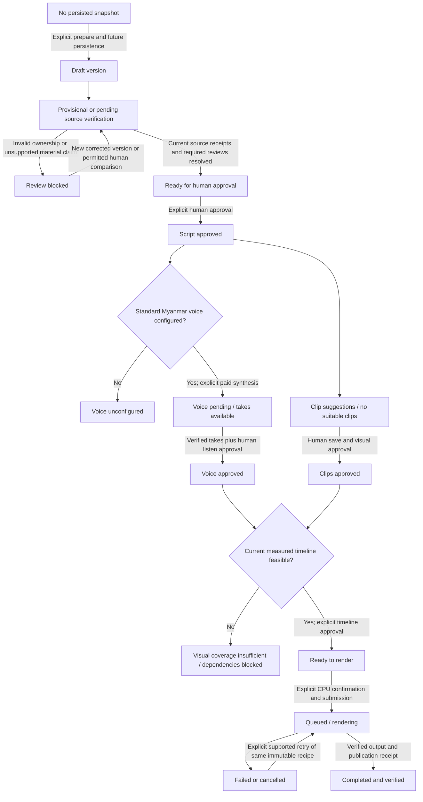

# Recap Studio v2.0 — screen, state and integration architecture

## 1. Scope and relationship to existing architecture

Read with [UI/UX specification and audit](RECAP_STUDIO_UI_UX_V2.md), [Storyline backend architecture](STORYLINE_RECAP_ARCHITECTURE.md), [implementation milestones](STORYLINE_RECAP_IMPLEMENTATION_PLAN.md) and [M1-B preparation](STORYLINE_SOURCE_PREPARATION.md).

The approved exception covers **Recap Studio only**. All other v1.0 screens, global navigation and existing Export workflows remain frozen. This file proposes screen composition and integration responsibilities; it creates no routes, schemas, workers, controls or tasks. Preserve unrelated uncommitted M1-B changes and logs. AGENTS.md and UI_UX_BASELINE.md are not changed.

### Capability boundary at this audit

| Available now | Not yet available |
| --- | --- |
| Existing saved Recap viewer/generation/recovery, real source player, subtitle review/QC, scenes/character analysis, full-movie subtitle renders/downloads | Storyline Studio aggregate and persisted source snapshots, script/version CRUD, review and trusted human receipt persistence, script approval, TTS/voice assets, clip plans, measured timelines, recap composition/downloads |
| M1-A pure contracts/validators; M1-B server-only read-only candidate preparation in the working tree | A browser-callable Storyline API; prepared candidates are neither persisted nor approved |
| Duration policy identity and supported-event eligibility validation | Approved numeric duration engine or calibrated Myanmar voice estimate |

Do not derive a working endpoint from a proposed component or operation name. Future controls are gated by server capability metadata and exact dependency readiness; no implicit calls to existing legacy generation or full-movie render routes as substitutes.

## 2. Screen hierarchy and URLs

```text
Existing AppShell / AppSidebar (unchanged)
└── /projects/{slug}/recap?movieId={selectedMovieId}
    ├── Recap context header / breadcrumb / selected movie
    ├── Experience links: Saved Recap | Storyline Studio
    ├── Saved Recap (default URL; existing RecapControls)
    │   └── Recap Script | Characters | Relationships | Evidence | Scene List
    └── Storyline Studio (?movieId=…&studio={workspace}, proposed)
        ├── Script: beats / editor / evidence / version history
        ├── AI Review: claim queue / source comparison / findings / approval
        ├── Voice: configuration / beat takes / playback / listen approval
        ├── Highlights: source preview / clips / measured coverage
        └── Export: approved dependencies / CPU action / history / verified output
```

Allowed proposed `studio` values: `script`, `ai-review`, `voice`, `highlights`, `export`. Workspace links are read-only navigation using Next.js Link. They keep the selected movie and relevant existing URL context. Removing `studio` returns to Saved Recap. The sidebar's existing Recap link may return to Saved Recap; it must not need a global redesign to remember a Studio subview.

Legacy tab state is not currently encoded in the URL. Preserve existing page URLs, `movieId`, supported hash targets and existing legacy element IDs. Do not rename `/subtitles`, `/translation?view=review#review` or `/export`, or reinterpret `view=review` as a Studio workspace. No separate `/studio` global route is needed. Future version/beat deep links require validated ownership and a separately specified query contract; do not insert imaginary persisted IDs into the first shell.

On entry without `movieId`, the existing server page resolves its latest movie for the legacy viewer. A Studio entry link pins **that displayed movie ID**. Reopening a script/version always resolves its own selected movie, never the latest movie. Switching movies clears selected beat, pending seeks, confirmations and task polling; dirty text requires explicit save/discard/stay choice. Block until identity and scoped capability reads complete.

## 3. Wireframes and responsive composition

All labels below are structural placeholders, not movie data or claims that controls are already implemented. Shared content remains bounded and global sidebar unchanged.

### 1440px: Script / AI Review multi-panel

```text
┌ existing 256px sidebar ┐  Projects > Project > Recap
│                       │  Selected movie · source/context currentness
│                       │  Saved Recap | Storyline Studio
│                       │  Script | AI Review | Voice | Highlights | Export
│                       │  [Current version / dirty / blockers] [one primary action]
│                       │  ┌ Beat / claim queue ┬ Main editor or comparison ┬ Inspector ┐
│                       │  │ ordered items     │ exact Myanmar narration  │ Chinese   │
│                       │  │ category/status   │ or selected claim        │ anchors   │
│                       │  │ real source time  │ Chinese/Myanmar compare  │ provenance│
│                       │  │                   │ findings / explicit save │ QC/bases  │
│                       │  └───────────────────┴──────────────────────────┴───────────┘
│                       │  Duration explanation / version history (disclosure)
└───────────────────────┘
```

At 1440px, roughly 1120px is available after sidebar and shared 32px side padding. A three-panel grid may use `minmax(180px,0.7fr) minmax(360px,1.6fr) minmax(280px,1fr)` with existing 20px gaps, enabled only where it fits (normally `xl`). Do not add a fourth history column. Each panel has `min-w-0`; content height follows text. Use a single manageable queue scroll region only for long lists, without trapping keyboard focus.

### 1440px: Voice / Highlights / Export variants

```text
Voice                          Highlights                      Studio Export
┌ Beat takes ┬ Voice detail ┐   ┌ Source video ┬ Clip inspector ┐ ┌ Dependencies ┬ Render history ┐
│ state/time │ native audio │   │ native      │ source trims   │ │ exact hashes │ real tasks     │
│ selected   │ config/gate  │   │ controls    │ coverage       │ │ approvals    │ safe failures  │
│            │ listen review│   │ evidence    │ measured voice │ │ CPU confirm  │ verified MP4   │
└────────────┴──────────────┘   └─────────────┴────────────────┘ └──────────────┴────────────────┘
                               Beat/clip timing rows beneath
```

Highlights assigns visual priority to the real source player. Script/Review shows source video only as useful collapsible evidence context; it does not force the large legacy media hero into every workspace. Voice and Export favor two panels with readable text/native controls. Original-source playback and generated voice/final output use explicit distinct labels and endpoints. Final video playback is offered only if supported verified artifacts later exist; download is the minimum delivery surface.

### 1024px: flexible stacked panels

```text
existing sidebar | Breadcrumb + movie identity
                 | Experience links / five workspace links wrap
                 | Beat or claim selector (above primary surface)
                 | Main editor / source comparison / source video
                 | Supporting evidence or clip settings (inline disclosure)
                 | Version history / takes / render history
```

With approximately 704px content width, do not retain desktop panel minimums. Stack full Chinese/Myanmar comparison and editor; an optional two-column summary/native-audio row is allowed only if both sides fit. This is not a reason to hide the existing sidebar at 1024px. Long inspector content remains full-width and reachable.

### 390px: one primary panel

```text
Existing mobile application Navigation disclosure
Projects > Project > Recap
Selected movie (wrap filename) · source state
Saved Recap | Storyline Studio
[Studio workspace: Script ▾]  (named navigation disclosure)
[Beats] [Source & evidence] [Versions]  (inline secondary disclosures)
┌ Primary selected-beat editor / claim / audio / video ┐
│ label, exact text, current task/review state          │
│ one action area, confirmation when applicable        │
└─────────────────────────────────────────────────────┘
Inline findings / secondary content / return-to-editor control
```

Keep current 16px mobile page padding. Wrap actions and IDs; timeline becomes labeled interval rows rather than a wide canvas. Keep draft state above panel switching so disclosures do not discard it. Avoid a fixed bottom toolbar that hides native player controls or focused inputs. All workspaces remain reachable with keyboard and touch; no essential hover-only control.

### Per-workspace primary/secondary mapping

| Workspace | Primary | Supporting panels | Primary action when eligible |
| --- | --- | --- | --- |
| Script | Beat narration editor | Ordered beats, evidence, duration, versions | Save version; explicit generation only when clean and supported |
| AI Review | Selected claim + exact source comparison | Claim queue, findings, inference bases, receipt history | Human source comparison or final Approve Script, as appropriate |
| Voice | Selected beat's real take/audio | Capability/profile, ordered takes, measured duration | Explicit synthesize; then human approve voice set |
| Highlights | Source player and selected clip | Source trim/order, measured voice, coverage | Save plan; then human approve clips |
| Export | Exact dependency readiness | Task history, verified outputs | Start Render with local resource acknowledgement |

Do not combine generation, review, verification, approval and rendering into a single ambiguous “Continue” mutation.

## 4. Component architecture

### Reuse inventory

| Existing file/module | Reuse boundary |
| --- | --- |
| `components/layout/app-shell.tsx`, `app-sidebar.tsx` | Unchanged global layout/navigation |
| `components/ui/styles.ts`, `app/globals.css` | Card/control/button/focus/badge vocabulary, system Myanmar fonts/wrapping |
| `components/ui/workspace-unavailable.tsx` | Load failure with read-only retry/navigation; not a substitute for an empty state |
| `app/projects/[id]/recap/page.tsx`, `RecapControls.tsx` | Existing scope resolution and intact Saved Recap branch; separate future Studio loader |
| `components/media/source-video-preview.tsx` | Native source playback/actual duration, `seekTo` and selected timing; no narration mixing or generated preview |
| `lib/source-video/selection.ts` | Movie-preserving URLs and scoped source endpoint; explicit invalid selection handling |
| `lib/recap/client.ts`, `lib/recap/recovery.ts` | Safe error mapping, synchronous submission gate and exact failed-attempt acknowledgement pattern |
| `components/export/render-history.tsx`, `render-model.ts`, `use-render-jobs.ts` | History presentation and bounded abortable polling patterns; current types/endpoints remain full-movie specific |
| `lib/storyline/{contracts,source,script,verification,duration}.ts` | Deterministic structural validation, human receipt trust boundary, contextual admission and duration eligibility |
| `lib/storyline/prepare-source.ts` | Explicit server-side read-only preparation only, not GET/SSR; no persistence/currentness reservation |

Do not directly pass Studio jobs to current `RenderHistory`, which assumes BURN_IN/SOFT_SUBTITLE mode/profile pairs. Prefer a small Studio history component following its visual patterns; extract a shared presentation primitive only if safe and regression-tested. Do not import private server preparation/storage/Prisma modules into client bundles. Existing local `EvidenceAnchor` displays legacy excerpts; reuse its disclosure pattern while adding Studio's exact-source DTO, not its truncated data as full evidence.

### Proposed components — all new names, no implementation yet

```text
RecapPage (existing server boundary, later scoped branch)
└── RecapExperienceNavigation
    ├── Saved Recap → existing RecapControls (unchanged contract)
    └── StorylineStudioShell
        ├── StudioContextHeader + StudioWorkspaceNavigation
        ├── StudioCapabilityNotice / StudioDependencyStatus
        └── Selected workspace
            ├── ScriptWorkspace
            │   ├── StoryBeatList + StoryBeatEditor
            │   ├── StoryEvidenceInspector + StoryDurationExplanation
            │   └── StoryVersionHistory + StudioSaveStatus
            ├── AIReviewWorkspace
            │   ├── StoryClaimQueue + SourceTranslationComparison
            │   ├── TranslationContextMetadata + StoryReviewFindings
            │   └── HumanSourceVerification + ScriptApprovalSummary
            ├── VoiceWorkspace
            │   ├── VoiceCapabilityPanel + VoiceTakeList
            │   └── VerifiedBeatAudio + VoiceSetApproval
            ├── HighlightsWorkspace
            │   ├── SourceVideoPreview + ClipPlanEditor
            │   └── MeasuredBeatTiming + VisualCoverageNotice
            └── StudioExportWorkspace
                ├── ApprovedDependencySummary + StudioRenderConfirmation
                └── StudioTaskHistory + VerifiedStudioOutput
```

Shared within Studio: `StudioActionConfirmation` binds operation/version/dependencies/provider profile/request ceiling; `StudioReadState` distinguishes loading/absent/unavailable/stale; `useStudioTaskStatus` owns abortable bounded GET polling once a real task contract exists. Never turn the proposed hook into a second job framework or reuse legacy token logic without matching backend semantics.

Keep persisted server state, local unsaved editor state, derived eligibility and network request state separate. Reset them by project/movie/version identity. A workspace switch may preserve local draft state in the scoped shell; a cross-movie change cannot silently reuse it. Avoid storing private narration/source text in browser persistent storage by default. Do not reconstruct trusted receipts from local form state.

## 5. UI state architecture and gates

The following labels describe **derived UI states**, not newly implemented database enums. Use independent dimensions: source currentness, script save/approval, claim support/review, voice capability/assets/approval, clip coverage/approval, timeline validation and task/output lifecycle. Failure of a new task must not erase a prior successful version.



This is an eligibility map, not automatic execution. State changes in reads never perform an arrow's mutation. No-snapshot means no **persisted** snapshot; an M1-B candidate is separately labeled prepared/not saved/not approved. Source/context/translation text, approval, QC or alignment change marks affected versions/receipts/downstream dependencies stale. It cannot silently delete historical artifacts, rebase a script, invalidate subtitles by Studio writes or send paid requests.

| State | Required evidence / presentation | Safe next action |
| --- | --- | --- |
| No snapshot | No persisted Studio source; capability availability distinct from absence | Explicit Prepare Source only after an implemented unpaid persistence contract; otherwise prerequisite explanation |
| Draft / dirty | Saved version ID/hash or local unsaved buffer clearly distinguished | Explicit Save version; conflict preserves buffer and asks for explicit reconciliation |
| Provisional evidence | Admitted translation context without claim source receipt | Open Chinese comparison; never label subtitle approval as verification |
| Pending source verification | Valid anchors but no supported human receipt | Explicit Supported/Unsupported/Inconclusive outcome after comparison |
| Review blocked | Safe field/rule finding, invalid ownership/reference, unsupported material meaning or unresolved required review | Correct in a new version; no waiver for deterministic invalidity |
| Ready for approval | Server proves exact current source verification and resolved required reviews | Explicit human Approve Script; no paid call |
| Script approved | Matching current human approval receipt | Open Voice/Highlights; editing forks a new unapproved version |
| Voice unconfigured | Real absent/unsupported standard Myanmar capability | Operator configuration guidance; no invented voices or cloning controls |
| Voice pending / approved | Separate queued/active/failed take state, verified asset and human listen receipt | Explicit scoped synthesis/recovery/listen approval; no implicit paid resend |
| No suitable clips | No validated available source intervals | Inspect source/evidence; no fabricated suggestions |
| Coverage insufficient | Missing measured duration or actual deficit in unique approved footage | Explicit clip/script revision with renewed downstream review; no hidden repeats |
| Ready to render | Current approved script/voice/clips/timeline and source binding | Acknowledge local CPU use and Start Render |
| Rendering | Actual queued/active phase and progress when reported | GET refresh/poll; supported cancel means cancellation requested until drained |
| Deferred | Real execution capability/checkpoint unavailable or ambiguous; distinguish from job lifecycle state | Explicit supported resume/operator guidance; no polling loop or false completion |
| Failed / cancelled | Safe error code, retained immutable input, historical successes still accessible | Explicit backend-supported retry; paid ambiguous outcomes require renewed resolution |
| Completed and verified | Matching verified artifact receipt and file availability | Scoped download; historical/currentness-unknown label if equality cannot be proven |

Disabled actions always have a nearby human-readable reason. Unknown currentness is not CURRENT; unknown duration/cost/progress is not zero. AI review may propose semantic findings but cannot issue trusted source verification, approve narration or waive ownership. Inferred motivation requires supported observed bases and cautious Myanmar qualification even after review.

## 6. Data/API dependency map

### Existing endpoints — reuse only for their existing purposes

| Existing path | Purpose and boundary |
| --- | --- |
| `GET /api/movies/{movieId}/recap` | Saved legacy recap and source-staleness metadata, not a versioned Studio script |
| `GET /api/movies/{movieId}/recap/generate?jobId=…` | Read-only retained legacy job status |
| `POST /api/movies/{movieId}/recap/generate` | Explicit legacy paid generation only |
| `POST /api/movies/{movieId}/recap/generate/retry` | Explicit failed legacy retry with jobId/failureToken/acknowledged |
| `GET/HEAD /api/projects/{projectId}/movies/{movieId}/source` | Private original source streaming/ranges; no source checksum job or encoding |
| `GET /api/movies/{movieId}/export/subtitles?format=srt&mode=all` (example) | Existing subtitle downloads: format `srt` or `ass`; mode `all` or `approved` maps to ALL_CURRENT / APPROVED_ONLY. Not a Studio mutation |
| `/api/projects/{projectId}/movies/{movieId}/renders` and supported detail/retry/cancel/download suffixes | Existing BURN_IN/SOFT_SUBTITLE whole-movie rendering only; not recap clip/voice composition |

### Proposed operation contracts — no callable Studio paths yet

| Future operation / DTO need | Dependency milestone | Frontend gate |
| --- | --- | --- |
| Read capability/context, current/historical snapshots; explicit prepare-and-persist source | M1-C and scoped persistence/read contract | No GET hashing/creation; preparation candidate cannot pretend to be persisted |
| Read/create immutable script versions; expected revision and parent version; beat selection | M1-C + M4 | Explicit save; stale write 409-style controlled conflict, exact text preserved |
| Evidence/beat/narration task submission and read status | M2–M4 | Explicit paid operation/input/profile/call-ceiling confirmation; reuse queued/active identity |
| Read review findings; source verification; human dispositions and script approval | M3–M4 | Server-owned bound receipts; no trust in client/provider SOURCE_VERIFIED fields |
| Read voice capabilities, verified takes; explicit synthesis/listen approval | M5 | Current approved script; configured Myanmar provider; valid real audio artifact |
| Read/save/approve clip plans | M6 | Source SHA, allowed interval/owner/beat membership; no source timing edits |
| Compile/read/approve measured timeline | M7 | Exact current approved voice/clip/script dependencies and feasible coverage |
| Submit/read/cancel/retry Studio render; verified download | M8 | Dedicated composition contract, shared CPU resource limits, narration-only verification |

Future browser DTOs expose safe scoped IDs, exact selected text/context/claim metadata, safe findings, revisions/hashes, capability reasons and verified artifact availability. Page/window exact source context where necessary; do not send the entire private 16 MiB snapshot, storage keys, file paths, consent assets, leases, secrets or raw provider responses. A Chinese excerpt is labeled as an excerpt and cannot silently substitute for full text used in human verification. Human receipt submission binds the actual viewed claim/context; source/translation changes reject stale confirmations.

Scope each future write by project/movie and current/selected immutable version. Maintain ALL_CURRENT row admission reasons and original times. Subtitle approval, manual provenance, active/resolved QC and human claim verification are separate DTO fields. Inaccessible records and unavailable infrastructure are distinct from empty lists. Server responses, not button state alone, decide duplicate reuse, ownership, lifecycle actions and approval eligibility.

## 7. Confirmation, playback and failure interactions

- Paid generation/review/TTS confirmations are stage-specific, identify the exact script/source/profile and bounded call plan, and reset on any relevant dependency/movie/version change. Unknown cost is stated. Never bundle human approval with a provider request.
- Same-turn synchronous submission guard complements disabled/loading buttons. After a receipt, poll its exact scoped task ID/generation; do not infer activity from persisted content or worker readiness. Abort reads on unmount/identity change, bound cycles/errors and offer explicit GET Refresh Status.
- Preserve the original source player and metadata synchronization. Evidence clicks use real saved integer startMs. Clip source timing and recap timeline positions have distinct labels; do not seek the original movie using cumulative narration time.
- Native audio controls operate only on real verified take files. Prevent confusing simultaneous voice/source previews in the future Studio integration; any playback-coordination extension must be narrowly scoped and preserve the shared player's other callers. No fabricated rendered preview while only source video exists.
- Save failures retain local text. Stale-write response offers inspect newer version / explicit new version, not last-write-wins. Switching history must not overwrite dirty text. No automatic rewrite, paid repair or source retranslation from an error.
- Cancellation and retry appear only when the actual stage supports them. An accepted cancel request is not terminal cancellation; an ambiguous provider request cannot promise a free retry. Download checks existing verified file availability and does not regenerate it.

## 8. Implementation order and acceptance gates

| UI milestone | Exact scope / prerequisites | Acceptance before proceeding |
| --- | --- | --- |
| UI-1 — Recap shell and capability audit view | Separate authorized coding task; scoped existing metadata reads, experience/workspace links, honest unavailable panels | Saved Recap unchanged/default; old movie pinned; no M1-B call on GET, no mutation or fake Studio records; 1440/1024/390 and keyboard navigation |
| UI-2 — Script and snapshot reads/save | M1-C persisted snapshot/version APIs and optimistic revision semantics; M4 human save capability | Exact text/IDs/currentness, explicit save/history, dirty/conflict safety; no narration generation until its service exists |
| UI-3 — Planning/generation and AI Review | M2–M4 real tasks, required review rules and trusted human receipt/approval APIs | Separate paid stages, strict ownership, provisional mixed translations, stale-safe confirmation and human approval; no subtitle writes |
| UI-4 — Standard Voice | M5 real capabilities/artifacts and approval | Real audio/duration, configured provider, exact approved script, explicit paid synthesis and listen approval |
| UI-5 — Highlights and measured timeline | M6–M7 clip/timeline services and source preview | Real seeks/trim/order, no duplicate footage, measured shortage, exact clip/voice/timeline approval; no fake waveform |
| UI-6 — Studio Export | M8 verified recap composition and lifecycle APIs | CPU confirmation, real history/recovery, narration-only audio, verified scoped download, historical labels; existing project Export unchanged |
| UI-7 — End-to-end acceptance | All prior capabilities and separately authorized operator pilot | Synthetic browser flow first; live paid verification only with source, stages and request ceiling explicitly authorized |

UI-1 is the recommended first UI coding milestone. Backend M1-C is the separate next persistence dependency, not silently included in UI-1. Do not add a migration to make a shell look functional. New presentational components should live under `components/storyline/`; tests under `tests/storyline/`. Existing route branching can be added only during authorized implementation.

### Test and inspection plan

Existing definitions inspected: `tests/recap/recovery.test.ts`, `recovery-ui.test.tsx`, `recovery-browser.test.mjs`, `tests/source-video/playback.test.ts`, `preview.test.tsx`, `stream.test.ts`, and `tests/video-render/export-ui.test.tsx` plus browser fixture setup. The recovery browser suite uses synthetic intercepted API responses and checks 1440/1024/390, GET-only refresh, failed-attempt token reset, double-click guard, safe errors and keyboard tabs. Source/export setup scripts can create records/media; they were **not run** for this documentation audit.

Future UI tests must add:

1. Experience/workspace URLs, back/forward, old movie, missing/foreign movie, no mutation on GET/tab/refresh/history/player playback.
2. All five legacy tabs and paid failed-recovery flow; independent saved-success/latest-failure display; source/evidence seek regression.
3. Long Chinese/Myanmar/filenames, missing/stale/invalid translations, mixed approvals, MANUAL/unapproved rows, active/resolved/unscanned QC and one scene with multiple beats.
4. Dirty editor panel/movie/version switches, explicit save, stale conflicts, version history, no automatic repair or approval carryover.
5. Claim ownership/relationship endpoints, observed/inferred basis, invalid non-waivable findings, human outcome receipts, AI pass without verification, approval-only/QC-only source staleness.
6. Unconfigured voice, partial/failed/ambiguous takes, real measured duration, human listen approval, no cloning or automatic paid resend.
7. No suitable clips, real source seeks, read-only transcript timing, keyboard trim/reorder, measured insufficient coverage, no hidden duplicate/freeze/speed policy.
8. Exact approved dependency summary, explicit CPU submission, queued/active/deferred/failed/cancelled/completed/missing-output states, supported recovery and historical download labels.
9. Keyboard/focus/labels at 1440/1024/390; no page-level overflow, clipped glyphs, obscured controls or unavailable secondary panels. Screenshot/static HTML checks alone do not prove playback, audio quality or narration-only final output.
10. Fake providers/scoped fake network for deterministic tests; separately authorized short-media browser/operator verification for real playback/download. No production fixtures or paid calls during routine UI tests.

For future coding milestones run relevant tests, lint, TypeScript, diff check and webpack build, without weakening configuration. This documentation-only audit performs document whitespace/scope checks; it does not claim browser, provider or render acceptance.

## 9. Risks and pending decisions

- Persisted Studio objects/DTOs do not exist yet. Enabling editor/approval/voice/export controls early would fabricate capabilities.
- Legacy Recap and Studio have different source inputs, prerequisites and history semantics. Never convert old recap text into an approved script or treat legacy confidence as human verification.
- Auto-duration coefficients, voice calibration and the actual Myanmar TTS provider are unapproved/unavailable. Design explicit unknown/pending states rather than optimistic numbers.
- Approved script context is sensitive to translation text, approval, QC and alignment. Clear conservative stale messaging is essential; historical outputs remain intact.
- Source preview compatibility varies by browser/container/codec; it is not evidence of usable rendered output or visual claim support. Missing source and unknown media freshness must block relevant future actions honestly.
- Human review rubric/operator qualifications, standard voice intelligibility acceptance, clip coverage/no-repeat policy and fixed recap profile still require the backend plan's approvals. Trusted-local attribution is not authenticated multi-user authorization.
- Nested experience/workspace/panel navigation can become confusing. Use named landmarks, one primary action per area and simple in-flow secondary disclosures; preserve legacy deep links/defaults.
- The project Export's Recap Video slot stays unavailable until separately authorized integration. No subtitle/full-movie endpoint or worker is altered by this proposal.

Stop at this design audit. The next action is approval of a concrete UI-1 implementation task; no generation, backend migration or live test is authorized by these documents.
