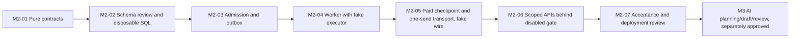

# Storyline M2 durable jobs implementation plan (proposal)

Status: phased plan for review. No milestone is authorized to make a live paid request, apply an existing-database migration, activate human receipt issuance, or change the locked Recap UI by this document. The design contract is in [M2 jobs architecture](STORYLINE_M2_JOBS_ARCHITECTURE.md). M1 deployment gates remain as recorded in [M1 final acceptance](STORYLINE_M1_FINAL_ACCEPTANCE.md).

## Invariants for every milestone

- The selected project/movie, exact immutable M1 source snapshot, full `ALL_CURRENT` context, optional immutable script version, source-media SHA, dependencies and Studio revision form the server-owned recipe. Chinese evidence and character/relationship ownership remain authoritative.
- No page render, GET, status poll, queue startup or reconciliation prepares a paid request. Only a human-confirmed POST may admit one. No Storyline provider call occurs until a separately approved authenticated spending authority and runtime deployment gate exist.
- A PostgreSQL submission checkpoint must commit and be acknowledged before network I/O. At most one actual provider request is permitted for a task generation. An ambiguous result is `UNKNOWN` and never automatically retried.
- AI candidates and AI review findings do not issue M1 human source-verification receipts, approve subtitles/scripts, establish semantic truth, or count supported duration. Existing signed authoritative verification and duration services keep their own trust boundary.
- Existing movie-processing queues, legacy Recap, render pipeline, translation, source-video preview and UI remain unchanged. Use synthetic fixtures and disposable PostgreSQL/Redis for implementation tests; application database migration and provider activation are separate deployment decisions.
- Preserve existing staging, logs and unrelated changes. Each implementation milestone needs its own scope approval and acceptance evidence. This planning task ends with these two documents.

## Dependency sequence

The order makes the database safety contract testable before an API or worker can submit money. Later M3 content generation cannot inherit an unfinished M2 `UNKNOWN` resolution policy or bypass fixed provider profiles. M1's actual schema conventions prevail over the older illustrative M2 examples in general Storyline documents.

## M2-01 — Pure task and recipe contracts

**Depends on:** M1-A through M1-D contracts and the M1 final acceptance findings. No database connection.

**Likely files:** new `lib/storyline/jobs/contracts.ts`, `recipe.ts`, `state-machine.ts`, `confirmation.ts`, `errors.ts`; new `tests/storyline/jobs/*.test.ts`. Existing modules remain unchanged unless a small pure export is required.

Define bounded request/task kinds, exact source/script bindings, immutable canonical recipe and hash, fixed versioned profile descriptor, confirmation proposal shape, safe status DTO, error codes and transition table. Disallow unknown fields, arbitrary provider options, unbounded windows, duplicate parents and cross-movie evidence. A proposed profile explicitly declares whether it is paid. Include `QUEUED`, `LEASED`, `SUBMITTED`, `UNKNOWN`, `COMPLETED`, `FAILED`, `CANCELLED`; represent deferred dispatch separately.

**Tests:** canonical byte/hash stability and changes from source, translation approval/QC/manual edit, media SHA, profile, script version or revision; wrong project/movie; invalid transition; one scene with multiple beats; partial/oversize/Unicode inputs; proposal expiry; duplicate idempotency key with changed recipe. These tests call no Prisma, Redis or provider.

**Exit:** a deterministic pure contract reviewed against M1's exact source-capture and verification semantics. No profile is implicitly approved for live use.

## M2-02 — Additive schema proposal and disposable PostgreSQL gate

**Depends on:** M2-01. Review the five actual M1 models and their composite FKs, immutability guards, lock order and restrictive deletion. Do not apply to the existing application database.

**Likely files:** review-only `docs/drafts/storyline-m2-jobs.prisma`, `docs/drafts/storyline-m2-jobs.sql`, a schema review document, disposable SQL/Prisma tests. A live Prisma migration directory is created only in a separately authorized integration milestone after review. Proposed tables: `StoryTask`, `StoryTaskDispatch`, `StoryPaidConfirmation`, `StoryProviderSubmission`, `StoryTaskResult`, and `StoryTaskEvent`. Evaluate a smaller physical schema only if all checkpoint, immutability, single-use grant, fencing, accounting and audit constraints remain database-enforceable.

**Disposable tests:** same-Studio/project/movie/script/source FKs; unique recipe/generation/submission/grant; immutable recipe/checkpoint/result; append-only event order; bounded values; invalid state and generation; cross-movie insert rejection; simultaneous admission; lock-order/deadlock timeout; missing queue receipt; wrong role cannot forge confirmation/checkpoint; global unresolved slot if approved; rollback after constraint failure; restrictive Movie deletion. Use unique dedicated disposable credentials, never application `DATABASE_URL`.

**Exit:** SQL and Prisma draft review plus a disposable-database PASS/BLOCKED/FAIL report, migration safety/rollback analysis and deployment role design. The existing database remains untouched.

## M2-03 — Durable admission and outbox, fake provider only

**Depends on:** validated M2 schema and reviewed migration integration. Any application-schema deployment is a separate controlled step. Repository tests use an isolated database and Redis.

**Likely files:** `lib/storyline/jobs/admission.ts`, `dispatch.ts`, `reconcile.ts`, `read.ts`; dedicated queue wrapper under `lib/queue/`; scoped database repositories; integration tests. Do not modify the eight legacy queues' behavior.

Build the explicit confirmation-to-task transaction: resolve selected Project→Movie→Studio, lock in the documented order, recapture/check authoritative source and source-media identity, validate exact proposal and future authority port, deduplicate the recipe, **consume the one-use confirmation with** task/dispatch/event creation atomically, then publish a reference-only BullMQ job after commit. On Redis failure, retain a due outbox row and return durable state. Bounded reconciliation republishes missing receipts and fences stale generations. GET/read services never dispatch. Initial integration uses a fake authority and fake executor exclusively in tests; production admissions remain disabled.

**Tests:** concurrent identical POSTs produce one task/outbox; conflicting idempotency key rejected; older selected movie maintained; wrong project/movie/snapshot/script denied; commit-success/Redis-failure recovery; duplicate publication; restart reconciliation; stale generation ignored; read-only listing creates zero jobs; no new task after unchanged terminal recipe; no paid call.

**Exit:** database is authoritative and a queue outage loses neither a confirmed intent nor its audit record. No task can reach a real provider.

## M2-04 — Leases and recovery worker, fake executor only

**Depends on:** M2-03. Reuse bounded Redis connections, explicit worker startup/readiness, per-worker and global concurrency one, graceful drain and controlled logging. Give Storyline its own queue and opt-in loader; leave legacy `workers/start.ts` behavior unchanged until startup integration is explicitly reviewed.

**Likely files:** `workers/storyline-worker.ts`, `lib/storyline/jobs/lifecycle.ts`, `lease.ts`, `recovery.ts`, a dedicated opt-in worker launcher, synthetic worker tests. Queue payload is only `{ taskId, generation }`; deterministic ID `story-text-{taskId}-g{generation}`. BullMQ delivery attempts are one. Database pre-submission retry policy is bounded independently.

Worker claims a database lease, rechecks exact source/context/script/revision and the **consumed, bound, unexpired** confirmation, and invokes only the fake executor. Heartbeat and owner/generation/state-revision checks fence concurrent workers. A crashed worker with no checkpoint may requeue in the **same generation** after proving no send permit existed, incrementing its bounded dispatch-attempt count. Expiry or exhaustion fails without a provider request; a new generation needs fresh acknowledgement. A crashed `SUBMITTED` worker becomes `UNKNOWN`. A stored definitive result can be republished without provider I/O. Shutdown cannot turn an in-flight unknown into a safe retry.

**Tests:** two workers racing; heartbeat expiry; redelivery; old owner write after generation change; DB commit but no Redis receipt; restart before checkpoint; restart immediately after checkpoint; crash during result persistence; cancellation before/after checkpoint; source changes between preparation, lease and publication; no completed state without a stored validated result. Run with fake provider and isolated infrastructure only.

**Exit:** durable lifecycle and recovery pass crash/race tests without any network provider call.

## M2-05 — Checkpoint, transport and accounting safety

**Depends on:** M2-04, fixed reviewed model/profile/price ceilings, and demonstrated single-request transport behavior. Do not activate live OpenRouter here.

**Likely files:** `lib/storyline/jobs/provider-port.ts`, `checkpoint.ts`, `result.ts`, `accounting.ts`, bounded fake transport adapter and tests. Reuse OpenRouter configuration and response-validation conventions where safe; do not reuse legacy Recap's automatic provider failure retry.

Commit a unique submission checkpoint before obtaining a process-local one-use send permit. Separate pre-request failure, complete definitive response, known invalid output and ambiguous outcome. Persist normalized bounded result or `UNKNOWN`, with static diagnostic codes and reported/unknown token/cost data. Revalidate all dependencies before publication and retain stale results only as historical private data. Disable SDK retries/redirects or prove a single wire send with controlled fake transport; an uncertain commit never sends.

**Tests:** intercept actual HTTP attempts to a local fake endpoint; assert one send across timeout, 429/500, connection reset, malformed body, partial response, worker crash and Redis redelivery. Assert no automatic repeat from `UNKNOWN`; complete invalid evidence/text is terminal without repair; usage counted once; absent usage remains unknown; duplicate submission does not consume another confirmation; secrets/response bodies absent from logs and Redis; bounded input/output and quote policy enforced.

**Exit:** a no-paid-request fake-wire acceptance report proves checkpoint ordering and ambiguity handling. If the SDK or provider contract cannot meet the rule, keep runtime disabled and specify a narrow transport replacement for later approval.

## M2-06 — Scoped APIs and explicit paid gate

**Depends on:** M2-05 and a reviewed authenticated operator/spending authority. Without that authority, write endpoints fail closed in real runtime and remain testable only with an injected fake authority. Human verification receipt issuance stays disabled.

**Likely files:** future scoped routes under `app/api/projects/[projectId]/movies/[movieId]/storyline/tasks/`, request validators, safe DTOs and API tests. No Recap Studio UI work belongs to this step. Proposed routes are defined in the architecture document and must be compared with existing slug/selected-movie routing before implementation.

`POST /prepare` is an explicit unpaid proposal, `POST /tasks` requires fresh paid acknowledgement, `GET` routes only read, and cancel/retry require current state/generation tokens. No `UNKNOWN` retry or force route. Distinguish safe errors for prerequisites, stale source/confirmation, already queued/active task, invalid evidence, unknown outcome, provider failure and runtime disabled. Return no paths, snapshot manifests, full provider content, leases, grant secrets or credentials.

**Tests:** GET/refresh/poll zero queue/provider writes; missing authentication fails closed; forged grant or stale price/source/failure token rejected; duplicate clicks return one task; wrong project/movie ID, especially an older selected movie, rejected or resolved exactly; cancellation race with checkpoint; terminal known-failure retry needs a new confirmation; `UNKNOWN` retry refused. No paid provider calls.

**Exit:** API safety evidence exists, while runtime activation is still a separate deployment decision. A later Studio UI can reuse the existing paid-confirmation and bounded-poll patterns without changing legacy Recap behavior.

## M2-07 — Foundation acceptance and deployment review

**Depends on:** M2-01 through M2-06 and M1 migration/authority status being explicitly known. No implicit activation.

Run pure contracts, disposable PostgreSQL constraints/concurrency, isolated Redis/worker fault tests, local fake-wire transport tests, Storyline M1 source/verification/duration regressions, legacy Recap and queue regressions, Prisma validate/generate, lint, TypeScript, diff checks and a Webpack production build as appropriate to the implementation. Do not run AI, TTS, full-movie FFmpeg or real media tasks for foundation acceptance. Verify startup with paid Storyline worker and receipt issuer disabled by default, even when schema exists.

Report separate status for code implemented, schema in source, disposable migration applied, application-database migration applied, operator authority configured, fixed provider/cost profile approved, worker enabled, receipt issuance enabled, and live paid use approved. M2 acceptance must not collapse these into one “ready” flag. Document `UNKNOWN` operator investigation and cost reconciliation before any future live activation. A first live paid call requires a separate explicit user task and confirmation.

**Exit:** a PASS/BLOCKED/FAIL acceptance report with specific gates. M3 content generation begins only by separate authorization; M4 human script review, voice, highlights and video are outside M2.

## Priority regression matrix

| Risk | Synthetic proof required before implementation acceptance |
| --- | --- |
| Duplicate spend | Concurrent admission, duplicate Redis delivery, resumed worker, stale generation and duplicate POST all produce at most one checkpoint and one fake wire request |
| Ambiguous result | Checkpoint committed then crash before send; timeout/reset/partial reply; DB result write uncertainty all reach `UNKNOWN` with no automatic send |
| Unauthorized spend | No real operator authority, expired/forged confirmation, changed cost/profile or stale failure token fail closed |
| Source drift | Translation text/approval/QC, Chinese alignment, media hash, script version, verification head or Studio revision changes block dispatch/publication appropriately |
| Human authority | AI candidate and AI review do not issue signed receipts, approve script/subtitle or promote current version |
| Recovery | Redis outage after DB commit, missing queue receipt, stale lease and restart reconcile from PostgreSQL without side effects from GET |
| Cancellation | Pre-checkpoint cancellation proves no send; after-checkpoint cancellation retains unknown/known cost and never claims refund |
| Isolation | Cross-project/movie/Studio task reads and writes fail; older selected movie never switches to the project's newest movie |
| Accounting and secrecy | Usage once per submission; missing usage unknown; private text, headers, keys, paths and internal tokens absent from logs/Redis/public DTOs |
| Legacy regression | Existing eight queues, Recap retry, translation, source preview, render/export and M1 verification continue unchanged |

## Decisions needed before implementation or activation

1. Approve initial task kinds and fixed Storyline provider/model/prompt/schema versions; choose which stages are local versus paid.
2. Set exact per-call token, byte, time and estimated-spend limits, currency/price version and whether a hard budget is contractually enforceable.
3. Provide real operator authentication and spending authorization distinct from M1 source-verification issuance; define retention and audit access.
4. Decide whether the conservative one-slot global unresolved-submission policy is acceptable operationally. No timeout may convert `UNKNOWN` into a retryable state.
5. Define provider billing/outcome investigation evidence and an audited manual resolution process; initial implementation may simply keep `UNKNOWN` blocked.
6. Authorize review-only M2 SQL and disposable validation separately from any application database migration. Keep M1 receipt issuance disabled until its independent security gates are satisfied.

