# Storyline M2 durable jobs architecture (proposal)

Status: architecture review only. No Storyline paid-job runtime, migration, API, or provider profile is enabled by this document.

## Scope and existing boundaries

This design extends the M1 foundation described in [Storyline architecture](STORYLINE_RECAP_ARCHITECTURE.md), [implementation plan](STORYLINE_RECAP_IMPLEMENTATION_PLAN.md), and [M1 final acceptance](STORYLINE_M1_FINAL_ACCEPTANCE.md). M1 source preparation, immutable snapshots and scripts, signed human verification, and authoritative duration checks remain separate from AI job execution. The M1 migration has been validated on disposable PostgreSQL; its application to the existing application database and receipt issuance remain deployment gates, not assumptions.

The repository already has bounded Redis connections, BullMQ queues and worker shutdown conventions; the render pipeline supplies a durable dispatch/outbox, generation fencing, leases, and reconciliation example. The legacy Recap UI supplies explicit paid confirmation, a synchronous submission guard, and read-only polling. Its provider failure retry policy has no durable per-request submission checkpoint, so that retry policy is **not** suitable for new paid Storyline work. OpenRouter is available for existing text tasks, but provider-side idempotency, retrieval of ambiguous results, billing finality, and remote cancellation have not been established here.

Storyline jobs must not alter legacy queues, Recap, translation, subtitle approval, source-verification receipts, or the locked UI. A job's result is candidate material or review findings. It never becomes a human source-verification receipt, an approved script, a current script version, or a verified duration merely because a worker completed.

## Execution units and binding

The first M2 execution unit is **one bounded logical paid provider request per task generation**. Proposed kinds are `ANALYZE_EVIDENCE`, `PLAN_BEATS`, `DRAFT_SCRIPT`, `REVIEW_EVIDENCE`, and `REVIEW_MYANMAR`. Each uses a fixed, versioned server profile that pins its model, prompt, response schema, validator, transport policy, maximum request/response size, and token/cost limits. A policy may decide that a particular step is local and unpaid; it must not be represented as a paid call. The current `RECAP_MODEL` is not automatically a Storyline model choice.

A recipe binds the database project ID and selected movie ID, Studio ID and expected Studio revision, exact immutable source snapshot ID plus source/content/context hashes and media identity, task kind, fixed profile and policy versions, bounded source window, and ordered parent-result hashes. Script-dependent tasks also bind the immutable script version ID and payload hash. A script-independent task records both script fields as absent. Translation context is the M1 `ALL_CURRENT` context: exact current aligned Myanmar rows, including approval, provenance and QC metadata, while Chinese remains primary dialogue evidence. Only supported source anchors may ground a claim.

For long movies, later analysis can partition the source into closed, bounded windows and create separate confirmed tasks. A later synthesis request depends on exact child-result hashes; because those hashes are unknown before the children finish, synthesis requires its own fresh confirmation. This plan does not grant an unbounded batch of future calls.

The canonical recipe is serialized with a versioned schema and hashed over exact bytes. Its semantic hash is a deduplication key, not proof of authorization or proof of wire-level request identity. A client idempotency key is scoped to the authenticated future operator, movie, and identical recipe; a reused key with different input is rejected. A unique `(studioId, kind, recipeHash)` identifies a logical task. Submission of an existing queued, running, completed, failed, or cancelled recipe returns its existing durable record and does not restart it or consume another paid grant. A distinct task or terminal retry needs a new explicit confirmation. Retry generations retain their prior submission/result history.

## State machine

Proposed task states are `QUEUED`, `LEASED`, `SUBMITTED`, `UNKNOWN`, `COMPLETED`, `FAILED`, and `CANCELLED`. `DEFERRED` is a dispatch reason with `nextDispatchAt`, not a claim that work completed. These names describe the M2 proposal; existing render and Recap state enums are unchanged.

```mermaid
stateDiagram-v2
    [*] --> QUEUED: explicit confirmed POST commits
    QUEUED --> LEASED: DB ownership acquired
    LEASED --> QUEUED: proven pre-submission failure; bounded retry
    QUEUED --> CANCELLED: cancel wins before checkpoint
    LEASED --> CANCELLED: cancel wins before checkpoint
    LEASED --> SUBMITTED: submission checkpoint commits
    SUBMITTED --> COMPLETED: complete response stored; valid and current publication
    SUBMITTED --> FAILED: complete definitive invalid result or stale publication
    SUBMITTED --> UNKNOWN: ambiguous response, lost owner, or uncertain result persistence
    SUBMITTED --> CANCELLED: definitive response stored and cancellation honored
    UNKNOWN --> COMPLETED: original response recovered and validated without another call
    UNKNOWN --> FAILED: definitive original outcome established without another call
    UNKNOWN --> CANCELLED: definitive original outcome and earlier cancel request
```



`SUBMITTED` means **the request may have been sent**. A crash between committing its checkpoint and sending the first byte is still `UNKNOWN`; no timer or lease expiration can prove zero provider charge. A timeout, reset, partial response, ambiguous HTTP failure, or lost database acknowledgement after a response likewise becomes `UNKNOWN`. A known, complete response that fails schema/evidence validation is terminal `FAILED` and is not silently repaired or resubmitted. Provider errors should be classified as safely terminal only when a separately verified provider contract proves finality; otherwise they remain `UNKNOWN`. Unknown cost is recorded as unknown, not zero.

`UNKNOWN` never has an automatic paid retry, `force`, or reset endpoint. A future authorized operator may investigate against provider billing/receipt evidence and attach a definitive outcome through a separately designed, audited procedure. That procedure cannot use a fabricated client receipt or make a second call. A late original response can be persisted only against its exact checkpoint/generation, and publication still requires current dependency checks. A stale worker cannot publish or submit merely because its Redis job resumes.

### Cancellation and retry

Cancellation is an explicit state-revision-checked write. Before the checkpoint, it fences dispatch and reaches `CANCELLED` with no provider request. After the checkpoint, it records `cancelRequestedAt` and may abort local waiting on a best-effort basis. It does not assert remote cancellation or refund. If the original result is definitive, it can end as `CANCELLED` while retaining private result and accounting; otherwise it remains `UNKNOWN`. Completed work cannot be retroactively cancelled. A cancelled task with an unresolved submission is not retryable.

Only failures proven to occur before a checkpoint and before any send permit exists may redispatch automatically. This keeps the **same task generation and consumed confirmation**; only the bounded dispatch-attempt counter advances. The review SQL permits at most three such retries while that confirmation remains unexpired. The scheduling delays (proposed 2, 4 and 8 seconds) need runtime review. If the grant expires or attempts are exhausted, the task fails without a provider call. A new generation then requires fresh authenticated acknowledgement and a new confirmation. An explicitly confirmed retry after a terminal, definitive failure also creates a new generation. The first implementation should decline ambiguous manual retry rather than expose an override.

## Paid request boundary

The future authenticated operator flow is `prepare` (unpaid, bounded proposal) → visible price/resource notice and explicit acknowledgement → confirmed task admission → dispatch → checkpoint → one provider request. An audit label from trusted-local mode is not authentication. The existing M1 human-verification operator action must not be repurposed as permission to spend money. Until a real operator authority and deployment gate exist, preparation can be exercised with synthetic fixtures, but paid submission remains disabled.

The confirmation binds exact recipe hash, task/snapshot/script dependencies, server profile, expected Studio revision, a bounded quote/reservation policy, expiry, and a maximum of one provider request. It cannot be supplied as a caller-authored receipt. The reviewed SQL consumes it atomically with admission. Duplicate POSTs cannot consume it twice and only one checkpoint can be associated with it. Pre-checkpoint redispatch may use the same **consumed but still unexpired** grant in the same generation. An expired grant cannot be extended or replaced in place; a new generation requires fresh authenticated acknowledgement. Source/profile/quote changes invalidate the old binding. Previously admitted tasks are rechecked for currentness before any checkpoint.

The worker constructs bounded request bytes using server-owned templates, validates source and dependencies, then atomically commits a `StoryProviderSubmission` checkpoint and a state/event transition **before network I/O**. On uncertain commit acknowledgement it does not send. Only the live process holding the acknowledged checkpoint receives a one-use, process-local send permit bound to submission ID, generation, request hash and owner. Redis payloads, persisted JSON and a restarted process cannot recreate this permit. The transport must be shown by fake-wire tests to issue at most one actual HTTP request, with SDK retries and redirects disabled or rejected and bounded timeout/body size. If the current SDK cannot guarantee that property, a narrow server-owned transport adapter is required before paid activation; no provider call is made while that remains unresolved.

```mermaid
sequenceDiagram
    participant Human
    participant API
    participant PG as PostgreSQL
    participant Redis as BullMQ
    participant Worker
    participant Provider
    Human->>API: Explicit confirmed POST
    API->>PG: TX: verify scope, snapshot, grant; consume grant, task + dispatch outbox
    PG-->>API: Commit task and generation
    API->>Redis: Publish reference only, after commit
    Worker->>PG: Lease, revalidate source/context/revision
    Worker->>PG: TX: recheck unexpired grant; checkpoint SUBMITTED; fence owner
    PG-->>Worker: Acknowledged commit, one-use send permit
    Worker->>Provider: One bounded request
    Provider-->>Worker: Response or ambiguous failure
    Worker->>PG: Store definitive result or UNKNOWN, with usage
    Worker->>PG: Recheck currentness; publish candidate only if current
```

There is no transaction held open across provider I/O. A provider result is first stored as immutable, bounded normalized candidate/finding data plus validation and usage metadata. A later short publication transaction rechecks the same project/movie/Studio, source media identity, full authoritative source/context, immutable script dependencies, current Studio revision and owner/generation. It may mark a task complete with a historical candidate or fail it as stale; it must never overwrite a human-edited current script. Promotion of a candidate to an M1 `StoryScriptVersion` is a separate explicit, unpaid operation that uses M1's own fresh-lock persistence contract and version allocation. Do not nest that service's self-owned transaction inside an M2 publication transaction.

## Durable dispatch, locks and recovery

A dedicated proposed BullMQ queue, `movie-storyline-text`, carries only `{ taskId, generation }`. The job ID is deterministic, e.g. `story-text-{taskId}-g{generation}`. Worker concurrency and BullMQ global concurrency start at one. BullMQ is delivery, not authority: it may redeliver a reference, but PostgreSQL owns task state, confirmation, checkpoint, result, and outbox. Queue attempts should be one; pre-submission retries are explicit bounded database transitions. No source text, prompt, paths, provider response or secret enters Redis.

Admission consumes the confirmation and writes task and dispatch row in one transaction; queue publication happens after commit. A bounded reconciler (proposed batch default 20, maximum 50) republishes missing receipts and recovers crashed leases by generation. Duplicate Redis deliveries inspect DB state and do no paid work if a matching checkpoint exists. A missing receipt for `SUBMITTED` or `UNKNOWN` does not authorize another request. Recovery with no checkpoint must prove no send permit existed, fence the old owner, retain the generation, increment the bounded dispatch-attempt count, and revalidate the still-current consumed confirmation and dependencies before another safe dispatch. An expired `SUBMITTED` lease becomes `UNKNOWN`; an already stored definitive response can be validated and published without provider I/O. Reconciliation never runs from GET or page rendering.

Acquire locks consistently as Project → Movie → Studio → Task → Dispatch → Confirmation → Submission/Result/Event. Existing authoritative source capture may calculate media SHA outside short locks, followed by a full fresh authoritative comparison after locks. Recheck source/context at admission, immediately before checkpoint, and before publication. Storyline task/status writes do not bump Studio content revision merely by polling or heartbeating. M1 content, approval/QC, verification-head or source changes must invalidate the relevant dependencies; a revision equality check alone is insufficient because some source writers change live context outside Studio. The final source/media check cannot freeze an external file through a paid request, so a mid-flight change retains historical result and blocks current publication. Use database-clock leases, owner tokens and generation/state revisions to fence stale writers. Loss of a lease after checkpoint cannot create another send permit.

Because an unknown remote request may still be running, proposed initial safety is one database-enforced unresolved paid submission slot across Storyline tasks. `SUBMITTED`/`UNKNOWN` retains that slot until the original outcome is definitively reconciled. This prevents a Redis restart or second process from overlapping unknown Storyline sends; it can also halt all new Storyline paid work. Legacy queues continue independently. Whether later deployments may use separately bounded lanes is an explicit policy decision, not a timeout-based fallback.

## Proposed additive persistence (no migration in this phase)

These are proposed M2 tables and constraints, not existing Prisma models. Names, SQL details and limits require a schema review and disposable PostgreSQL validation before an application migration. Preserve M1's restrictive Movie/Studio relationships, immutable historical Chinese anchors, bounded canonical `TEXT` payloads, and deletion policy. Do not replace live M1 records or add voice/highlight/render models here.

| Model | Core fields | Required database protections |
| --- | --- | --- |
| `StoryTask` | Scope IDs, kind, canonical recipe/hash, source and optional script IDs/hashes, expected Studio revision, state, generation, state revision, safe error/cancel timestamps, result pointer | Composite same-Studio/project/movie FKs; unique `(studioId, kind, recipeHash)`; script ID/hash both present or absent by kind; bounded immutable recipe; indexed state/dispatch age; optimistic CAS |
| `StoryTaskDispatch` | Task/generation, next dispatch time, queue receipt, dispatch lease, worker owner/lease, heartbeat, bounded retry/defer counters | Unique task row; generation FK/check consistency; fenced lease transitions; indexed due rows; no Redis-only authority |
| `StoryPaidConfirmation` | Server-prepared recipe/profile/revision/cost-policy binding, operator authority reference, expiry, single-use status, confirmation/audit timestamps | Immutable proposal/decision fields; unique grant-to-task/checkpoint binding; authenticated authority required; never accept a caller-authored trusted grant |
| `StoryProviderSubmission` | Task/generation, confirmation, exact bounded request identity, checkpoint time, owner fence, `SUBMITTED/UNKNOWN/RESOLVED` outcome | Unique `(taskId, generation)` and confirmation ID; append-only checkpoint identity; forward-only outcome; proposed partial unique unresolved global slot |
| `StoryTaskResult` | Exact submission, bounded normalized candidate/finding payload and hash, validator/profile versions, safe diagnostics, token/actual-cost fields when reported | Unique submission; immutable content; finite nonnegative counters and integer USD micros; same task/generation FKs; no raw provider envelope or credentials |
| `StoryTaskEvent` | Task/generation/sequence, transition, static reason, timestamp, safe attempt and accounting metadata | Append-only; unique `(taskId, sequence)`; monotonic sequence allocated under task lock; no transcript, prompt, response or token values |

All historical rows use restrictive relations rather than cascade deletion. SQL `CHECK`, composite FK, unique and trigger guards must enforce scope, valid intervals/counts, immutable recipes/results/checkpoints and forward-only states. Prisma validators alone cannot enforce trust. Exact M1 source/receipt constraints remain untouched. Store estimated exposure and reported actual cost as bounded integer USD micros with separate estimate and `REPORTED`/`PARTIAL`/`UNKNOWN` usage classifications; missing provider usage is `null`, never inferred to be zero. Provider prices and quote caps require an approved server policy. If a hard spending cap cannot be enforced under the provider's actual contract, the system must state that limitation and stay disabled for budgets that require a hard cap.

## Proposed API and service boundary

The route names below are candidates for later implementation under `/api/projects/{projectId}/movies/{movieId}/storyline`; no route exists as part of this plan. The project identifier is a database identity resolved from the selected slug, and every request scopes to the exact selected movie, including an older movie. Request bodies reject unknown fields and arbitrary model names, prompts, URLs, file paths, or provider options.

| Operation | Behavior |
| --- | --- |
| `POST /tasks/prepare` | Explicit unpaid source/dependency preparation and bounded server-owned quote/confirmation proposal; creates no job or provider request |
| `POST /tasks` | Requires exact confirmed proposal, `acknowledged: true`, idempotency key and future authenticated spending authority; commits task/outbox, then best-effort dispatch; returns existing matching task safely |
| `GET /tasks`, `GET /tasks/{taskId}` | Bounded, scoped, read-only status; no reconciliation, Redis write or provider request |
| `POST /tasks/{taskId}/cancel` | Explicit generation/state-revision-checked cancellation request; no false refund claim |
| `POST /tasks/{taskId}/retry` | New confirmation plus terminal failure token; refuses `UNKNOWN`, unresolved submission and stale dependencies |

No unknown-result override, receipt issuance, script approval, or provider retry route is proposed for initial M2. Public status DTOs contain safe state, kind/profile, timestamps, bounded error codes, candidate availability, reported/unknown usage and currentness classification. They omit source/storage paths, full snapshots, request/response bodies, credentials, leases, signing material and internal tokens. The browser may use the legacy Recap pattern of explicit acknowledgement, synchronous double-click guard, abortable read-only polling and selected-movie preservation; M2 does not change UI now.

## Security, observability and costs

The deployment is trusted-local today; there is no authenticated spending principal yet. Audit labels and signed M1 receipts do not grant spending authority. Paid endpoints and worker startup must fail closed until a separate operator authority, role separation, fixed model policy, budget policy, and deployment flag are deliberately established. Human verification issuance remains disabled. No Storyline paid job is created by GET, refresh, navigation, polling, startup, reconciliation, or a source snapshot read.

Log only static stage/rule/error codes, task/movie/job correlation IDs, generation, state, elapsed times, safe finish reason, provider model/profile ID, bounded token counts and reported cost classification. Never log Chinese/Myanmar content, prompt, raw provider output, SDK error bodies/headers, request URLs with credentials, source paths, API keys, signed receipts, leases or confirmation tokens. Existing logger allowlists require a narrowly reviewed Storyline extension rather than broad arbitrary metadata logging. Private normalized candidates are stored with bounded size and scoped read access; storage encryption and retention policy need deployment decisions.

Accounting is per unique submission checkpoint. One checkpoint may represent a request that never reached the provider, so it reserves the maximum configured exposure until definitively resolved. Known provider usage is recorded once even when validation fails, cancellation is requested, or publication becomes stale. Ambiguous usage and bill are `UNKNOWN`, and duplicate task reuse adds no new request or charge. Provider-reported usage is not proof of provider billing finality. Model/price ceilings must be versioned; a quote is an estimate until the provider contract supplies a hard bound.

## Acceptance hazards and open decisions

1. Choose and approve fixed Storyline model/provider profiles, response schema limits and an enforceable per-call cost policy. Existing Recap configuration does not supply this decision.
2. Supply real operator authentication and spending authority. A local audit label and M1 receipt issuer are insufficient.
3. Decide whether the conservative global unresolved slot and its potential head-of-line blocking are acceptable. Never release an ambiguous slot on elapsed time alone.
4. Verify actual OpenRouter SDK wire behavior with synthetic transport: retries, redirects, timeouts, response limits and proof of one send. Do not assume SDK `retryConfig: none` covers every transport path.
5. Set private candidate retention, provider billing reconciliation and a documented human investigation process for `UNKNOWN`. No automatic rerun is a default invariant.
6. Review additive schema, trigger/role design and M1 migration deployment separately. This document does not apply either migration or enable receipt issuance.

