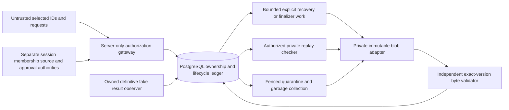
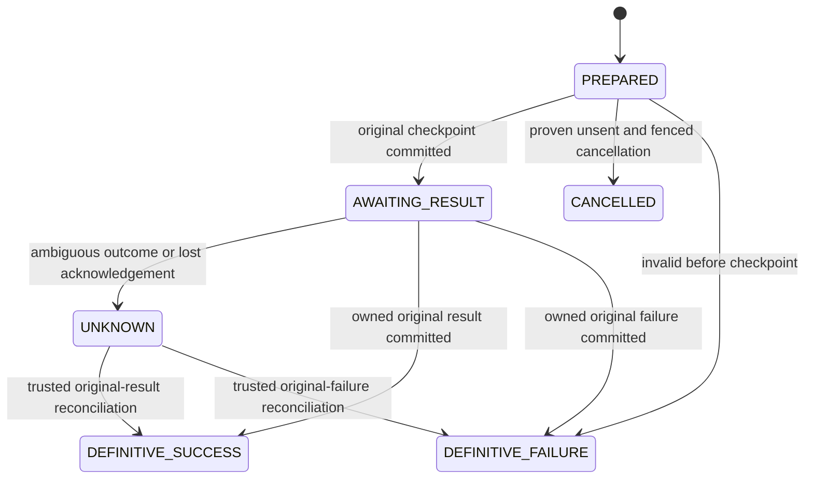
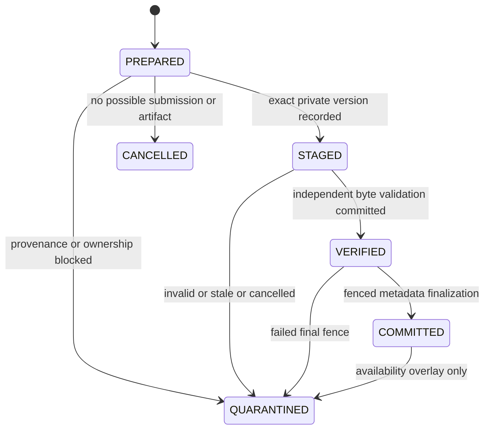
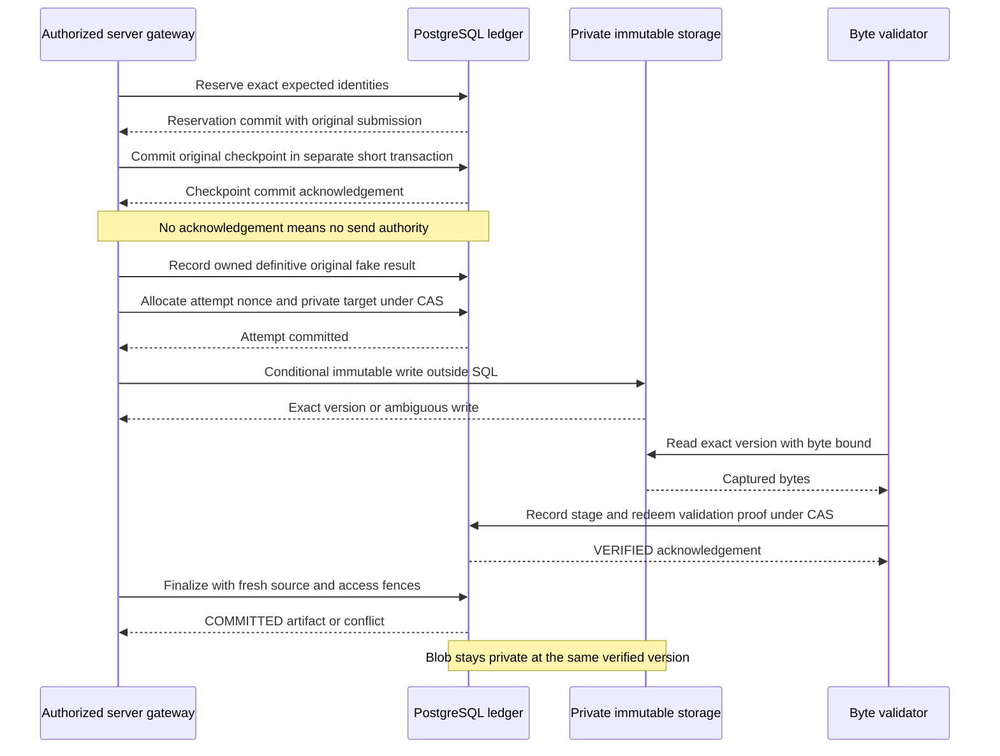
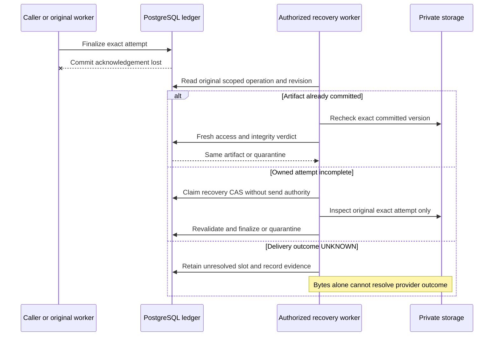

# M5-04 — Durable voice artifact lifecycle design

## 1. Scope, status and audited baseline

Design date: 2026-10-18 (Asia/Bangkok). **M5-04 Design Review PASS — documentation only.** This document is **DESIGN-ONLY**. Only this Markdown file is added. No runtime service, type export, SQL, schema, migration, blob adapter, audio file, endpoint, provider, approval or worker is implemented or executed. This verdict covers the proposed design and static/source review, not runtime acceptance or production security certification.

Entry: `recovery/m9-studio` at `1b4ab3cbf1c3370ddb2d21fd884092371666b925`, clean index and working tree. The [M5-01 foundation](STORYLINE_M5_01_VOICE_FOUNDATION.md), [M5-02 verification](STORYLINE_M5_02_AUDIO_VERIFICATION.md), [M5-03 ownership](STORYLINE_M5_03_ARTIFACT_OWNERSHIP.md) and [M9 acceptance](STORYLINE_M9_FINAL_ACCEPTANCE.md) are historical implementation reports, not evidence of newly executed acceptance tests. All APIs in the inventory below were checked against actual source. Everything under sections 2–11 is a **proposed specification**, with no claim that its interfaces/tables/gateways exist.

### Existing implementation inventory

| Existing source | Actual exports / behavior relied on |
| --- | --- |
| [foundation/contracts.ts](../lib/storyline/voice/foundation/contracts.ts) | `VOICE_FOUNDATION`, `NarrationReference`, `VoicePlan`, `VoiceChunk`, `SyntheticVoiceCapability`, `fakeVoiceRestrictions`. Discriminated M4/R4/future reference shapes; FAKE_ONLY plan and permanent synthetic restrictions. Future approval reference is unresolved shape, not an issuer. |
| [foundation/reference.ts](../lib/storyline/voice/foundation/reference.ts) | `parseNarrationReference`, `referenceFromM4`, `referenceFromR4`, `checkedEditedNarration`. Canonical captured-byte/parent checks; no authentication, stored-existence or live-currentness proof. |
| [foundation/narration-input.ts](../lib/storyline/voice/foundation/narration-input.ts) | `m4NarrationVoiceInput`, `editedNarrationVoiceInput`; exact section/paragraph projections, no R4-to-M4 cast. |
| [foundation/chunk-plan.ts](../lib/storyline/voice/foundation/chunk-plan.ts) | `planMyanmarVoice`, `validateVoicePlan`, `reconstructVoiceSections`; exact UTF-8/grapheme reconstruction, runtime Unicode/ICU policy in plan identity, null duration estimate. |
| [foundation/capability.ts](../lib/storyline/voice/foundation/capability.ts) | `syntheticVoiceCapability`, `parseSyntheticVoiceCapability`, empty `productionVoiceCapabilities`. Existing fake capability is 24 kHz only. |
| [foundation/fake-adapter.ts](../lib/storyline/voice/foundation/fake-adapter.ts) | `createSyntheticVoiceAdapterForTest`, `createFakeVoiceHarness`; process-owned adapter, deterministic silent fixture, sticky UNKNOWN/failure. Its unverified metadata stays unverified/null; it is not durable execution infrastructure. |
| [audio-verification/wav.ts](../lib/storyline/voice/audio-verification/wav.ts) | `capturePcmBytes`, `verifySyntheticPcmWav`, `pcmDurationUs`; strict 24/48 kHz mono PCM16 structure, exact file SHA-256, exact sample count and nearest-microsecond/ties-up policy. |
| [audio-verification/receipt.ts](../lib/storyline/voice/audio-verification/receipt.ts) | `verifyFakeVoiceOutput`, `parseSyntheticAudioReceipt`; replay requires expected plan/index and actual bytes. Unsigned synthetic byte-integrity evidence, no historical submission authentication. |
| [audio-verification/collection.ts](../lib/storyline/voice/audio-verification/collection.ts) | `verifySyntheticAudioCollection`, `parseSyntheticAudioCollection`; complete unique canonical chunk coverage and actual byte replay, no concatenation or final track. |
| [audio-verification/contracts.ts](../lib/storyline/voice/audio-verification/contracts.ts) | `AUDIO_VERIFICATION`, `PcmMeasurement`, `SyntheticAudioReceipt`, `SyntheticAudioCollection`. 4 MiB/file, 16 MiB/collection, integer sample-derived duration; integration remains 24 kHz. |
| [private-artifacts/store.ts](../lib/storyline/voice/private-artifacts/store.ts) / [contracts.ts](../lib/storyline/voice/private-artifacts/contracts.ts) | `createPrivateFakeAudioStoreForTest`, `PRIVATE_FAKE_AUDIO`. Returned `control` establishes expectations/owners and virtual time; `store` admits/replays/settles/inspects/validates collections. Factory-local capabilities and buffers; neither serializable nor recoverable after process loss. UNKNOWN is terminal for admission here. |
| [jobs/fake-checkpoint.ts](../lib/storyline/jobs/fake-checkpoint.ts) | `createStoryTaskFakeCheckpoint`, `StoryFakeSendPermit`, `StoryFakeResultReceipt`. Checkpoint must commit and be acknowledged before one-use process permit; permit is burned before any await. Acknowledgement loss does not mint a permit. |
| [jobs/state-machine.ts](../lib/storyline/jobs/state-machine.ts) / [reconcile.ts](../lib/storyline/jobs/reconcile.ts) | `canAutomaticallyRetryBeforeSubmission`, `decideStoryTaskTransition`, `createStoryTaskReconciler`. Pre-submission retry requires no checkpoint/issued permit/unresolved submission. Original-result resolution is distinct from resend. Reconciler dispatch observation is not provider retry authority. |
| [narration/contracts.ts](../lib/storyline/narration/contracts.ts) / [context.ts](../lib/storyline/narration/context.ts) | `NarrationDraft`, `NarrationSourceBinding`, `NarrationAnalysisDependency`, `checkSyntheticNarrationContext`; complete M1/M3/M2 ancestry, provisional synthetic narration, no approval. |
| [narration-integration/context-access.ts](../lib/storyline/narration-integration/context-access.ts) / [persist.ts](../lib/storyline/narration-integration/persist.ts) | `createNarrationContextRunner`, `createProvisionalNarrationPersistence`; returned persistence has `persist` and `read`. Scoped source/media/task reconstruction and commit fences; a read is a point-in-time observation, not a future lease. |
| [studio-versions/contracts.ts](../lib/storyline/studio-versions/contracts.ts) / [service.ts](../lib/storyline/studio-versions/service.ts) | `STUDIO_EDIT`, `EditedVersionPayload`, `unapprovedEdit`, `createDisposableStudioVersionService`, `STORYLINE_STUDIO_VERSION_PRODUCTION_ENABLED = false`. Original M4 identity and immutable edited identity are distinct; saved edits remain synthetic and unapproved. |
| [studio-versions/synthetic-auth.ts](../lib/storyline/studio-versions/synthetic-auth.ts) / [database.ts](../lib/storyline/studio-versions/database.ts) | `createSyntheticStudioAuthenticationForTest`, `verifyStudioRequest`, `assertStudioDatabase`, `signStudioAuthorization`. Session/origin/CSRF/scope rechecks and transaction-bound restricted gateway proofs are conventions to preserve, not production auth to activate. |
| [voice/handoff.ts](../lib/storyline/voice/handoff.ts) | `parseVoiceRequestProposal`, `assessNarrationVoiceHandoff`; existing v1 remains disabled/non-executable. |
| [disposable-postgres.ts](../tests/storyline/disposable-postgres.ts) | `DisposableStorylinePostgres`: owned random cluster/database/credentials, private UNIX socket/no TCP, target/owner/version checks and marker-guarded cleanup. `start`, `restrictedLogin`, `securityAdministrator`, `stop` belong to the test class. No cluster is started in M5-04. |

The M4 stored draft ID/hash is distinct from its logical payload ID; R4 has its own edited ID/content hash/previous lineage. No current M4/R4 record is eligible for real TTS. Human narration approval and SOURCE_VERIFIED issuance are separate absent/future authority systems; no byte receipt, saved edit, subtitle approval, synthetic capability or copied hash can replace them.

## 2. Architecture and authoritative subsystems

### Decisions

1. PostgreSQL owns durable identities, exact scope/owner/generation, state revisions, admission reservations, immutable metadata, result provenance, audit and access/GC fences.
2. Private storage owns only immutable bytes at an **exact object version**. Storage paths/metadata/ETags are not tenant authority or canonical audio hashes. No cross-tenant or cross-artifact blob deduplication in the first design.
3. A server-only gateway independently resolves principal, membership, narration/source and approval policy. Restricted database functions enforce the same bindings. A signed JSON claim is not enough without live issuer/session/revocation checks.
4. A separate byte validator reads the exact private version, validates actual WAV bytes and anchors a receipt to that version, reservation and owned definitive result. It cannot approve narration or spending.
5. There is no distributed transaction across PostgreSQL and storage. Use reservation → private immutable write → independent read/verify → fenced ledger finalization. COMMITTED is a ledger decision, not a public object ACL change.
6. Delivery outcome and artifact availability are separate state machines. UNKNOWN cannot be resolved by finding a WAV-shaped object, expiry or a new key/generation.
7. M5-05, if separately authorized, is disposable FAKE_ONLY. Existing fake restrictions are copied intact and immutable. Any real execution schema, issuer, provider, download transport and activation requires a separate review; no production-mode Boolean is designed as an escape hatch.



Browser/client input never reaches storage directly. A callback is untrusted input to an observer; only an owned, durably recorded definitive result can support admission. Recovery has no send/provider capability. GC cannot create an artifact or grant access. Future user-facing download would be an independently reviewed authenticated server stream, not a pre-signed/public URL; it is outside M5-05.

The proposed immutable object remains at its original verified private version after commit. No rename, bucket ACL publication or required upload follows COMMITTED. A backend that needs a copy/promotion must complete that private copy and independently validate its **new exact version before** finalization; otherwise it is unsupported. This removes a metadata-committed/final-blob-not-yet-created success window without pretending storage and SQL commit atomically. Media publication remains an entirely separate gate.

## 3. Versioned contracts and hash boundaries

### Existing domains retained byte-for-byte

| Existing schema/domain | Allowed reuse |
| --- | --- |
| `story-narration-draft-v1`, `story-edited-narration-v1` | Selected original/edited identity, never interchangeable; preserve parent/source/analysis domains. |
| `story-voice-narration-reference-v2` | Captured synthetic M4/R4 reference. `FUTURE_APPROVED_REFERENCE` stays unresolved and is rejected by current M5-02 receipt integration. |
| `story-voice-chunk-plan-v1`, `story-voice-chunk-text-v1`, `story-voice-section-text-v2` | Full exact text/topology/Unicode-ICU/voice plan identity; pin compatible segmentation runtime for replay. |
| `story-voice-synthetic-capability-v1`, `story-voice-fake-profile-v1` | Fake capability/profile identity; no verified live registry entries. |
| `story-voice-fake-request-v2`, `story-voice-fake-recipe-v1`, `story-voice-synthetic-audio-artifact-v2` | Inner fake adapter request/recipe/unverified metadata. Durable submission IDs are separate outer ledger IDs; do not substitute them into these schemas. |
| `story-synthetic-pcm-measurement-v1`, `PCM_DURATION_US_NEAREST_TIES_UP_V1` | Exact validated sample measurement and rounding. Sample count/rate remain authoritative. |
| `story-synthetic-audio-verification-v1`, `story-synthetic-audio-collection-v1` | Unchanged inner M5-02 receipt/complete manifest, recreated from actual bytes. Their public hashes are not authority. |
| `story-private-fake-audio-expectation-v1`, `story-private-fake-audio-artifact-v1`, `story-private-fake-audio-ownership-v1`, `story-private-fake-audio-collection-v1` | Existing M5-03 **ephemeral-only** semantics. Keep them for regression fixtures; do not relabel virtual ticks, capabilities or memory records as durable evidence. |

Canonical JSON is the actual existing bounded serializer: safe integer numbers only, no floats, negative zero, BigInt, Date objects, getters, custom object prototypes, holes or normalization. Canonical capture does not invoke inherited array methods. Canonical hashing is SHA-256 over `domain + newline + canonical JSON`; audio SHA-256 covers exact complete file bytes. Domain hashes, database row IDs, storage version IDs and provider receipts are distinct. Currency uses bounded integer USD micros; time values in canonical payloads use canonical UTC strings/integer policy units, not fractional seconds or unbounded PostgreSQL numeric coercion.

### Reserved proposed contracts — none exported or installed

All following `story-durable-*` domains are **new proposed v1 domains**, both schema identifier and canonical hash domain unless the row says otherwise. Names are reserved by this design only. Each envelope requires exact fields, bounded JSON, full execution/environment discriminator, domain-aware identity and permanent fake restrictions. Adding incompatible semantics requires v2; no old hash changes meaning.

| Proposed contract/domain | Required binding and size/policy |
| --- | --- |
| `story-durable-voice-request-v1` | FAKE_ONLY; environment/fixture namespace, tenant and Project/Movie/Studio; exact narration binding and full M5-01 plan/hash; selected chunk; durable recipe hash, expected fake request/submission identity; scoped idempotency key stored separately from stable recipe identity. ≤2 MiB envelope; plan retains its own 1 MiB bound. No spending authority. |
| `story-durable-synthetic-narration-binding-v1` | Full unchanged M4/R4 `NarrationReference`, captured canonical text/plan identity, source and M3/M2 dependencies, eligibility SYNTHETIC_ONLY and approval NONE. Server reload/read-fence provenance is separate from caller reference consistency. |
| `story-durable-approved-narration-binding-v1` | **Reserved post-M5-05 design**, rejected in fake schema: independently resolved non-synthetic reviewed exact text, selected domain/parent lineage, approval issuer/receipt/policy/revocation epoch and separate source-verification receipt/dependency/currentness. Existing `story-approved-narration-v1` and `story-narration-approval-v1` are unresolved reference domains, not existing issuers. A fake binding cannot be upgraded in place. |
| `story-durable-voice-recipe-v1` | Full synthetic binding + inner plan/hash/profile/capability/chunk + validator/output policy, FAKE_ONLY and environment. Excludes session expiry, worker lease, transient confirmation/nonce and key rotation. Inner fake recipe remains unchanged. |
| `story-durable-voice-submission-v1` | Stable ledger submission ID, exact request/recipe/chunk and inner fake identities, submission generation, committed checkpoint identity/hash, immutable result-observation identity and execution restrictions. Original-process acknowledgement is a separate permit prerequisite, never regenerated from a durable flag. Lease-holder identity/revision is separate mutable state. |
| `story-durable-audio-reservation-v1` | Reservation ID, exact tenant/scope/submission generation/request/recipe/plan/chunk; independently captured expected result/byte policy; owner principal, worker owner generation, expected revision and attempt nonce; bounded retention policy. A reservation never authorizes send. |
| `story-durable-audio-stage-v1` | Reservation + unique attempt ID/nonce, opaque server-only object-version handle, actual length/hash observation, backend policy/namespace and stage observation time; claimed length is not validation proof. No raw path or credential in public DTO. |
| `story-durable-synthetic-audio-verification-v1` | Full unchanged inner `SyntheticAudioReceipt`, exact object version/attempt/reservation/submission, validator ID/version/runtime, measurement/hash/size and validation revision. Issued only after bounded independent read and owned definitive-result checks. Public content hash separate from transaction-bound validation proof. |
| `story-durable-synthetic-audio-artifact-v1` | Immutable durable artifact ID, tenant/scope/narration/plan/chunk/recipe/submission/attempt lineage, exact verified object version, full outer/inner receipt identities, sample metadata and permanent FAKE_ONLY restrictions. No publication eligibility or ownership lease promise. |
| `story-durable-synthetic-audio-collection-v1` | Full unchanged M5-02 inner manifest/hash; complete ordered durable artifact IDs/hashes/object-version receipt bindings, same plan/source/voice and owner context. Dynamic availability/access is checked separately. No combined WAV or track. ≤4 MiB outer metadata, retaining the unchanged ≤2 MiB inner bound. |
| `story-durable-audio-access-policy-v1` | Server-resolved tenant/principal/session/issuer/revocation epochs, action/resource scope, expiry and minimum content/source/approval policy. Authorization receipt has its own challenge/transaction binding; stable artifact hash does not freeze permissions forever. |
| `story-durable-audio-lifecycle-v1` | Aggregate ID, delivery/artifact/availability axes, revision, owner generation, cancel flag, expected predecessor and transition reason, authoritative DB timestamps. This is a mutable ledger projection, not part of immutable artifact bytes. |
| `story-durable-audio-recovery-v1` | Original identities, observed failure/evidence, recovery case ID, allowed action, recovery worker fence/revision, quarantine reason, source/access verdicts and audit reference. Never carries a provider-send permit. |
| `story-durable-audio-audit-v1` | Tenant/aggregate, immutable event ID/sequence, prior/next revision, action/result/reason, resolved actor/service identity, request/receipt hashes, key ID and DB time. Optional hash-chain detects some tampering, not a privileged database administrator. No secret/audio/text/path logging. |

M5-05 creates **new ledger records** by revalidating pre-owned synthetic inputs; it does not migrate M5-03 process capabilities, promote old UNKNOWN, reinterpret its virtual ticks or import public JSON as authority. No live data migration is proposed. Later approved/real execution needs distinct accepted schemas and independently reviewed issuers, not widening these FAKE_ONLY enums. Revalidation under a new WAV/segmentation policy creates a new receipt/review case, never rewrites historical hashes.

Proposed outer JSON ceilings are explicit and independent of inner limits: request 2 MiB; synthetic narration binding and recipe 64 KiB each (reference/hash linkage to separately stored exact plan text, no duplicate full script); submission 32 KiB; reservation 64 KiB; stage 16 KiB; durable verification 128 KiB with inner receipt ≤64 KiB; artifact 256 KiB; collection 4 MiB with inner manifest ≤2 MiB; access policy 32 KiB; lifecycle 8 KiB; recovery 64 KiB using evidence references, not embedded bytes; audit 16 KiB. Reject composition overflow; do not raise an old parser's bound or truncate content to make it fit. Record/nonce/ID fields remain bounded. The reserved future approved binding's exact parser belongs to its separate issuer review and is not accepted by M5-05.

## 4. Proposed metadata ledger and private storage port

### Logical PostgreSQL layout (design, not executable SQL)

Use a distinct disposable namespace such as `voice_m505` in a **new owned scratch database only**. All tenant-owned primary/foreign keys include tenant and Project/Movie/Studio, preventing a globally valid ID from joining into another scope. Every transition is a restricted function, not direct application DML.

| Proposed table | Keys, constraints and mutability |
| --- | --- |
| `plan` / `narration_binding` | Immutable canonical payload/hash/domain; unique scoped hash, exact M4/R4 parent binding; bounded canonical JSON. No tenant inferred from source JSON. |
| `request` / `idempotency_slot` | Immutable request/proposal; unique `(tenant, scope, key)`, exact digest conflict; aliases point to the same request. Preserve tombstones permanently for this fixture protocol. |
| `recipe_claim` | Permanent unique `(tenant, scope, environment, durable_recipe_hash, chunk_index)` to original submission. New key/owner generation cannot evade unresolved ownership. No retry-generation creation in M5-05. |
| `submission` / `result_observation` | Stable submission and inner fake identities/generation; delivery state, checkpoint commit receipt, cancel flag, owned immutable result. An ACK audit observation cannot grant recovery-send authority. One definitive result per submission; hash conflict quarantines, never last-write-wins. |
| `reservation` / `owner_lease` | Unique original submission/chunk; owner principal, owner generation, revision, nonces, lease bounds and allowed states. Worker takeover preserves submission ID/generation; it does not issue a send permit. |
| `stage_attempt` | Unique `(reservation, attempt_nonce)` and exact backend object version; server-generated key, tenant-owned namespace, write/validation observations. Object version belongs to one reservation; no cross-artifact deduplication. |
| `verification_receipt` / `artifact` | Append-only canonical metadata/hash; unique committed artifact per reservation/chunk and exact receipt/object-version FK. UPDATE/DELETE/TRUNCATE denied by grants and immutable guards. Never mutate historical committed bytes/metadata. |
| `artifact_availability` | Mutable AVAILABLE/QUARANTINED/DELETE_PENDING/DELETED overlay with revision and integrity observation. Historical COMMITTED artifact stays immutable when access is later denied. |
| `collection` / `collection_member` | Immutable plan/manifest/hash; unique `(collection, chunk_index)` and unique artifact membership; exact child scope/plan/voice/source constraints plus final completeness gateway. Availability is derived from current children, not cached success alone. |
| `recovery_case` / `quarantine_hold` | Original provenance, reason/evidence hash, owner/revision and disposition. Separate provider-outcome and byte-integrity uncertainty; unresolved execution forbids deletion/retry. |
| `gc_intent` / `audit_event` | One conditional exact-version deletion fence; immutable tombstones and append-only sequenced transition events. No delete by untrusted prefix or age alone. |

Required checks: enums and permitted cross-axis combinations; nonempty bounded hashes/IDs; exact canonical payload hash; domain discriminator; positive bounded generations; monotone revision CAS; PCM samples/data length/rate and receipt relations; key/recipe uniqueness; tenant-scoped FKs; immutable payload guards; source/approval policy epochs verified in gateways. A hash CHECK cannot validate audio outside PostgreSQL or authenticate the caller. Use bounded integer revisions (no unsafe JS bigint coercion), safe integer sample/cost units and explicit DB timestamp-to-canonical-string conversion. Fail closed on overflow.

Proposed gateways, all unimplemented: `reserve`, `checkpoint_ack`, `record_original_result`, `claim_recovery`, `record_stage`, `record_validation`, `finalize_artifact`, `finalize_collection`, `read_private_manifest`, `authorize_private_replay`, `request_cancel`, `mark_quarantine`, `begin_gc`, `finish_gc`. Each receives an independently resolved server action context, expected row revision and owner generation; no role label/tenant supplied solely by client JSON authenticates it. Runtime roles get EXECUTE on the minimum subset, no direct private table or column privileges. Separate non-login schema owner; pinned search path/qualified names; revoke PUBLIC execute/CREATE; reject superuser/BYPASSRLS/role-owner and unexpected inherited privileges. Catalog assertions must cover column grants, function grants, ownership, triggers and search-path substitution as R4 does.

### Proposed replaceable private storage interface (pseudocode only)

```text
PrivateBlobPort.putImmutable(serverTarget, boundedBytes, attemptFence)
  -> WRITTEN(exactVersion) | EXISTS(exactVersion) | UNKNOWN
PrivateBlobPort.readExact(exactVersion, byteCeiling, accessFence)
  -> bounded bytes | MISSING | UNAVAILABLE
PrivateBlobPort.statExact(exactVersion) -> existence/length observation only
PrivateBlobPort.deleteExact(exactVersion, gcFence)
  -> DELETED | ALREADY_ABSENT | UNKNOWN
```

Targets are allocated by the trusted namespace registry from tenant/reservation/attempt randomness, never caller paths, URLs, bucket names or hash prefixes. Methods have no provider-send authority. Writes are conditional create-only; EXISTS must be independently read and match owned expected bytes/version, or quarantine. A version can never silently mean “latest.” `statExact`, an ETag, a successful upload ACK and object metadata do not prove PCM validity, canonical hash or power-loss durability. Backend credentials live only in a server-side secret boundary; storage returns no locator to the browser.

Initial bounds remain 4 MiB per WAV, 16 MiB per collection and 720 planned chunks, with explicit per-tenant/script/global reservation and retained-byte quotas. Count staged/orphan/quarantined bytes as occupied until safe deletion is acknowledged. Never evict UNKNOWN to admit new work. M5-05 uses known silent fixtures, current 24 kHz integration and unchanged byte validators; 48 kHz integration and real speech need new reviewed capabilities.

For the first M5-05 fixture, use configurable limits **below** hard ceilings of 32 owners, 720 key slots/submissions/artifacts, 1,440 stage attempts, 16 MiB total audio across its entire private namespace and 32 MiB serialized ledger metadata, with bounded recovery batches of at most ten. Tenant/script limits cannot exceed the fixture-wide cap. Quarantine and abandoned attempts consume those quotas until safely disposed; duplicates remain addressable at capacity. These synthetic harness ceilings are not production capacity/retention recommendations.

Allow at most two physical stage attempts per owned definitive result in this first fixture protocol; an ambiguous first write must be resolved/held, not bypassed by a second target. Reserve 4 MiB of the 32 MiB metadata ceiling for mandatory recovery/GC/audit facts; ordinary admission stops before consuming that headroom and reserves its bounded expected transition cost. If mandatory audit capacity is exhausted, freeze further state changes/deletion and require an explicit operator capacity decision; never mutate/delete without required audit or evict UNKNOWN. Duplicate reads do not need a new lifecycle event. Rate-limit repeated denial diagnostics so unauthorized traffic cannot require unbounded private ledger writes.

## 5. Lifecycle state machines and transition fences

There are two axes plus availability, not one enum that lets byte validation imply provider success. `submissionGeneration` identifies the original execution intent. `ownerGeneration` identifies the current worker lease holder. Recovery may advance only the latter under CAS, while retaining original submission/result identity and consuming no send authority. A late obsolete worker cannot finalize; a new authorized recovery owner may independently adopt an already recorded original result with a new validation attempt/proof. No generation rotation recreates a permit or releases an unresolved execution slot.

### Delivery axis



All unlisted transitions reject. In particular UNKNOWN → PREPARED/AWAITING_RESULT/CANCELLED rejects. SUCCESS/FAILURE/CANCELLED are retained terminal delivery facts. A definitive result cannot be replaced by a conflicting callback. M5-03's terminal UNKNOWN behavior is unchanged: the proposed **new durable domain** permits reconciliation only through a separate authoritative original-result observation, consistent with existing M2 `RESOLVE_ORIGINAL_VALID`/`RESOLVE_ORIGINAL_INVALID`. Finding audio bytes or receiving public JSON is insufficient. M5-05 defaults to no new execution generation/retry at all.

AWAITING_RESULT records a committed checkpoint, **not proof that its acknowledgement reached the original process or that a send occurred**. Only that original process, after observing commit acknowledgement and passing current deadline/owner checks, could receive its one-use execution permit. PostgreSQL cannot atomically prove delivery of its own acknowledgement. A persisted ACK audit marker is never sufficient to recreate a permit after crash/loss; recovery conservatively retains the unresolved original slot.

### Artifact axis and availability



STAGED requires a ledger-owned definitive success, current admission owner, exact original submission and an immutable stage observation. VERIFIED additionally requires actual-byte validation. COMMITTED additionally requires the final policy/source/session fence, receipt/object identity, no cancellation and exact revision. A blob associated only with UNKNOWN can exist solely as **quarantined evidence**, never as STAGED/VERIFIED eligible output. QUARANTINED never automatically returns to COMMITTED; remediation creates a new audited attempt/version after independently proving the original definitive result and eligibility. For a previously committed artifact, quarantine/retirement changes availability only; its immutable artifact payload, historical receipt and commit event remain unchanged.

| Transition/operation | Transaction owner, fence and required audit |
| --- | --- |
| Create PREPARED request/reservation | Reserver gateway locks exact scope/source/policy and unique key/recipe claim; independent server identity and expected plan; insert reservation + audit + dispatch intent in one transaction; do not call storage/send inside it. |
| PREPARED → AWAITING_RESULT | Checkpoint authority locks original request/submission, expected revision/generation and consumed current confirmation where real execution would apply, then commits the checkpoint/state. Only **after** the original process observes commit acknowledgement may it receive a process-owned one-use permit. M5-05 simulates this without a provider. |
| Original result or UNKNOWN | Result-observer gateway compares original submission/request/recipe, checkpoint and generation; stores immutable result observation or unresolved state + audit. A callback cannot choose its own owner or generation. Lost ACK is reconciled by read, not resend. |
| Record STAGED | Stager uses exact reservation/attempt and expected revision, definitive-result FK, owner lease/generation, namespace/version proof and cancellation check; storage I/O already occurred outside the transaction. |
| STAGED → VERIFIED | Validator reads exact bytes outside SQL, replays original expected plan/receipt, then redeems a one-use validation challenge bound to object version, result, owner/revision, DB transaction/backend/action/nonce and validator policy. Store receipt + audit atomically. |
| VERIFIED → COMMITTED | Finalizer reacquires current actor/session/membership, policy/source/approval epochs and reservation/owner fence; verifies definitive result/no cancel, exact immutable version/measurement and receipt; inserts immutable artifact + availability + audit and commits CAS. No external write is required afterward. |
| Cancel | Proven unsent/no checkpoint/no permit: CAS to CANCELLED. After a checkpoint/possible send: set `cancelRequested` and preserve delivery state/reservation; retain definitive outcome and quarantine any bytes. No false rollback/cost release. |
| Quarantine/read/collection/GC | Separate minimal privileges and current action authorization. Quarantine commits availability/recovery/audit; read has no transition/send power; collection validates every child; deletion requires irreversible GC fence, reference/hold checks and exact-version evidence. |

Every mutating operation includes aggregate ID, expected revision, expected owner generation, action and idempotent operation ID. Zero updated rows means conflict/expired/stale, not success; reread only through scoped authorization. Duplicate operation ID returns the same committed fact if bytes/claims match; changed claims conflict. Audit/event insertion failure rolls back the SQL transition and fences. No external blob operation is rolled back by that SQL transaction.

## 6. Reservation, verification and finalization protocol

1. **Resolve independent expected identity.** Server loads exact immutable M4/R4 text/domain, complete source/M3/M2 dependencies and selected plan; validates plan and synthetic policy using scoped source gateways. M5-05 uses explicit synthetic session/fixture membership and approval NONE. Future real mode would require a separate exact non-synthetic approved binding and source-verification issuer; these are not available now. Admission JSON is never the source of expected ownership.
2. **Reserve in SQL.** Lock Project → Movie → Studio → request/submission/reservation, then policy/session epoch rows in a documented global order; all cooperating writers use the same order. Unique key/recipe claims and resource quotas reserve stable identity. Commit reservation/checkpoint facts and audit. If acknowledgement is lost, look up the same scoped key/digest and original submission; never create a fresh key/generation to recover.
3. **Observe definitive result independently.** A process-owned observer or existing trusted durable original-result record authenticates exact original identity. A fake fixture may supply known bytes only through that test authority. New callbacks with only hashes/IDs enter a recovery/quarantine case, not success. No unresolved delivery is turned into success by the blob validator.
4. **Allocate one private stage attempt.** Under owner/revision CAS, commit an attempt nonce and server-owned object target. Outside SQL, `putImmutable` creates only that exact attempt version. A timeout is an ambiguous storage write, not proof of absence. Repeat inspection of the same attempt; no new provider execution. Never accept an object found by caller-supplied path.
5. **Independently read and verify.** Read that exact object version within byte/time limits. Compute actual SHA-256, PCM sample count/rate/data boundaries and rounding; replay unchanged M5-02 receipt against the original expected plan/index. Compare independent ledger request/submission/source/profile/expected hash. Do not trust a source metadata duration, public receipt, ETag or upload response. Record STAGED observation and VERIFIED receipt through distinct restricted transitions; storage bytes remain private throughout.
6. **Finalize in SQL.** Short transaction reacquires source/currentness and authorization fences; validates owner/revision, immutable object version and fresh validator proof, original definitive result, cancellation flag and quota ownership. Use actual DB time at fence redemption, not only transaction-start time. Append immutable artifact/audit and availability. Commit acknowledgement permits returning its ID; loss of acknowledgement permits scoped read-back only. A source/session/approval change before commit rolls back metadata and leaves stage bytes private for quarantine/GC.
7. **Read or finalize a collection separately.** Fresh read authorization plus artifact availability and exact-version integrity is required. Complete collection finalization locks child availability rows in chunk order, checks all expected receipts/plan IDs, no UNKNOWN/failure/quarantine and exact unique indices, then inserts immutable manifest/member rows + audit atomically. Later child unavailability blocks collection replay without rewriting its history.



Finalization's byte observation is meaningful only if the storage backend guarantees immutable exact-version reads and prevents concurrent deletion. The SQL GC fence prevents authorized cleanup races; a compromised backend/admin can still violate availability. A backend unable to guarantee exact immutable version identity is unsupported. Missing/corrupt bytes after commit deny replay and quarantine; no database transaction can guarantee a dishonest/unavailable external backend never loses data.



## 7. Crash, UNKNOWN, quarantine and cleanup rules

The recovery authority is a current, restricted service principal with tenant-scoped work claims, not the expired original browser session. It can preserve independently observed historical result/integrity facts while denying artifact finalization or replay when the original content/access policy is stale. Every action checks original identities and current ownership CAS; no recovery API can submit work to a provider or refresh confirmation/spending permits.

| Failure cut / condition | Authoritative observation and safe recovery |
| --- | --- |
| Crash before reservation commit | No acknowledged reservation. Authorized repeat of the same key/digest may create or discover it; SQL unique claim decides. No external bytes/send allowed before the appropriate acknowledged checkpoint. |
| Reservation committed, ACK lost | Read same scoped key/proposal/operation. Do not assume rollback, mint a permit or create another submission. If original checkpoint exists but no definitive result, conservatively UNKNOWN; recover metadata/results only. |
| Crash after reservation before stage | Reservation/quota/recipe retained. Recovery claims owner generation under CAS and may inspect/resume artifact admission only when original definitive result is already owned. It cannot rerun audio generation. |
| Stage blob written before stage-metadata commit | Reserved attempt target/nonce already exists. Re-read exact owned target and verify. If no legal binding can be proven, mark orphan/quarantine; never infer success from listing metadata. |
| Crash before/after stage or verification commit | Look up exact attempt/receipt/revision. Independently re-read bytes; obtain a fresh **validation** challenge if needed, not a provider permit. Duplicate durable facts are idempotent; conflicts quarantine. |
| Metadata commit before final blob publication | Required post-commit publication is forbidden by architecture. If a backend copy was not completed/verified before finalization, finalization must fail. Any missing committed exact version is unavailable/quarantined, not served via a fallback/latest key. |
| Finalization ACK lost | Read original artifact/reservation under current authorization. Same commit returns same identity after integrity check; unknown transaction outcome never causes regeneration or a second artifact. |
| Duplicate definitive callbacks | Matching original owned result hash is idempotent. Different bytes/result IDs under the same submission conflict and quarantine; no overwrite. Public callback IDs alone cannot authenticate either result. |
| Stale owner generation / concurrent finalizers | Owner generation + revision CAS admits at most one transition; obsolete callback rejected. New recovery owner may adopt original durable evidence only through a new audit/validation attempt, never reuse obsolete validation proof or issue a new send permit. |
| Corrupt/truncated/oversized staged bytes | Independent verifier rejects; quarantine immutable exact version and evidence. No caller-updated hash/duration repairs it. A corrective artifact requires separately owned definitive bytes/new attempt and full verification, without provider resend. |
| Revoked/expired caller or stale source/approval | Deny create/finalize/download. Restricted result observer may retain historical original result and quarantine bytes for audit; it does not impersonate the caller. Later new principal needs independent scope/policy authorization. |
| UNKNOWN outcome plus valid-looking bytes | Retain unresolved submission, original recipe claim and any real budget reservation. Bytes can be quarantined evidence only. Resolution needs original trusted durable result or separately reviewed provider reconciliation proof, absent in M5-05 except fake owned-ledger fixtures. |
| Definitive failure or late success after cancel request | Preserve original outcome and cost uncertainty. Cancel flag blocks finalization; quarantine late bytes. Failure does not imply free execution or authority for retry. |
| Orphan object / unowned target | Quarantine after checking owned namespace marker and original attempt registry. Inventory age and object-supplied tenant tags are insufficient deletion authority. Foreign/unrecognized targets are never touched automatically. |
| Missing/corrupt committed object | Fail private replay, mark availability QUARANTINED and invalidate collection availability. Never synthesize replacement, return cached success, substitute another version or erase history. Restore exact bytes only from independently authenticated backup under a separate recovery policy; backup design is a production blocker. |
| Database loss, restore or storage rollback | Read/write/GC stop until ledger/namespace/version provenance is reconciled. Restored owner leases, epochs or ACK history cannot recreate send authority. No cross-system disaster-recovery guarantee is claimed by the disposable harness. |

### Safe garbage collection

GC uses an explicit retention policy, current service authorization and a two-step **delete intent**. A short SQL transaction locks the exact attempt/artifact availability, proves no unresolved execution, live reservation/finalizer/read hold, legal/quarantine hold or retained collection reference, and that the DB retention deadline passed. It records an irreversible DELETE_PENDING fence/tombstone and audit under CAS. Finalization and new replay claims reject that fence. Then GC deletes only the exact owned object version outside SQL and records an acknowledged DELETED observation. Ambiguous delete retains DELETE_PENDING and re-inspects the same version; it never reuses its identity.

Read leases/holds and deletion intents share ledger fences, with bounded leases and no SQL transaction held open across blob reads. A reader must first obtain a live hold; GC cannot start while one is valid. If it expires mid-read, the reader must fail rather than return unverified partial bytes, and stale readers cannot extend it after deletion intent. This does not retract copies previously delivered. First replay implementation buffers at most 4 MiB and verifies the whole object before yielding any bytes; streaming partial downloads are deferred.

Retention expiry, principal revocation or owner-lease expiry alone never proves safe cleanup of UNKNOWN. Such records remain held until independent execution resolution and retention/hold policy permit GC. Committed artifacts can be retired only via explicit access revocation/retention policy, reference/hold checks and availability tombstones; immutable metadata/audit/idempotency/recipe claims remain. No automatic deletion of quarantine evidence for unresolved outcomes. No list-and-delete-prefix, global hash-dedup reclamation or browser-controlled delete target is allowed.

## 8. Authorization, tenant isolation and key custody

| Action / subsystem | Required server checks and separation |
| --- | --- |
| Authenticate | Genuine session issuer, principal/tenant, session expiry/revocation/epoch and exact request Origin/method/Fetch Metadata/CSRF for browser mutations. No browser role claims, fake capabilities or environment-wide role as user authentication. M5-05 uses explicit disposable session fixtures only, with no production resolver or route. |
| Read metadata | Current tenant membership and `canReadVoiceArtifact` scoped to Project/Movie/Studio plus exact selected narration/plan; unavailable/quarantine policy returns safe status, not private locations or another tenant's existence details. |
| Create reservation | Separate `canCreateVoiceArtifact`; independently loaded original/edited binding/source/plan; synthetic-only fixture policy; exact idempotency identity and quota. Creating metadata never grants provider submission. |
| Finalize | Separate `canFinalizeVoiceArtifact`, live original or explicitly authorized recovery actor, owner/generation/revision, original definitive result, no cancel flag, unchanged source/policy epoch and byte/receipt/version proof. New principal does not inherit authority from the original principal's public receipt. |
| Private replay / future download | Independent `canReplayVoiceArtifact` and later `canDownloadVoiceArtifact`, exact artifact and current availability, owner/access/source/approval policy, bounded read hold and full-byte integrity. Future download is deferred; no M5-05 endpoint or URL token. A final authorization/CAS check after buffering is the read linearization point; revocation committed before it denies the response, and already authorized copies cannot be recalled. |
| Source and narration approval | Independently reconstructed source/M3/M2 lineage and currentness. Future human narration approval covers exact edited text and reconciled claims/evidence, not merely the original draft. Separate SOURCE_VERIFIED evidence does not grant human script approval or voice authority. Current synthetic M4/R4 ancestry remains ineligible forever. |
| Spending / execution | Independent explicit user cost consent, current quote/capability evidence, atomic per-request/script/operator/global budgets, acknowledged checkpoint and one-use process permit. Existing fake byte validation and durable artifact reservation cannot issue any of these. Real execution remains absent/blocked. |
| Result observation / validation | Service identities with only original-result or validation powers; cannot create membership, human/source approvals, spending decisions or arbitrary send permits. Public callback bytes/metadata do not authenticate the service. |
| Recovery / GC | Restricted service permissions scoped to owned cases/targets; independent policy decisions, CAS/nonces and audit. No arbitrary path read, bulk prefix delete, provider capability or owner-lease renewal used as send recovery. |

Resolve permissions on the server for **every operation**. Persisted policy references are historical binding, not irrevocable access tokens. In a single-DB M5-05 fixture, session/membership/source policy epochs and cooperating writer locks provide a coherent finalization/read fence. If real identity/approval issuers live in separate systems, a stale signed snapshot alone cannot enforce immediate revocation: a reviewed online check or coherently mirrored revocation-epoch protocol with fail-closed outage behavior is a production prerequisite. No distributed-auth atomicity is assumed.

Use a separate non-login schema owner and minimal login roles for reservation, observer, validator, finalizer, reader, recovery and GC. R4's existing broad trusted-server source SELECT inheritance is **not complete tenant RLS**; production must add restricted tenant source gateways or reviewed RLS and prove cross-tenant joins/source media isolation. Do not copy disposable role names/credentials into app routes. M5-05 asserts catalog privileges including extra SECURITY DEFINER functions, column grants, owner membership and temp-schema substitution; source writers, checkpoint workers and approval issuers cannot masquerade as artifact finalizers.

Proof keys are separate by purpose (session/context, result observation, byte validation), environment and key ID; secret bytes never enter canonical payloads, browser bundles, logs or object tags. A proposed one-use database challenge binds tenant/principal/action/target, exact hashes/version, owner generation/revision, nonce, DB transaction/backend and DB-evaluated expiry. Gateway verifies current issuer/key status; consuming a proof and writing its fact/audit is atomic. Historical records retain policy/key ID and claim digest; the public digest or old proof is never accepted as a reusable credential. Rotation revokes new proof redemption as policy requires, preserves historical evidence and permits fresh **read/validation** proof only after current authorization; it never refreshes a paid send permit. Key-provider choice and production custody are unresolved blockers, not an added integration.

Storage writer/reader/deleter identities have separate narrow namespaces and actions; finalizer has no storage overwrite power, and blob credentials have no database policy/approval privileges. Paths/version handles stay in private server-side ledger columns; DTOs expose opaque artifact IDs plus safe provenance/status only. No globally shared content-hash URL, cross-tenant dedup oracle, public bucket, caller-selected backend or browser credential is allowed. Privileged DB/storage administrators and compromised trusted validator processes require independent audit/backup/operational controls; content hashes alone cannot defeat those actors.

## 9. Timing, isolation and retry policy

| Deadline / authority | Owner and failure semantics |
| --- | --- |
| SQL transaction / lock deadline | Database/gateway; bounded statement, lock and transaction waits. SQL timeout/connection loss may leave unknown commit outcome: scoped read-back of the same operation, no external resend. |
| Owner lease | DB wall-clock deadline plus owner generation/revision. Expiry stops mutations; recovery takeover uses CAS and preserves original submission. It does not establish non-submission. |
| Human confirmation / quote | Separate issuer/consent deadline, not an owner lease. Expired confirmation cannot be recovered by rotating worker generation. No confirmations are issued by M5-05. |
| Provider send permit | Process-owned one-use capability; burn before awaits, monotonic local deadline, DB pre-send fence and post-wait deadline recheck. Checkpoint ACK is necessary but not sufficient. Process loss never regenerates a permit from a row. |
| Spending reservation | Independent durable budget ownership; unresolved execution retains it until independently resolved. Confirmation expiry or a definitive failure is not proof of zero charge. |
| Network timeout | Observation of local communication, not proof of rollback, provider rejection, no billing or absent blob. Provider ambiguity and blob-write ambiguity are distinct recovery cases. |
| Read/validation proof | Short-lived, action/version/revision-bound; may be reissued under current access only. It cannot authorize execution. Expiry after a fully observed definitive result must not erase the historical result. |
| Retention / GC | DB policy/hold deadline, independent of session/lease expiry; never overrides UNKNOWN or legal/recovery holds. |

Default metadata isolation is **Read Committed with explicit row locks, unique constraints and revision CAS**, matching the existing restricted workflow conventions. Acquire common scope/source locks in existing Project → Movie → Studio order before artifact aggregates; sort siblings by stable ID/chunk index and document subsequent session/policy-row order for all writers. No blob/network I/O inside a lock-holding transaction. Deadlock/serialization/lock-timeout recovery may repeat the **same idempotent SQL metadata operation** after state lookup when safe; never wrap a provider call in transaction retry. Do not automatically reset ownership on an ambiguous checkpoint commit.

A preliminary M4/R4 read on another connection is not the final source fence. The new restricted voice finalization gateway must reacquire/reconstruct scoped source bindings in its **own finalization transaction/backend** through a narrowly privileged source-fence layer, compare the independent source/media observation and policy epochs and retain cooperating writer locks through commit. It must not reuse R4's transaction-bound proof on another connection or grant a new voice role all existing R4 capabilities. Out-of-lock media inspection is preliminary; changed descriptor/hash/revision at the final fence denies commit. Historical original-result storage remains possible under a current result-observer authority after a send permit expires; it does not waive finalization/source/access checks or recreate send authority.

Check expiry with authoritative current DB wall-clock at fence redemption **after lock waits**; transaction-start timestamps alone can be stale. Recheck actor/revocation/source epochs at final commit fence, and enforce elapsed transaction/validation limits even when individual lock steps succeed. Local monotonic time bounds the process permit; do not compare unsynchronized machine wall clocks as if equal. Production must specify conservative DB-to-process deadline mapping, maximum skew/clock-step behavior and fail-closed monitoring; a delayed event-loop timer is not an on-time safety fence. No blanket deadline widening is an accepted repair.

The unresolved historical incident is `M4 expiry M1 last: actual wire before expiry 2 retains original definitive result after expiry` (expected one fake-wire entry, observed zero). It used a 700 ms confirmation and a separately bounded one-use permit. Later unchanged passes did not identify its root cause. Preserve those assertions and report any recurrence with DB wall time, transaction start/current time, lock wait, owner lease/confirmation remaining time, monotonic permit deadline, checkpoint ACK observation and actual fake-wire boundary. Distinguish a legitimately denied send from a broken positive control; do not call it harmless flakiness. M5-04 runs no timing tests and makes no claim to resolve the incident.

## 10. Threat model and required negative acceptance cases

| Threat | Prevention | Detection / required negative case |
| --- | --- | --- |
| Forged owner / cross-tenant access | Server-resolved identity, scoped composite FKs, independent action permissions and restricted gateways; no bearer artifact ID. | Wrong Project/Movie/Studio/tenant/principal/role/column grants deny without leaking paths or altering another scope. |
| Audio replacement / mutable version | Conditional immutable writes, exact version binding, independent full-file hash/sample replay, no latest-version fallback. | Flip a valid PCM sample, corrupt/truncate header, replace same target or roll back storage version; deny/quarantine before output. |
| Rehashed malicious metadata | Independently loaded expected plan/result/byte policy and transaction-bound validation proof. | Recompute all public hashes for changed source/candidate/profile/duration/chunk and prove admission/finalization still denies. |
| Public receipt/capability replay | Public hashes establish consistency only; live action context + one-use nonce/revision/backend/transaction proof. | Reuse proof across tenants/actions/transactions/connections, serialize M5-03 caps, forge role JSON; no authority. |
| Duplicate/late callbacks | Immutable original-result observation, submission identity/generation, owner CAS and stable operation IDs. | Concurrent duplicates yield one artifact; conflicting payload, obsolete generation or post-cancel success cannot overwrite/commit. |
| Stale source or approval | Reacquire exact source/media/candidate lineage and current policy/revocation epochs under final fence. | Writer changes source/edited text/approval during validation or lock wait: rollback final metadata, retain private quarantine evidence. |
| Lost ACK / partial two-system commit | Stable request/recipe/attempt identities and read-back reconciliation; no fresh-key resend. | Drop reservation/checkpoint/stage/verification/finalization ACKs before and after commit; same identity recovered or held unresolved. |
| Unauthorized download / path leak | Separate replay/download permission, private exact-version backend, bounded full validation before output; no endpoint in M5-05. | ID guessing, former member, expired session, raw object handle or collection copied from another scope denies; no public URL/partial bytes. |
| GC/orphan race | DELETE_PENDING fence, no live holds/references/unresolved outcome, owned namespace and exact-version delete. | Pause finalizer/reader/GC at each fence; only one legal disposition, no committed/live object deleted. Ambiguous delete never resurrects an ID. |
| Expired credentials / key rotation | Current session/issuer/key epochs, purpose-separated nonce proofs and DB time after waits. | Expire/revoke between steps, rotate key or delay redemption; old proof denied while historical result remains immutable. |
| Provider UNKNOWN / unauthorized spending | Original acknowledged checkpoint, one-use permits, separate budgets; recovery has no send ability. | Audio-shaped callback, permit cast, new key/owner/generation or missing ACK never causes provider dispatch/budget release. |
| Incomplete/corrupt collection | Full independently selected plan, unique chunk index coverage, exact child scope/voice/receipt/version and dynamic availability. | Missing, duplicate, foreign, UNKNOWN, failed or later quarantined child blocks complete replay; no WAV concatenation. |
| Privileged service confusion | Separate observer/validator/finalizer/GC roles, exact operation challenges and catalog assertions. | Reader attempts issue/finalize/delete; GC attempts reserve/send; validator attempts membership/approval issuance; all deny. |
| Quota exhaustion / retention abuse | Reserve count/byte/metadata quotas across staged/quarantine/unknown; no silent eviction; bounded batches. | Exhaust namespace/script/tenant/global quota, then retry exact duplicate and new requests: duplicates stable, new work denied atomically. |

Integrity is not language accuracy. Valid silent PCM is never verified Myanmar speech. Immutable synthetic ancestry cannot become human approval, SOURCE_VERIFIED, TTS permission, publication eligibility or spending authority through rehashing, persistence, signed byte receipts or administrator relabeling.

## 11. Separately authorized M5-05 work breakdown

The proposed M5-05 is **disposable-only, FAKE_ONLY** and requires a new explicit request before any implementation, SQL or fixture blob writes. No application database, real provider, cloud storage, API/download route, approval issuer, Redis worker or media processing is part of it.

| Package | Implementation-ready scope and acceptance exit |
| --- | --- |
| A. Freeze synthetic contracts | Implement only the reserved fake durable envelopes, strict parsers/domain hashes and section 3 byte ceilings; reuse unchanged M5-01/M5-02 inner types. Reject future-approved/real execution variants, unsafe numbers, unknown fields and reinterpreted M5-03 memory records. Review exact wire fields/DDL against this specification before coding each parser. |
| B. Owned disposable SQL fixture | Use the actual `DisposableStorylinePostgres` ownership/target checks and separate new namespace/roles/gateways. Install proposed scratch tables/constraints/immutable guards only after separate authorization. Do not broaden existing role union/default datasource or touch M1–M4/R4 schemas; new fixture bootstrap creates its own restricted logins under the verified scratch administrator. Catalog privilege tests must fail unsafe owner-like credentials. |
| C. Private storage ports and fixtures | Implement a deterministic fault-injectable fake port plus a **newly owned temporary-directory immutable fixture adapter**, only when M5-05 expressly authorizes those fixture writes. Mark/randomize namespace; prevent traversal/symlinks/foreign targets; create-only exact versions, bounded copies, explicit conditional deletion. Retain this fixture across service-child restarts, not as application persistence. No cloud SDK/backend chosen. Simulated memory-only restart tests alone cannot prove durable bytes. |
| D. Server-only ownership/access | Explicitly injected synthetic auth/expected-context loaders, purpose-separated proof keys and restricted action gateways. Independently load original narration/source/plan; never build expected identity exclusively from admission JSON. No app composition/production auth bootstrap. |
| E. Reservation/result/admission/finalizer | Stable scoped key/recipe claims, submission/worker-generation distinction, acknowledged checkpoint/immutable owned result facts, stage/verify/finalize CAS transitions and bounded quotas. No provider or M2 paid-transport changes. Every failure leaves an auditable owned disposition. |
| F. Recovery/quarantine/GC | Explicit bounded `runOnce`-style test orchestration, no scheduled worker startup. Reconcile original operation/attempt/object only; model UNKNOWN, missing bytes, stale actor/source, separate recovery authority and DELETE_PENDING races. No automatic provider retry. |
| G. Collection/private replay | Use actual M5-02 complete coverage, independently selected plan, live per-artifact permissions/holds and post-read integrity check. Freeze metadata; no combined audio, download endpoint or publication. |
| H. Crash harness and observability | Separate child processes for service crash/restart while owned PostgreSQL/blob fixtures remain; deterministic barriers/kill points and lost-ACK injection; verify state from independently restricted connections after restart. Collect safe timelines/counters below and preserve all failure logs. |

### Failure-injection matrix for M5-05

Inject both before and after each boundary, including concurrent independent connections/processes:

| Cut | Required assertion |
| --- | --- |
| Reservation insert/claim/audit commit | Rollback leaves no partial key/quota/fence; lost ACK finds same identity. Concurrent same-key/same-digest requests converge; changed digest conflicts. |
| Checkpoint commit / ACK / one-use fake permit consumption | No ACK → zero sends/permit recovery. UNKNOWN never releases recipe/budget or recreates a generation. Keep existing M2/M4 expiry tests unchanged. |
| Owned result-observation journal | Missing/forged observation plus valid blob cannot resolve UNKNOWN. Independently authenticated original definitive fake journal may reconcile the **original** identity with no new fake/provider invocation. |
| Attempt allocation / storage create / write ACK / stage commit | Exact attempt is recoverable or quarantined; duplicate write never overwrites. Partial/truncated/foreign/symlink targets reject; ambiguous write inspects same target. |
| Byte read / validation proof / VERIFIED audit commit | Corrupt bytes or mutated metadata/domain/source/profile fails independently. Old transaction/owner/revision/key/nonce proof cannot be replayed. Audit failure rolls back receipt state. |
| Source/session/approval epoch or lease changes before final commit | Finalization denies/rolls back; original result/history retained. Expired owner cannot impersonate recovery. No stale blob or synthetic approval becomes eligible. |
| Finalizer CAS / artifact insert / audit / ACK | One immutable artifact under duplicate/concurrent finalizers. Crash before commit leaves no artifact; after commit recovers same artifact even when ACK missing. Blob stays private; no required post-commit publication. |
| Committed bytes missing/corrupt / collection child changes | Replay returns no bytes and quarantines availability; immutable history remains. Missing/duplicate/foreign/unresolved child blocks collection; arrival order is canonicalized. |
| Read hold / GC intent / delete ACK | Reader/finalizer/GC races cannot delete a live referenced object. Ambiguous delete retains tombstone; expired owner or retention alone cannot delete UNKNOWN. |
| DB/service/blob-fixture restarts and loss | Service restart recovers metadata/owned existing bytes without send. Lost blob fixture or inconsistent restore denies/quarantines; no false power-loss/disaster-recovery claim. |

Observe counters for CAS/key conflicts, unresolved submissions, denied obsolete callbacks, stage/quarantine/orphan bytes, quota occupancy, missing/corrupt committed versions, validator/GC proof expiry, GC hold conflicts and recovery lag. Audit every successful transition and meaningful denied/conflicting case using bounded safe codes. Include actor/service and opaque aggregate IDs, revision/generation, DB timing/lock wait and monotonic permit-boundary diagnostics. Never log raw audio/narration, storage paths, session/CSRF tokens, MACs, credentials or provider keys. Metrics/audit lack of data must not imply safe rollback or permit retry.

M5-05 acceptance requires all negative matrix cases to execute without skips, actual child-process restart evidence, independent privilege/immutability tests, zero network/provider/paid calls, no approval side effects, unchanged prior regressions and production import/bundle/action checks. Failures block PASS and commit. Report overlapping test counts accurately. Fixture restart success proves only the tested scratch protocol, not production storage durability, disaster recovery or timing certification.

## 12. Decisions, unresolved risks and activation blockers

| Decision / risk | Disposition |
| --- | --- |
| PostgreSQL vs blob authority and commit order | **Resolved for design:** SQL owns identity/access/state; exact immutable private version is independently verified before COMMITTED, no atomic external write or required post-commit promotion. |
| UNKNOWN, retries and cancellation | **Resolved:** original-result reconciliation only, no audio-only success, no fresh-key/generation/send recovery; pre-checkpoint cancellation distinct from potentially submitted work. Existing M5-03 terminal UNKNOWN remains unchanged. |
| Mutable availability vs immutable artifact | **Resolved:** quarantine/retirement/delete overlays and tombstones; no overwrite/relabel of committed metadata or synthetic ancestry. |
| M5-05 backend and scope | **Resolved plan:** new owned scratch PostgreSQL + in-memory fault fake and owned temporary immutable fixture port under new authorization; no production/cloud backend, audio endpoint or real provider. |
| Exact parser composition/SQL DDL/proof serialization | **M5-05 pre-implementation checklist:** freeze bounded outer envelopes, catalog allowlists and challenge wire fields from this specification before installing scratch SQL. No public API already exists. Changes to this fake design require documented review/versioning, not implicit widening. |
| Storage durability, consistency, encryption, backup/restore and availability SLA | **Unresolved production gate:** choose a replaceable backend only after it proves exact-version/create-only/delete-fence semantics and independent restore reconciliation. No cloud recommendation or integration made. |
| Real authentication, tenant source RLS/gateways and cross-system revocation | **Unresolved production gate:** existing disposable auth and inherited trusted source SELECT are insufficient. Issuer/key custody, tenant operations and revocation coherence need independent security acceptance. |
| Human script approval, SOURCE_VERIFIED and real approved binding | **Unimplemented production gate:** separate reviewed issuers/policies, exact edited claims/evidence reconciliation and non-synthetic lineage. No current M4/R4/fake artifact qualifies. |
| Provider/Myanmar support and spending | **Unresolved production gate:** verified capabilities/pronunciation/format support, explicit quotes/consent/budget controls, one-use acknowledged execution and billing reconciliation; no real SDK/network work authorized. |
| Clock skew, load, leases and historical M4 positive-control incident | **Unresolved operational gate:** preserve assertions and investigate causal timings on recurrence. No passing synthetic run is a fix or production certification. Production timeout/lease/retention values require measured load/policy review. |
| Retention/legal holds and privileged operator threat | **Unresolved policy gate:** define audit retention, recovery authority separation, backup protection and deletion obligations before real data. M5-05 keeps conservative holds/tombstones and contains synthetic data only. |
| Runtime/version policy | **Production gate:** pin segmentation/WAV validator deployment versions; old-plan replay failure cannot be fixed by silently rehashing data or fabricating a new receipt. |

**M5-05 readiness: ready for a separately authorized disposable fake-only implementation**, with package A's exact wire/DDL review before coding/installing any scratch infrastructure. This is design readiness, not authorization or proof of the proposed protocol. Real production activation additionally needs all independent gates above, explicit deployment approval, reviewed transport/download behavior, rollback/recovery runbooks and operational verification. No M5-05/M6 work begins in M5-04.

## 13. Design verification and Git disposition

Verification logs and static audit artifacts: `/tmp/movie-translator-m5-04-6iSKBS/`. Existing implementation tests remain unchanged and are not rerun or re-counted for this documentation-only milestone. No database starts, SQL execution, network/provider call, blob/audio persistence or media tooling is performed.

Completed review:

| Check | Actual result |
| --- | --- |
| Branch/baseline/index audit | PASS: expected branch/HEAD and clean entry; this document is the only owned change. |
| Existing API/source audit | PASS: TypeScript AST/source checks verified **65 named implementation references across 19 inventory rows**. Returned class/object methods were inspected with their factories, not asserted as standalone exports. Proposed ports/gateways/types are explicitly unimplemented. |
| Local Markdown paths | PASS: **29 link targets** exist within the repository; no external link/network request used. |
| Existing hash/domain compatibility | PASS: **19 existing domain/policy literals** checked against actual constants; separate proposed durable domains avoid reinterpreting memory ownership, fake result IDs or old measurement/manifest schemas. |
| Mermaid/document structure | PASS: five balanced Mermaid blocks (architecture, two state machines, two sequences) checked structurally; diagrams/transitions reviewed manually. No external renderer or Mermaid package was installed or executed, and no rendering claim is made. |
| M2/M4/R4 design compatibility | PASS manual review: checkpoint commit vs observed ACK, no permit recreation, original-result-only UNKNOWN resolution, cancellation distinction, source fences in final transaction, historical result retention, immutable synthetic ancestry and separate current access/approval/spending. Existing expiry risk remains unresolved. |
| Lint | PASS, `pnpm lint`, exit 0 (`lint.log`). |
| Whitespace, credentials and exact staged scope | PASS: document scan and working/staged diff checks; no credential-pattern matches; only this document staged and its bytes match the reviewed file. |
| Runtime/infrastructure work | **0 runtime tests executed in M5-04**, no test/source changes, no DB/SQL/blob/provider/media/worker operation. Prior PASS counts are not re-reported as current execution. |

Review refinements made explicit outer/inner byte ceilings, preserved the source fence on the finalization connection, separated committed checkpoints from original-process acknowledgement and reserved audit/cleanup quota. An initial static checker literal used “promotion” where the reviewed assertion said “publication”; the checker was corrected and all final checks passed. No runtime contract was changed as a shortcut.

Commands/artifacts for this review:

```sh
git branch --show-current
git log -1 --format='%H %s'
git status --short --untracked-files=all
node /tmp/movie-translator-m5-04-6iSKBS/audit-design.mjs
pnpm lint
git diff --check
git diff --cached --check
python3 /tmp/movie-translator-m5-04-6iSKBS/audit-owned.py
python3 /tmp/movie-translator-m5-04-6iSKBS/audit-owned.py --staged
```

Static audit details are retained in `design-audit.json`, `api-references.json` and `design-audit-final.log`; file/secret/staging results in `prestage-audit.json` and `staged-audit.json`. All logs/prior work are preserved. The only staged path is this document, and the requested local commit message is `docs(storyline): design durable voice artifact lifecycle`. The resulting commit hash and final working-tree status are reported outside the document to avoid a self-referential hash. No push. Stop after M5-04.
