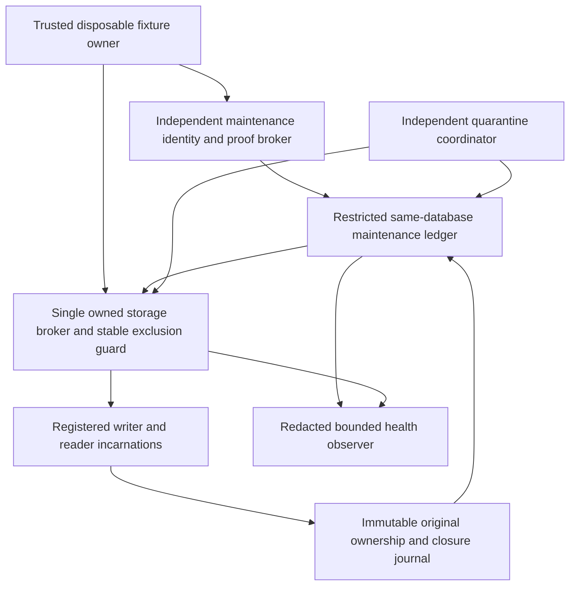
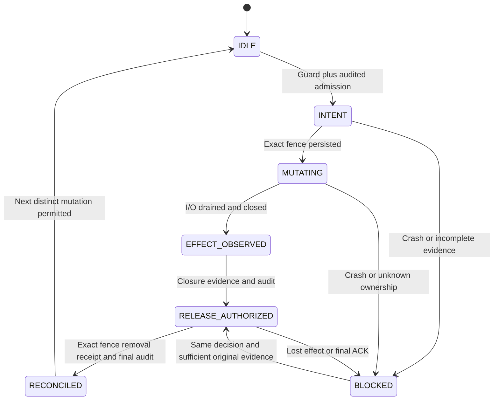
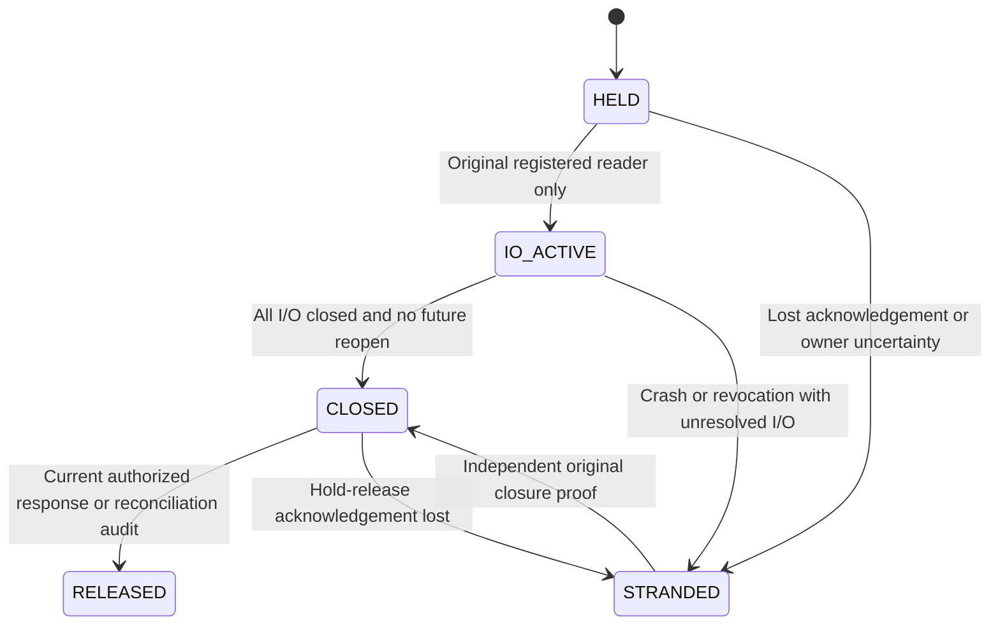
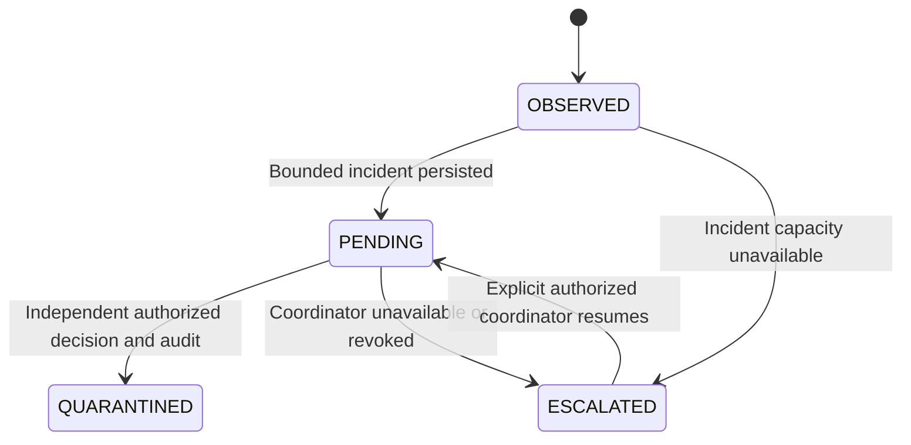

# M8-05 — FAKE_ONLY operational hardening design and security review

Date: 2026-10-21, Asia/Bangkok. **DESIGN_ONLY. Static design review PASS; implementation and operational recovery are not accepted or enabled.** This report specifies a later, separately authorized M8-06. No runtime, test, SQL, dependency, configuration, UI or existing documentation changes are included.

## 1. Executive decision and baseline

The accepted disposable fake subsystem intentionally preserves evidence at the expense of availability. An abandoned mutation sentinel blocks writers; an unreleased reader hold blocks GC; an unavailable quarantine coordinator can leave stale last-known AVAILABLE metadata; UNKNOWN and historical identities retain quota. These are unresolved operational limitations, not permission to unlock, delete or restart work. This review does not reproduce a new exploit or certify a repair through execution.

The proposed solution adds independent, non-launching maintenance authority, ownership instrumentation and audit-complete reconciliation. **Recovery of an uninstrumented legacy root/hold is not generally possible from the current records.** Unsupported or insufficient evidence must produce a durable BLOCKED decision. Successful maintenance can restore access to a safely reconciled storage root without resolving an operation's UNKNOWN outcome or releasing its retained quota.

Entry verification: branch `main`, full HEAD `03acd42c26d9e4020b47cfbefec5ab82e337c312`, upstream `origin/main`, clean index/worktree/nonignored untracked inventory. Accepted M8 commit `518bc953c33a54138c133013835267d0c1319db8` is an ancestor; the feasibility document is committed at HEAD. Cached `origin/main` remains at that M8 acceptance commit. Origin matches the user-specified public repository; no fetch or live remote-state verification occurred. No branch operation or push. Ignored coverage receipts remain untouched except a newly owned static-review receipt directory.

Read [AGENTS](../AGENTS.md), [CLAUDE](../CLAUDE.md), the unchanged [real-media feasibility design](STORYLINE_REAL_MEDIA_TTS_FEASIBILITY_SECURITY_DESIGN.md), [M8 final](STORYLINE_M8_FINAL_ACCEPTANCE.md), [M8-04](STORYLINE_M8_04_FAKE_EXECUTION_SECURITY_ACCEPTANCE.md), [M8-03](STORYLINE_M8_03_FAKE_EXECUTION_FOUNDATION.md), [M8-02](STORYLINE_M8_02_MEDIA_EXECUTION_SECURITY_DESIGN.md), [M8-01](STORYLINE_M8_01_RENDER_PLANNING.md), and [M7](STORYLINE_M7_FINAL_ACCEPTANCE.md)/[M6](STORYLINE_M6_FINAL_ACCEPTANCE.md) acceptance. Actual source and test definitions below take precedence over report summaries. Historical results are not fresh executions.

Permanent boundary: DISPOSABLE_FAKE_ONLY / SYNTHETIC_ONLY / SIMULATED_NOT_MEDIA / MEDIA_VERIFICATION_NOT_PERFORMED / NOT_RENDERED. Human approval NONE; sourceVerified false; original movie audio EXCLUDED; synthesized narration NONE; speech NOT_VERIFIED; synchronization UNSUPPORTED; spending NONE; publication false; codec/frames/duration/streams NOT_MEASURED. No M5–M8 object becomes real media authority. No fake operation launches TTS, FFmpeg or another media tool.

## 2. Exact inspected source inventory

All paths in this section already exist. Symbols are actual declarations or local service functions, not new exports. Test names describe source coverage **NOT RERUN** here.

| Existing module | Actual ownership and relevant behavior |
| --- | --- |
| [contracts.ts](../lib/storyline/render-execution-fake/contracts.ts) | `EXECUTION`, `limits`, `restrictions`, `measurements`, `actions`, `parseEnvelope`, `envelopeHash`, `workHash`; fourteen strict versioned domains, nine actions and fixed fake profile. Canonical work excludes the request key; submission generation remains 1. |
| [auth.ts](../lib/storyline/render-execution-fake/auth.ts) | `createSyntheticExecutionAuthenticationForTest`, `verifyExecutionRequest`, `newSessionFixture`; process-private WeakMap authority, native Request, exact fixture URL/method/origin/Fetch Metadata/cookie/CSRF, session expiry/revocation and exact namespace/four-part scope. Browser claims are not authority. |
| [database.ts](../lib/storyline/render-execution-fake/database.ts) | `assertExecutionDatabase`, `createExecutionGatewayForTest`, `CommitUnknown`; nine restricted action connections, catalog assertions, action/fact MACs, nonce/PID/transaction/body/deadline binding, pre-COMMIT native recheck and unknown-commit classification. |
| [storage.ts](../lib/storyline/render-execution-fake/storage.ts) | `StorageIdentity`, `PrivateBlobPort`, `createOwnedBlobFixture`, `attachOwnedBlobFixture`, `byteHash`, `captureBytes`, `objectVersion`; pinned directories, ownership marker, opaque versions, create-only files, bounded no-follow reads, root-wide `mutate` sentinel, quota scan and exact tombstones. |
| [source.ts](../lib/storyline/render-execution-fake/source.ts) | `createFakeSourceAuthorityForTest`; independent scoped fake binding, full fake byte hash/count, expiry and process-local revocation. No movie possession or approval. |
| [process.ts](../lib/storyline/render-execution-fake/process.ts) | `createFakeProcessOwnerForTest`, `expectedFakeOutput`; WeakMap one-use permit burned before awaits, original journal/start counter, sticky uncertainty and simulated concurrency. No subprocess. |
| [service.ts](../lib/storyline/render-execution-fake/service.ts) | `createFakeExecutionServiceForTest`; local `executeFake`, `inspectPrivate`, `recover`, `quarantine`, `gc`, `readopt`, `recordOriginal`. Recovery advances observation ownership; it has no invoke port. `releaseHold` clears source/quarantine flags, not reader rows. |
| [index.ts](../lib/storyline/render-execution-fake/index.ts) | Server-only explicitly named fake factories; no production composition. Proposed maintenance ports below are absent. |
| [scratch schema](../tests/storyline/render-execution-fake/schema.sql) | `execution_m803` owner, fixture/scope/session/access_grant/proof_key/used_proof/source/work/key_slot/state/fact/audit_event/read_hold/gc_intent/tombstone; `gateway`, `complete`, `current_source`, `capture`, immutable triggers and nine wrappers. No storage-mutation identity or descriptor-closure table exists. |
| [fixture](../tests/storyline/render-execution-fake/fixture.ts), [child](../tests/storyline/render-execution-fake/child.fixture.ts) | `executionFixture` seeds independent M1–M7 lineage, one fake source version, separate quarantine POST identity and new owned DB/blob fixtures. The enumerated child is service-only. Fixture admin/key/storage owners remain trusted. |
| [M6 schema](../tests/storyline/highlights-persistence/schema.sql), [M7 schema](../tests/storyline/timeline-persistence/schema.sql), [M6 gateway](../lib/storyline/highlights-persistence/database.ts), [M7 gateway](../lib/storyline/timeline-persistence/database.ts) | Cooperating source/head/session/grant/policy locks and restricted saved-record authorities. M8-06 must not alter their roles, SQL or currentness semantics. |
| [expiry controls](../tests/storyline/checkpoint-expiry-acceptance-postgres.test.ts), [checkpoint service](../lib/storyline/jobs/fake-checkpoint.ts) | Original M4 confirmation/worker/permit/wire boundary and sixteen controls; see section 15. |

Inspected existing executable coverage: [contracts](../tests/storyline/render-execution-fake/contracts.test.ts), [lifecycle](../tests/storyline/render-execution-fake/lifecycle.test.ts), [security](../tests/storyline/render-execution-fake/security.test.ts), [recovery](../tests/storyline/render-execution-fake/recovery.test.ts), [restart](../tests/storyline/render-execution-fake/restart.test.ts), [storage/process](../tests/storyline/render-execution-fake/storage-process.test.ts), [independent security](../tests/storyline/render-execution-fake/independent-security.test.ts), [independent storage](../tests/storyline/render-execution-fake/independent-storage.test.ts), and the [production audit](../tests/storyline/render-execution-fake/production-audit.mjs). M6/M7 [catalog](../tests/storyline/timeline-persistence/catalog.test.ts), [fencing](../tests/storyline/timeline-persistence/fencing.test.ts) and [security](../tests/storyline/highlights-persistence/security.test.ts) definitions inform the proposed contention tests. No test module was imported or executed.

## 3. Current versus proposed behavior

| Concern | Current source | Proposed M8-06; not implemented |
| --- | --- | --- |
| Mutation ownership | `OWNED_M803.json` binds root/namespace/nonce/ownerPid. `MUTATION_LOCK` is opened exclusive and empty; no durable per-mutation ID/generation/target. `finally` closes/unlinks/syncs; crash can strand it. | Independently registered storage-owner incarnation, stable exclusion guard, durable root gate and immutable per-mutation intent/observations. Legacy empty sentinel is insufficient for automatic recovery. |
| Serialization | Every cooperating `register/create/remove` enters the same root fence; contention rejects STORAGE_BUSY. Reads do not take it. | Preserve root-wide serialization across all attachments and maintenance. No TTL reaper or unlocked quota scan; conditional release applies only to a proved stopped original mutation. |
| Read lifetime | SQL row identifies scope/operation/hold/session, not exact version or reader incarnation/descriptor. `smallRead` closes in finally before returning copied bytes. `readFinish` or `readRelease` deletes the row; failed release can be swallowed. | Exact artifact/version and one-use read-instance ownership; durable I/O closure and no-future-open receipts; separate, auditable hold reconciliation. Session revocation does not establish closure. |
| Quarantine | Failed `inspectPrivate` uses required independent `quarantineRequest`. Error is suppressed if coordinator unavailable; no bytes return, metadata may remain AVAILABLE. | Bounded incident journal, independent coordinator health/escalation, idempotent decisions; no reader privilege borrowing. No blanket automated AVAILABLE repair. |
| Quota | Conservatively monotonic ledger reservations and key/work/version identities; retained UNKNOWN; root blob scan separately limits ordinary bytes. | Observability and bounded reconciliation, not capacity recycling. Preserve ledger charges even after physical GC in M8-06. |
| Recovery | Existing `recover` increments owner generation; may observe original result via separate observe authority. It cannot reconstruct the original flow. Repeated calls are not an idempotent maintenance decision protocol. | New exact decision ID/body hash, generation/revision CAS, purpose-specific roles and durable closure/release results. Existing actions and fourteen envelopes remain unchanged. |

Freeze existing seven planning domains and fourteen execution domains byte-for-byte. Add sibling maintenance contracts only after their own design freeze; never extend a v1 parser to accept maintenance/executable variants. Proposed domain family: `story-recap-fake-maintenance-{decision,proof,writer-receipt,reader-receipt,incident,health,audit}-v1`. These names and all following ports are proposals, not current exports or credentials.

## 4. Trust and ownership boundaries

Fixture owner provisions a fresh owned root and process registry, not a caller path. Storage broker alone hands out internal descriptors/mutation tickets; request callers never get root, nonce, file paths, proof keys or raw descriptor-transfer authority. Trusted supervisor owns registered service-only process identities and closure observations. DB owns scoped decisions/revisions/holds; it cannot prove filesystem quiescence by itself. Quarantine coordinator owns that separate mutation grant, not the reader identity. Health observation cannot read blobs, inspect private lineage, release holds or launch work.

Threat actors include wrong-tenant clients, stale/competing operators, delayed callbacks, revoked identities, malformed proofs, accidental coordinator failures and crash-injected storage corruption. The fixture's privileged/same-UID administrator and trusted authority/key compromise remain outside enforced tamper resistance. An administrator can alter a lock/guard/marker or forge evidence; hashing is not a defense against that actor. No public endpoint or production authentication is proposed for M8-06.

Root serialization spans multiple scopes. A tenant-scoped operator cannot release a shared root gate on behalf of another tenant. Root recovery requires an explicit fixture-root maintenance grant **and** the exact affected scope grant(s); scope sets are immutable, explicit and sorted, never wildcard. Root-wide uncertainty or an unknown affected set requires fixture-owner-wide ownership review and a BLOCKED decision until known. Cross-scope inventory/content is not returned to a tenant operator. Root authority confers no source inspection, artifact delivery, quarantine or execution grant. If effect classification needs source bytes or source-bearing recipe metadata, the inspecting actor must separately hold the existing inspect capability; a root-only reconciler can use ownership/closure summaries and leave content classification unresolved. It cannot ask a more privileged broker to bypass this restriction on its behalf.

## 5. Mutation-fence recovery protocol

### Ownership and evidence freeze

Propose `FakeStorageSupervisor`, `MutationReceipt`, `RootGate` and `ReconcileMutation` as new FAKE_ONLY ports/records. Bind namespace/root registry ID and root incarnation, exact scope, original mutation ID/kind/target version, expected owner marker hash, root device/inode identity, immutable guard identity, fence identity, storage-owner incarnation, recovery generation/revision, original operation/stage/intent references and evidence hashes. Original process identity includes supervisor boot/incarnation and non-reused child identity; ownerPid is diagnostic only. Empty/partial/corrupt fence contents are not self-authenticating.

**Mandatory implementation prerequisite:** all attachments, writers, GC and maintenance must cooperate with one stable, non-replaced kernel-backed exclusion guard. A reviewed single-host advisory-lock primitive on a pinned, never-unlinked guard inode is a candidate, not an available/certified API here. No guard probing, dependency installation or child invocation occurred. The later fixture must prove its exact semantics and supported host before recovery code is enabled; unsupported hosts remain BLOCKED. Never replace the guard file to acquire a second lock on another inode. No descriptor transfer, inheritance or surviving child writer is allowed. Existing uninstrumented attachments do not satisfy this prerequisite.

Acquiring that guard prevents overlap only under the reviewed cooperative broker contract; it does not alone prove a safe interrupted mutation, DB outcome or full ownership closure. The broker must prove all old registered mutation tasks/queued continuations are drained or irrevocably fenced, all relevant descriptors closed and no unregistered writer exists. Live cooperative owner can attest closure through the trusted supervisor. Crash closure requires supervisor-observed termination/reaping of the exact registered process set, non-transferred descriptors and independently acquired guard. PID absence, a dead DB connection, a lost heartbeat or a canceled Promise is insufficient. Unknown children/attachment registry/boot identity leave the root blocked.

### Normal mutation and recovery sequence

1. Acquire stable guard nonblockingly before storage mutation; contention returns bounded BUSY. Authenticate and commit an exact mutation intent/root-gate revision plus immutable audit in a short SQL transaction. No file I/O while SQL locks are held. Every cooperating attachment checks this gate before proceeding.
2. Under the guard, create the exclusive sentinel and persist bounded identity/intent plus root-directory sync. Torn/headerless state remains owned by the root's pending intent, not reusable free space. Persist a start observation before the effect; no arbitrary callback may retain write authority outside this guarded scope.
3. Perform only the authorized register/create/exact delete against pinned versions; await every write/sync/close. Preserve original observations of partial or uncertain effects. No replay of a possibly completed create/delete just to complete a receipt.
4. Commit RELEASE_AUTHORIZED with closure/effect evidence and audit before removing the sentinel. This authorizes only conditional removal of that exact fence under the same guard, not deletion/adoption of any blob. Record exact removal/root sync in the ownership journal, then commit RECONCILED/audit before the next mutation is admitted. Journal completion and SQL are explicitly split, not atomic.
5. On crash or ACK loss, ordinary mutations remain denied by sentinel **or** durable root gate. A fresh independent operator reserves the original maintenance decision; stale generation/revision conflicts. Acquire the same guard, establish original-owner quiescence, inspect only that mutation/version/journal and classify the effect without replay. A root recovery decision cannot declare a fake process result or make output AVAILABLE.
6. Validate the exact fence identity immediately before unlink under exclusive guard and current root generation. If it changed, evidence disagrees, authorization expired, audit failed or identity cannot be proved, do not unlink. A short release-decision transaction rechecks permission/epochs/CAS; storage broker checks the authorized decision/root generation before effect. Revocation before effect denies it. After an irreversible effect, retain original evidence and require fresh authority to finish accounting.
7. Reconcile lost release ACK using the same decision ID, original sentinel identity, release journal and root-gate revision. Mere absence is not proof of authorized removal. Crash after unlink/before final SQL keeps root gate blocked; a same-decision observer can complete only the journal-backed outcome. No replacement key, generation or sentinel-path reuse to evade uncertainty. No rollback assertion after an external effect.

BLOCKED may be permanent. Recovering a fence never rewrites a partial `.blob`, creates a missing original result, forgives a corrupt tombstone or reclaims UNKNOWN quota. Preserve/quarantine affected bytes through independently authorized paths. If normal unlock/final audit fails, surface an explicit uncertain outcome; do not return a clean success or start another mutation. Legacy roots remain denied unless complete attachment/descriptor ownership can independently be established; otherwise preserve them and, with separately authorized provisioning, use a new isolated fixture without adopting or erasing the old evidence.

## 6. Reader-hold reconciliation

Existing `read_hold` has only session/operation identity; a current artifact reference can be inferred from immutable facts, but original reader incarnation/descriptor closure cannot. `readFinish` removes the row at the response fence; `readRelease` is best effort in finally. `releaseHold` does not bypass reader rows. `smallRead` closes its own file in finally, yet there is no durable receipt proving that close after a caller/process crash. The current source check also performs byte I/O; all reads for the reconciled reader instance must drain, not just the output descriptor.

Propose `ReaderInstance`, `ReaderClosedReceipt` and a separate `readerHold.reconcile` action. Bind exact namespace/scope/operation/artifact hash/version/hash/count, hold ID, owning principal/session, broker/reader incarnation, nonserializable read-ticket identity, hold revision, open/close observations and supervisor closure evidence. A persisted ticket ID cannot reopen a descriptor. Register the durable hold before any I/O; broker burns the one-use open capability and tracks every associated outstanding operation. Storage ports must reject unregistered output-reader access.

Normal path: complete bounded byte/hash check → close all descriptors and await continuations → retain closure receipt → final current authorization/source/availability fence → atomically release hold and append immutable release decision/audit → return complete copied bytes. A failed final fence returns no bytes. Permission loss may strand metadata even after actual close; independent reconciliation may release only that proved-closed hold, without impersonating the revoked reader. An already committed successful response fence is a linearization point; later revocation cannot recall copied bytes.

Recovery operator acquires a hold-specific decision/CAS under an independently scoped permission, asks the trusted reader supervisor for closure, and atomically records release/tombstone of the hold with immutable evidence/audit. The read owner and operator race on the same hold revision; exactly one release observation wins, repeated same decision returns its original result. Keep append-only release history even if the active hold row is deleted. A pre-release crash leaves the row; a post-commit lost ACK is reconciled from the exact release record, not an empty SELECT. New readers use fresh IDs and independent current admission.

GC and read admission serialize on the operation availability revision before hold rows. A live/unknown reader blocks delete intent; DELETE_PENDING denies new readers. Revocation, expiry and quarantine stop later delivery but do not close descriptors. Closure permits removing only the reader hold: retention, source/quarantine/recovery holds and original outcome/quiescence remain independent GC gates. A legacy hold with no reconstructable closure proof stays retained. Session disappearance, lack of a reader callback, process lease expiry or a single missing PID never releases it.

## 7. Quarantine coordination

M8-04's separate `quarantineRequest` callback is mandatory and is checked afresh; a read-only GET cannot become a quarantine POST. Existing maintenance service paths that load source-bearing state require their action **plus inspect** at native and SQL layers. Preserve those checks. A recovery-only/GC-only identity gets no implicit inspection or quarantine authority.

Propose an independent `QuarantineCoordinator` with explicit inspect/quarantine scope and no execute/finalize/GC/read-delivery grant. Its capability to inspect is independent and revocable; never pass a reader's credentials or embed coordinator credentials in an incident. A separate `incident.report` grant permits only a bounded immutable observation; it cannot change availability or expose lineage. Reader failures remain denied even if reporting fails.

Incident identity binds scope, exact operation/artifact/version, observed availability revision, bounded failure code, reporter incarnation and existing evidence digest. Coordinator independently reloads authorized metadata and independently verifies relevant exact bytes under an observation hold; a report is an untrusted hint, not proof authorizing deletion. Missing/corrupt original evidence can justify quarantine, not a fabricated replacement verification. No source capture or byte delivery is implied by incident reporting. Unknown or foreign IDs reject without existence disclosure.

Coordinator health is READY/UNAVAILABLE/REVOKED/UNKNOWN, separately reported from artifact availability; a heartbeat or READY status grants no permission. Each mutation checks native/SQL identity, exact scope/body/action, expected revision and live expiry. One bounded attempt per observation; no infinite foreground retries, identity fallback or new worker startup. Preserve a pending incident for explicit operator escalation. If even reserved reporting space is exhausted, deny reads/mutations as applicable and expose only a redacted failure/capacity status through an independently authorized observer; do not erase an older incident.

AVAILABLE remains last committed availability until an authorized transition. Health/API DTOs must distinguish unresolved integrity incident from verified current delivery; every actual read still fully checks bytes and final availability. A process-local deny cache may fail closed but is not durable quarantine. Duplicate reports converge on a fixed incident key; concurrent quarantine decisions use exact decision/body IDs and availability CAS, one transition/audit outcome. Lost ACK looks up that decision and original audit; NOT_FOUND is inconclusive. Revocation before commit denies the transition; deferred audit failure rolls back metadata but retains independently recorded observations for later authorized handling.

No M8-06 automatic unquarantine is proposed. Re-adoption of uncommitted output keeps the existing validation/currentness rules and permissions; a committed corrupt artifact cannot be repaired by replacing its bytes or overwriting verification. DELETE_PENDING/DELETED is never reset by a delayed report. GC-only and recovery-only identities cannot act as substitute coordinators.

## 8. UNKNOWN quota and bounded health model

Current accounting is deliberately conservative and split:

| Resource | Actual constraint / retention |
| --- | --- |
| SQL operation reservation | `fixture.operations` max 16; each new work charges 2,097,152 reserved bytes against 29,360,128 ordinary bytes. Therefore byte reservation normally binds at fourteen works even though the independent operation cap is sixteen. |
| Registered versions | Ledger max 32; fixture starts with one source version. Storage counts `.owner` registrations independently, max 32, retained after delete. Work/key/fact/audit/intent/tombstone identities are never recycled. |
| Physical payloads | Storage scans complete bounded `.blob` files under mutation fence; create checks ≤28 MiB ordinary payload. Each source/output ≤1 MiB. Deleted blob bytes may disappear, but owner/tombstone files and SQL charges remain. |
| Headroom | `limits.total` 32 MiB minus 4 MiB reserve. The current scan bounds ordinary blob payload, not a demonstrated total root/filesystem/SQL/log disk quota. Four MiB headroom is not an implemented arbitrary recovery-write API. |
| Claims and metadata | Same work/different key aliases original; alias insert global count cap 128. Ordinary proofs cap 14,000 versus 20,000 for recover/quarantine/GC; read holds global count cap 32. These are schema counters, not OS resource enforcement. |
| UNKNOWN | One unresolved original work per scope, fixed submission generation 1, active slot and original identities/evidence retained. Result/quiescence must be original and complete before resolving it. GC never frees this evidence. |

Current SQL does not decrement operations/bytes_reserved/versions on GC. M8-06 must retain that policy; new capacity recycling would need a separately reviewed protocol. Deleted bytes do not grant a new work identity, version or budget refund. Root-fence recovery and reader-hold cleanup do not clear `fixture.active` or resolve UNKNOWN. Only the existing independently authenticated original definitive result path can change original outcome; complete QUIESCENT evidence remains mandatory.

Propose a bounded `FakeFixtureHealthSnapshot`: scoped counts of reserved/ordinary allocated/unknown/quarantined/held/deleted versions; operation/version/proof/hold headroom; oldest unresolved age for visibility only; root/coordinator state; observation consistency/revision/time. No paths, raw source/recipe/text/bytes, principals, tokens, keys or cross-tenant IDs. Fixture-root aggregates need root-observe authority; tenant summaries include only authorized scope. UNKNOWN/stale/incomplete accounting is explicit, never zero. An independent storage observation uses owned registration and bounded enumeration; a busy/corrupt root yields UNKNOWN, not an unsafe unfenced capacity estimate.

Proposed alerts: WARN at ≥75% of any finite ordinary budget, CRITICAL at ≥90%, ADMISSION_STOP on exhaustion, uncertain accounting, unavailable mandatory audit capacity or unsafe owner state. Evaluate independent limits separately (including the fourteen-work reservation ceiling), not just physical bytes. Age may trigger operator attention but never deletion/unlock. Responses: stop admission, preserve original decisions/evidence, inspect redacted health, restore a separately authorized coordinator, collect original definitive facts if available, or explicitly provision a new independent disposable fixture. No automatic retries, forced eviction, charge release or migration/adoption of unresolved operations. If capacity cannot safely be recovered, report NO_ADMISSIBLE_RECOVERY honestly.

M8-06 must account for actual new receipt/incident/audit bytes and metadata overhead within a reviewed total fixture budget before admission. Pre-reserve bounded recovery records before ordinary mutation; reject when completion/audit capacity cannot be assured. Proposed decision/report body cap 8 KiB and fixed per-root/operation record bounds require schema freeze and saturation tests. No ring-buffer overwrites, silent truncation or external logging of secrets. Full recovery/audit storage can itself block progress; this is a supported failure, not a reason to consume retained evidence.

## 9. Recovery authorization and proposed contracts

| Actor / proposed capability | Permitted evidence and action | Explicitly denied |
| --- | --- | --- |
| Root maintenance observer | `root.observe`, exact owned root registry, redacted root health | Content/lineage read, fence release, execution |
| Mutation recovery operator | `root.reconcile` plus affected exact-scope maintenance grants and original mutation decision | Source inspect, byte delivery, quarantine, GC, launch |
| Reader-hold reconciler | `readerHold.reconcile`, exact hold/version/reader closure summary | Impersonating reader, reopening ticket, releasing other holds or quarantining |
| Incident reporter | `incident.report`, exact bounded failure observation | Availability mutation, source capture, arbitrary metadata enumeration |
| Quarantine coordinator | Separate existing inspect and quarantine plus scoped incident observation | Read delivery, execute, finalize, GC; borrowed credentials |
| Existing recover / GC identities | Existing operations and explicit inspect when full source-bearing inspection is needed | New recovery capabilities automatically, quarantine or launch |
| Closure supervisor/storage broker | Independently registered owner incarnation and purpose-specific receipt authority | Self-approved human permission, forged original result or publishing |

New maintenance actions need separate restricted connections/wrappers and proof keys; do not add broad grants to the nine existing gateways. A minimal new closure-summary view avoids source-bearing `inspect`; this is a new explicitly granted action, not a bypass in the old action. NOLOGIN/non-elevated schema owner; application logins lack direct private table/column SELECT/DML, CREATE/TEMP, helper EXECUTE, owner/elevated role membership and unsafe search-path changes. Any schema additions are scratch-only, separately authorized in M8-06; none are supplied here. Existing M6/M7 owners/grants remain unchanged.

Freeze `MaintenanceDecision` with fake discriminator/domain, namespace/root incarnation, exact four-part scope or explicitly authorized affected-scope set, target kind/immutable ID/version, original evidence hash list, reason, decision ID/body hash, expected resource generation/revision, supervisor incarnation and proposed outcome. Immutable decision/outcome/audit and unique decision identity prevent changed-body reuse. A takeover creates only a new observer generation CAS, never a new original mutation, stage, submission, key, send or fake invocation capability. Same ID/body returns original decision/outcome; changed body conflicts. Retrying a denied/unknown decision needs fresh authentication/proof but retains its original identity and evidence.

Proposed proof projection binds new proof domain, action, canonical decision/body SHA-256, namespace/scope/target/root, actor/session/grant epoch, one-use nonce, backend PID/transaction ID, exact method/origin/Fetch Metadata/CSRF digest and bounded database-clock deadline. Purpose-separated receipt MACs bind original ownership and closure facts; a reader or generic recovery key cannot sign a writer receipt. No secret appears in envelopes, filenames, logs or health. Reject unknown keys, invalid Unicode/non-integers, oversized captures, NULL/missing/extra fields, scope/domain swaps and every fake-to-real promotion. Canonical serialization uses existing safe principles under new domains, never changes old hashes.

Any later request boundary remains a fixture-local native Request seam, not an API/Server Action: exact server-owned URL/method, single authenticated cookie, same Origin and Fetch Metadata, mutation CSRF, expiry/revocation and exact scoped grant. Session/current grant agreement is independently enforced in SQL. Explicit `(permission test) IS NOT TRUE` rejects NULL arrays/elements and absent rights. One-use proofs are checked after waits using current DB time, not transaction-start time. Fresh checks before commit and deferred decision/audit/deadline completeness close later transaction gaps. No operator can release a fence merely by presenting a correctly signed invented closure receipt; only registered independent supervisor evidence is admissible under the declared trusted boundary.

Filesystem mutation and DB revocation cannot be made one atomic transaction. Define an audited effect-authorization linearization point; broker rechecks current decision/generation immediately before effect, with revocation serialized through the broker's admission gate. Revocation before that point denies effect. Revocation after an irreversible exact release cannot retroactively undo it; retain evidence, stop further actions and require renewed authority for final reconciliation. Claim no instantaneous cross-system revocation guarantee.

## 10. Lock order and concurrency analysis

Actual scratch code, not only historical prose: proof key → M7 scope/session/grant → M6 scope/session/grant/policy/current_dependency/head → M7 policy/head → execution scope/session/grant. `capture` then locks source SHARE and returns before fixture/state locks. Other gateway paths lock fixture UPDATE, then source SHARE and work state UPDATE; service admission/finalization call `fresh`/capture first on the same transaction, retaining the source lock. Read/GC changes follow the state row. This branch distinction matters when adding writers; do not infer one universal source/quota order from report shorthand.

M6 writers never acquire new M7/execution rows; M7 writers follow M7→M6→M7 and never acquire execution rows. Preserve their source/currentness fences through COMMIT. New maintenance is not a reason to require current source eligibility for retaining old evidence or releasing a proved-closed I/O hold. It must not grant fresh artifact eligibility; admission/finalization/readoption/delivery keep their complete existing replay/currentness requirements.

Before SQL implementation, freeze a full writer/action lock graph. Proposed M8-06 operational transactions: purpose-key/auth rows in their fixed order → existing M7/M6/execution prefix only for actions that legitimately need that lineage → fixture accounting row → target operation states in sorted scope/ID order → new root gate → exact mutation/hold/incident/decision rows in stable order → audit. New root-only actions never later acquire lineage/state rows after their root gate. Source-bearing actions acquire their source SHARE before fixture when replay is required; existing standalone maintenance retains its branch without any later source UPDATE/lock upgrade. Source disable/revocation remains a separate cooperating writer. If implementation requires changing these assumptions, re-review the graph rather than weaken fences.

The OS guard may span multiple **short, committed** SQL transactions and external I/O, but SQL locks never span I/O or waiting for the OS guard/supervisor. Normal mutation acquires guard first, then intent transaction; GC first commits intent without guard, later acquires guard and rechecks its exact intent/CAS in a new transaction before deleting. A transaction holding root/state locks must never wait for a guard held by another actor awaiting SQL. All byte/hash/closure observations happen outside SQL locks; final transactions bind their immutable versions/evidence. Metadata-only reconciliation may retry with original decision/CAS after a proved rollback; uncertain external effects never retry speculatively.

Root serialization, per-operation CAS and hold checks are separate fences. Two operators cannot gain authority by racing stale generations. A source/head writer may legitimately make history stale after a valid commit; preserve the original facts and deny later eligibility. Independent PostgreSQL backends with actual blocking observations and service-only process barriers must prove this lock graph; design inspection is not that proof. Unsupported graph/identity/exclusion means M8-06 BLOCKED before installing new scratch schema.

## 11. Crash and lost-ACK decisions

| Cut | Permitted recovery | Forbidden inference / evidence retained |
| --- | --- | --- |
| Intent commit ACK lost, no sentinel yet | Same decision lookup plus root gate and original ownership journal | NOT_FOUND is not rollback; no new mutation ID to bypass pending work. |
| Sentinel create/header/sync interrupted | Guard and supervisor quiescence, exact pending intent and fence identity; otherwise BLOCKED | Empty header or old timestamp is not permission to unlink. |
| During register/create/delete | Inspect exact original version under exclusive broker ownership; record partial/uncertain effect | Do not recreate, overwrite or delete corrupt bytes to produce expected evidence. |
| After closure before RELEASE_AUTHORIZED audit | Original closure receipt may support a fresh same-decision authorization transaction | Audit failure leaves fence/gate intact. No unaudited unlock. |
| After release decision, before or during unlink | Recheck current authority/guard/generation and original exact fence | No path-based or substituted-inode unlock. Expired authority cannot resume effect. |
| After unlink/root sync, before final DB ACK | Same decision, exact removal journal and original release record; retain gate until reconciled | Absence alone does not prove authorized release or a complete transaction. |
| Reader dies before/after open or close | Prove full registered reader quiescence; retain hold until closure/audit commit | Session expiry/revocation and missing callbacks do not close descriptors. |
| Reader release commit ACK lost | Exact immutable release record/hold identity and outcome query | Empty hold table alone is insufficient; never release an unrelated new hold. |
| Coordinator lost/revoked/audit fails | Deny byte response, retain bounded incident, explicit authorized escalation | No identity fallback, unauthorized quarantine audit or AVAILABLE repair claim. |
| Delete tombstone survives with corrupt blob | Preserve exact tombstone and surviving bytes; deny DELETE_MISMATCH | Matching tombstone does not authorize removal of changed bytes. |
| UNKNOWN and quota full | Preserve work/key/submission/stage/source/results/holds; report capacity stop | No lease-driven release, replacement key, new launch or forced deletion. |
| DB restore, supervisor boot loss or root registry disagreement | Block relevant operations until independently reconciled | Service restart is not power-loss/backup/multi-host correctness evidence. |

No recovery branch obtains `arm`/`invoke`, sends a provider request or clears the process simulator's original-start history. Storage maintenance must remain safe even when original process start count is zero and its outcome still UNKNOWN.

## 12. Evidence sufficiency matrix

| Claim | Required combined evidence | Insufficient alone |
| --- | --- | --- |
| Original writer cannot resume | Complete registered owner set; exact supervisor/boot identity; closure/drained continuations; stable guard acquisition; no transferred/inherited descriptors; old generation denied | PID disappearance, heartbeat/lease age, root ownerPid, lock contents, process stdout or DB connection loss |
| Exact sentinel may be released | Above plus immutable mutation intent, exact root/fence identity, current independent grant/CAS, release audit and conditional removal journal | Generic operator role, matching filename, missing sentinel, a newer owner generation |
| Reader hold may be released | Exact hold/version/reader identity, all related I/O closed and future open authority burned, supervisor evidence, current reconciler grant and atomic release/audit | Expired/revoked reader, closed output FD while source read/callback remains active, Promise cancellation |
| Original UNKNOWN may resolve | Existing original definitive result journal, complete generation/submission/body binding and QUIESCENT fact via authorized observer | Correct output bytes, successful storage cleanup, complete closure of a storage writer, a signed invented result |
| Artifact may be quarantined | Current independent inspect/quarantine authority, exact target/availability CAS, independently evaluated incident and complete audit | Reader error, unsigned report, coordinator heartbeat, foreign hash |
| Exact bytes may be GC'd | Definitive outcome/quiescence, quarantine/retention gates, all relevant holds resolved, committed exact-version intent, owner/hash/count and storage tombstone reconciliation | Free space pressure, elapsed retention alone, SQL tombstone with substituted/missing unproved storage evidence |
| Capacity is available | Consistent ledger reservations plus independently bounded actual allocation/metadata observations and reserved audit margin | Blob absence, deleted physical bytes, old health snapshot or arithmetic based only on claimed metadata |

Operator decisions must state evidence gaps and BLOCKED reasons. No manual “force” boolean converts insufficient evidence into sufficient evidence. Repeated retries do not increase confidence.

## 13. Future adversarial acceptance plan

All tests below are **specifications, NOT RUN**. Use newly owned disposable PostgreSQL and newly marked non-media blob roots; application DATABASE_URL explicitly unreachable. Future service-only children must be enumerated and separately authorized; no general command runner, media parser or provider imports. Run timing-sensitive server tests serially. Snapshot original M4/M6/M7 records and all existing domains/assertions before/after.

Fixture conventions: W = registered storage writer; R = registered reader; O1/O2 = independent exact-scope/root reconciliation operators; Q = independently granted inspect/quarantine coordinator; G = independently granted GC actor; H = redacted health observer. Grant only the permissions stated in section 9. `S` is the original canonical work's start count immediately before the injected event (0 or 1); **every maintenance/recovery/inspection/GC step must keep S unchanged**, including replacement service owners. Only the explicitly tested original live flow may move 0→1. For crash tests retain parent-observed starts plus child identity, not merely a restarted in-memory counter.

Each row specifies prerequisites/actors, exact interleaving, outcome, persistent evidence and recovery. Use independent processes for ownership closure and separate SQL backends for contention; mocked state alone is insufficient.

| ID | Fixture, actors and exact interleaving | Expected transition/denial, persistent evidence and recovery; start counter |
| --- | --- | --- |
| A01 Live writer vs recovery | Instrumented root; W holds guard/sentinel after first byte, before sync/close. O1 has root+scope reconcile only. Pause W and attempt takeover; then explicitly drain W. | While live: BUSY/BLOCKED, no unlink or decision success. After real closure: same original decision may reconcile. Preserve writer identity, inode, intent, closure and audit. S unchanged; failed recovery cannot interrupt or impersonate W. |
| A02 Competing operators | W definitively closed, root pending. O1/O2 use distinct decision IDs and same expected root revision on separate backends, released together at decision CAS. | One generation/CAS wins; loser conflicts without effect. Same-decision repeats return identical result, no double unlink/audit. Keep both attempt/denial evidence and winning receipt. Lost response reconciles original winner. S unchanged. |
| A03 Stale callback after takeover | W's queued callback retains old generation/ticket; O1 reconciles after proven drain and advances root generation. Inject old callback at broker entry and use correctly signed stale SQL proof. | Deny before any file open/write; SQL rejects obsolete revision. Preserve original completion and new generation; no bytes changed. If callback can still write outside guard, test fails and recovery stays disabled. S unchanged. |
| A04 SIGKILL mid-mutation | Fresh registered service-only writer; pause register header/create payload/delete tombstone at separate parameterized cuts while guard held. Supervisor observes exact child SIGKILL/exit and descriptor ownership. | Pending root blocks new mutation. Independently prove quiescence, record exact partial state; no replay/overwrite. Recovery either audit-completes exact safe release or stays BLOCKED. Retain journal/partial bytes/fence/tombstone. Parent-observed S unchanged across child restart. |
| A05 Recovery ACK cuts | Closed W; O1 pauses before release audit, after audit/before unlink, after unlink/sync and after final commit. Lose each ACK and restart only observer. | No unaudited release; root gate blocks after uncertain split. Same decision reconciles exact journal and SQL outcome. No second mutation key, removed-evidence fabrication or automatic create. Immutable decision/audit persists; S unchanged. |
| A06 Legacy/foreign fence | Empty legacy sentinel with no owner registry, or substituted root/fence/guard inode. O1 otherwise valid; independently test unreadable/partial ownership journal. | BLOCKED, no unlink/new guard/adoption. Preserve original root/fence and uncertainty; only independently complete fixture-owner closure could permit later review. PID/age/lease manipulations never change result. S unchanged. |
| A07 Old cleanup and guard ABA | Pause W before its original finally/close; O1 attempts release and a second W attempts a new fence. Also replace guard/fence inode through trusted fault injection between observation and effect. | No takeover while old cleanup may run; changed inode denies release, and no second guard can serialize against the original. Preserve sentinel/journal/identity conflict. After legitimate W completes, reconcile its exact observation without deleting a later fence. S unchanged. |
| B01 Live reader vs GC | Committed artifact; R holds registered descriptor at bounded read barrier. Q quarantines; separate authorized hold flags released; G attempts gcBegin while R row remains. | GC_HELD; no intent/unlink. Release reader barrier, close descriptor and fail final delivery because quarantine preceded fence. Only exact reader-release/audit permits subsequent independently eligible GC. Keep original artifact and hold history; S=1 unchanged. |
| B02 Revoked reader open | R descriptor remains open; revoke native then SQL session in separate variants before afterRead/final fence. O1 tries reader reconciliation, G tries deletion. | No response bytes; live descriptor keeps hold and blocks GC despite revocation/expiry. Later supervisor-confirmed close allows only reader-hold release with new operator authority. Preserve revoked session evidence, closure and audit. S=1 unchanged. |
| B03 Reader crash cuts | R crashes after readBegin/before open, during read, after close/before hold-release and after release COMMIT/before ACK. Separate child exits observed; no descriptor transfers allowed. | First three retain hold until independent closure proof; last resolves same release record. If supervisor identity missing, remain stranded. No empty-SELECT proof. Exact version/release tombstone and artifact facts persist; S unchanged. |
| B04 Owner/operator release race | R finishes normally while O1 reconciles same hold; pause each before CAS on two backends. Start a different fresh read ID concurrently. | One release observation, idempotent same decision; fresh hold cannot be removed by old receipt. GC/new read follows availability serialization. Audit and closed-instance record persist; S unchanged. |
| B05 Descriptor escape/closure lie | Attempt inherited/duplicated descriptor, queued source read, fabricated close receipt or cross-version ticket. O1 has reconcile but no read/inspect. | Registration/receipt validation denies; otherwise host/protocol unsupported, hold BLOCKED. No result bytes or GC. Retain evidence gap; do not call a canceled Promise closure. S unchanged. |
| C01 Coordinator unavailable | Read-only R discovers corrupt bytes; Q callback throws/times out, then reserved incident space is exhausted in separate run. H observes status. | No bytes, no borrowed quarantine audit. Last-known AVAILABLE explicitly unresolved; bounded pending/escalated incident or capacity-stop status retained. Later independently authorized Q may quarantine, never repair bytes. S=1 unchanged. |
| C02 Revoked/cross-scope coordinator | Q revoked in native/SQL independently or targets foreign tenant/root/artifact. Pause after incident capture before commit. Recovery-only and GC-only actors attempt substitute action. | Deny transition and content/existence disclosure; preserve exact report and immutable facts, no unauthorized audit. Fresh properly scoped Q can act on original incident. S unchanged. |
| C03 Duplicate/concurrent reports | Same corrupt version: two Rs report duplicate IDs/body, then changed body/scope; two Qs race exact availability revision; lose quarantine ACK. | Dedupe same report, reject changed-body reuse, CAS one quarantine, same decision lookup no double effect. DELETE_PENDING/DELETED never regresses. Retain incidents/winning audit, byte corruption evidence. S unchanged. |
| D01 UNKNOWN capacity exhaustion | Original work fault CHECKPOINT_ACK_LOST/AFTER_START variants, S=0/1. Fill other allowed scope reservations/versions/proofs to each independent cap; H reads health, O1 attempts recovery/GC/new key. | Stop admission, retain UNKNOWN/key/work/source/stage/active/quota. Health shows real exhausted/unknown values; no eviction/refund/second start. Definitive original evidence may resolve only that original work; otherwise NO_ADMISSIBLE_RECOVERY. S unchanged. |
| D02 Reservation vs physical accounting | Seed source version, reserve successive distinct eligible work; independently create bounded payloads to 28-MiB edge and then GC an eligible resolved version. Concurrent W/O1 allocators challenge scan. | Ledger byte cap can bind at fourteen works; physical cap/32 registrations remain enforced. GC frees payload only, not ledger history/charges. Maintain ≥4-MiB policy margin and reject unaccounted receipt growth; retain quota/audit. S unchanged during maintenance. |
| D03 Health privilege/capacity | H has only observe; issue scoped snapshots during busy mutation, corrupt root and exhausted report/audit budget. Try lineage/blob access and cross-tenant aggregate queries. | Return bounded redacted UNKNOWN/stop status or explicit denial; no paths/secrets/content. No overwritten old reports or leaked other-tenant counts. Preserve evidence/counters; subsequent recovery needs independent permission. S unchanged. |
| E01 Incomplete original result | UNKNOWN with valid-looking planted fake bytes. Feed missing/null/extra QUIESCENT, wrong submission/generation, forged journal and wrong body/domain with otherwise valid observer MACs, bypass TS parser. | Deny resolution/finalization/GC. Original UNKNOWN/claims/result absence persist; no manufactured failure to clear active/quota. Authorized recovery cannot repair evidence by rehashing. S=0/1 unchanged. |
| E02 Restricted SQL/proof bypass | New purpose-specific and all nine old logins, independent backends. Try table/column DML/SELECT, helper/owner/TEMP/search-path/elevated role access, wrong nonce/action/body/PID/transaction/domain/root/scope. | Catalog/assertion or SQL denial; no effects/audit success. Missing/NULL grants and mismatched native/SQL principal deny. Preserve baseline rows and recorded bounded diagnostics. Fresh valid proofs cannot change original decision identity. S unchanged. |
| E03 Expiry during lock wait | Block operation/root/hold row with independent writer; short proof/session expires before release. Repeat revocation after observation and before final COMMIT. | Current-clock/deferred fence rejects and rolls back metadata/audit. External effect not begun, or original completed effect remains explicitly unresolved for fresh authority. No stale receipt use; retain original evidence/root gate. S unchanged. |
| E04 Audit/metadata fault cuts | Force failure on mutation intent/release, reader release, incident and quarantine outcome audit insertion/deferred completeness; separately drop final ACK after valid COMMIT. | Before effect authorization: no effect. After irreversible effect: root/hold uncertainty persists with journal, no fictional rollback. Atomic SQL rollback, then same-decision observation; no double audit/effect. S unchanged. |
| E05 Currentness/lock graph | Separate M6/M7 head/source/policy writers contend with unchanged admission/finalization, while O1/G use new root/hold decisions on other scopes. Observe actual blocking backend through COMMIT. | Existing writers serialize exactly; stale admission/finalization denies, historical maintenance never grants AVAILABLE. No reverse-order deadlock or SQL-held I/O/guard wait; timeout retains originals. Original M4/M6/M7 records remain unchanged by maintenance. S unchanged except explicitly original launch. |
| F01 Corrupt surviving tombstone | Resolved quarantined original with exact delete intent; trusted fixture corrupts surviving `.blob` after original tombstone persisted before unlink. O1/G reconcile. | DELETE_MISMATCH, surviving bytes retained. No fence recovery can reinterpret tombstone as permission to delete replacement. Keep intent/tombstone/hash/count and corruption observation; S=1 unchanged. |
| F02 Missing/substituted delete evidence | Remove blob without tombstone; swap tombstone version/hash/count/intent/scope; substitute owner marker/foreign version in parameterized cases. | Deny completion/deletion/adoption. Genuine same-intent lost-delete ACK only reconciles matching exact evidence; no wildcard/latest/path delete. Preserve every surviving original fact. S unchanged. |
| F03 No IDs restored after deletion | Proper exact deletion completed, ledger/tombstone retained. Attempt new version/key reuse, latest alias, changed bytes, rehashed verification and old delayed finalizer. | No resurrection, overwrite, quota recycling or AVAILABLE transition. Record explicit denial; original artifact/result/verification and tombstone unchanged. S unchanged. |
| G01 No unauthorized flow consumption | Wrong tenant, same-scope wrong session, stale DB grant, maintenance-only actor call executeFake/cancel before legitimate original flow. Also deserialize/copy original permit. | Unauthorized actions cannot consume flow; legitimate original may start 0→1 once. Subsequent recovery/service restart/old ACK replay adds zero starts; fixed submission generation 1. Preserve key/work/flow-owner evidence. |
| G02 Restart without invoke | Restart registered writer/reader/coordinator observers after each A–F barrier; retain original child counter observations. Inject empty result lookup, lost journal and concurrent recovery claimants. | New recovery composition has no arm/invoke/process adapter; UNKNOWN stays sticky unless complete original result exists. All root/hold/incident decisions converge or remain BLOCKED, never replacement execution. S unchanged, replacement owner counter zero. |
| G03 Frozen boundaries and expiry | Freeze all existing source/domain/test hashes and sixteen original M4 controls. Future serial regression includes unchanged positive 700-ms fixture and actual-wire assertion; production import/bundle audit excludes maintenance factories/keys. | No change to fake discriminators or real/approval/spend/publication capability, no provider/media calls. If positive timing fails, retain evidence and fail affected acceptance; no deadline/assertion edits. Maintenance adds zero starts; M4 control wire counts remain their original assertions. |

These are test families, not claimed passing test counts. Parameter expansions, parent groups, repeated focused runs, child observations and assertions must be counted separately in M8-06 receipts; deduplicate consolidated overlaps. Independent acceptance must challenge the actual compiled/runtime code and restricted SQL, not only read this plan.

## 14. Preserve all seven M8-04 corrections

| Correction; actual source/test anchor | Preservation obligation and new test families | Regression definition |
| --- | --- | --- |
| 1. Concurrent quota serialization: storage `mutate`, root sentinel; independent-storage tests “concurrent attachments cannot exceed 32 registered versions” and “concurrent creates retain four MiB of recovery headroom” | A01–A05/D02: maintenance shares the stable guard; check actual quota while exclusively owned, reserve receipt space. Keep existing contention rejection/assertions unchanged. | Two attachments/recovery can allocate outside one fence, exceed 32/28-MiB ordinary limits or consume reserved margin. |
| 2. Corrupt survivors under tombstones: storage `remove`; independent-storage “a prior tombstone cannot authorize deletion of substituted bytes” | F01–F03: same intent/version/hash/count, independently read survivors; no recovery shortcut or generic absence proof. | Matching tombstone deletes changed survivors, absence without evidence completes GC, or deleted ID reappears. |
| 3. Maintenance source-inspection separation: auth/gateway `capture`/`inspect`; independent-security loop “recover/quarantine/gc alone cannot capture or inspect private source lineage” | C02/E02/D03: no broadened old grant; new minimal closure-summary action is independently granted, never source capture. Correctly MACed direct SQL still denies old bypass. | Maintenance-only actor obtains source/recipe/lineage bytes, helpers or implicit inspect through recovery. |
| 4. Independent failed-read quarantine coordinator: service `inspectPrivate`/`quarantineRequest`; independent-security corruption, missing/truncated/extra, revoked coordinator and response-fence tests | C01–C03/B01–B02: explicit Q identity/inspect/quarantine; bounded incidents/health, always no bytes on failed read. Preserve coordinator-denial assertions. | Reader/recovery/GC borrows quarantine, silently returns corrupt bytes or reports unavailable coordinator as successful durable quarantine. |
| 5. Unauthorized live-flow consumption prevention: service `executeFake` authenticates/matches before map deletion; `cancel` deletes only after SQL success; independent-security unauthorized executeFake/cancel loop | A03/G01–G02: operator takeover changes observation only; old requests cannot burn another principal's flow/capability. | Unauthorized attempt consumes original live flow, serialized ACK restores launch, or recovery raises fake start count. |
| 6. Fail-closed SQL NULL grants: schema `gateway` uses `IS NOT TRUE`; independent-security NULL-grant test | E02–E04/C02: apply explicit NULL denial to every new action/prerequisite and deferred completion; bypass native parser in tests. | Missing/NULL/unknown grant or boolean expression silently permits any action. |
| 7. Definitive result/QUIESCENT completeness: schema reconstructs exact result body/envelope; independent-security “correctly MACed result without quiescence cannot resolve UNKNOWN” | E01/G02: independent original journal required, generation 1 and full original quiescence; storage/reader closure never substitutes for fake process result. | Signed partial/extra/coerced or invented result resolves UNKNOWN, clears active/resources or makes output available. |

Existing full-file regression anchors are linked in section 2. None is edited here. Passing new tests without rerunning all seven preserved families and original expiry controls is insufficient for M8-06 acceptance.

## 15. Unresolved M4 expiry incident

Historical M1-last actual-wire-before-expiry positive repeat 2 expected one fake wire entry but observed zero. Root cause remains **UNRESOLVED**; later reported passes do not establish a repair. Preserve all sixteen controls and byte-identical [original test](../tests/storyline/checkpoint-expiry-acceptance-postgres.test.ts), SHA-256 `8330f222f1d74bcd21a8aec20f0b7b4569bac9b557e478df8412063bb41c55d7`. The positive confirmation TTL stays **700 ms**. The separate 1,000-ms wire-observation bound is not an extension of authorization. Original one-use/no-speculative-resend behavior remains mandatory.

A future recurrence needs one correlated original task/submission/checkpoint identity; checkpoint DB COMMIT timing and the caller's observed ACK; blocking backend/lock waits; current database clock and confirmation/lease epochs; original owner generation; monotonic permit issue/burn/deadline and actual fake-wire entry/settlement. Record relative monotonic intervals and database wall observations separately with clock uncertainty, plus process/barrier/order and bounded scheduler/event-loop evidence where available. Never log secrets or change critical timing through uncontrolled tracing; retain instrumentation effects as a limitation.

Distinguish failure before checkpoint, ACK loss, confirmation expiry at final send fence, permit expiry, revocation, unexpected source inspection delay and missed actual-wire entry. A zero-send fail-closed outcome is not equivalent to a passing positive control. Collect original evidence without resending, widening the deadline, deleting assertions or dismissing the miss as flaky. No M4 test or timing diagnosis was executed here; M8-06 must report any recurrence and its impact honestly.

## 16. Assumptions and unproven guarantees

The stable exclusion primitive, complete registered owner set, durable closure receipts, root/hold incarnation fencing, bounded reporting storage and new SQL catalog are **not implemented or tested**. Current root markers/sessions cannot retrospectively prove these properties. Node's existing storage implementation does not expose the proposed kernel guard; choosing and authorizing a mechanism is a prerequisite, not an implicit package/install/subprocess permission. Unsupported environment fails closed.

All proposed quiescence claims depend on trusted brokers respecting descriptor ownership, no transfer/inheritance and no unregistered same-UID writes. Completion journal/SQL ordering has explicit uncertain cuts; fsync calls alone do not prove power-loss/storage-controller durability. Single-host service restart is not multi-host coherence, backup/restore correctness or production authentication. Host/admin compromise and false trusted authority receipts remain outside fixture guarantees.

No real source, parser, encoder, codec, media fidelity, actual track exclusion, resource sandbox or Myanmar speech safety is evaluated. No provider model/price/availability research is needed for this fake-only report. The previous feasibility report remains byte-identical. Production authentication, source rights, spending, editorial approval and publication are independent missing boundaries.

## 17. Narrow M8-06 proposal

M8-06 requires a separate user authorization for executable FAKE_ONLY changes and newly owned disposable fixtures. Suggested stages and owned boundaries, none created here:

1. **Freeze before SQL:** strict new maintenance contracts, exact domains/proof projections, root/scope privilege matrix, lock graph, idempotent decisions, quotas and state transitions. New internal maintenance modules alongside `render-execution-fake/`, default disabled, no new production exports/composition. Existing fourteen envelopes and M1–M8 hashes remain unchanged.
2. **Establish supported owner/exclusion fixture first:** choose an explicitly permitted stable kernel guard; prove all attachments/broker ownership, no descriptor transfer, full service-only child closure and old-generation denial on the intended test host. No real process/media adapter. If unavailable, stop BLOCKED before installing additional SQL. Legacy uninstrumented resources stay conservative.
3. **Add separate scratch maintenance ledger/gateways:** new restricted owner/actions with catalog/proof/deferred audit checks on the same newly owned M6/M7/M8 disposable database; no changes to M6/M7 schemas/roles. Review any narrow M8 schema/port integration explicitly; do not blindly change catalog count assertions to tolerate extra privileges. SQL/type freeze and grants must pass independent review before lifecycle integration.
4. **Instrument original storage/read lifetimes:** durable intents, immutable closure/effect observations, root gates and reader-instance holds; all new creates stay arbitrary bounded `.blob` bytes. Preserve root-wide quota serialization, exact tombstones, original result facts and no-launch recovery. No automatic cleanup of old roots/holds.
5. **Add independent incident/quarantine/health handling:** purpose-separated identities, bounded dedupe/escalation, redacted observer, explicit saturation behavior; no background production worker/route/UI or identity fallback. Operational invocation remains an injected fixture port.
6. **Independent adversarial acceptance:** implement A01–G03 families on actual PostgreSQL backends and enumerated service-only children; original/replacement start evidence, crash/ACK/corruption/expiry/GC races. Run preserved seven M8-04 fix families, all sixteen unchanged M4 controls, relevant M1–M8 regressions, current component/Chromium suites and production import/bundle audits, lint/TypeScript/dummy-datasource build under the later authorization. Preserve failures/timing evidence and deduplicate test accounting.

Completion evidence: exact file/contract/catalog inventory, all original-source/domain/expiry snapshots, actual transition/denial/closure/audit receipts, original start counters and no-invoke recovery composition; full negative matrix and honest unresolved cases. New operational behavior is accepted only after independent executable review, not by this design's PASS.

## 18. GO / NO-GO, static verification and Git

| Decision | Verdict |
| --- | --- |
| Accept this documentation-only design review | **PASS** after static checks; no executed security guarantee inferred. |
| Begin M8-06 automatically | **NO-GO**; separate authorization and pre-SQL ownership/exclusion/contract gates required. |
| Release a current legacy stranded fence/hold from age/session/PID evidence | **NO-GO**; complete independently established ownership/closure is required or remain blocked. |
| Reuse shared operational primitives for real media | **NO-GO**; accepted M8-05 design alone is insufficient. M8-06 implementation needs independent adversarial acceptance plus later real-specific review. |
| Independent M10-01 source/sandbox feasibility design | Can be separately authorized without reusing unsafe shared recovery primitives; not begun or authorized here. |
| Real media/TTS/FFmpeg, spending, source verification, human approval, production activation | **NO-GO**; no fake artifact or maintenance decision supplies this authority. |

Static verification covers exact branch/HEAD/upstream/remotes/accepted ancestry and clean entry; referenced actual symbols/paths and relative links; Mermaid structure/transition consistency; baseline tracked-text hashes and Git scope; frozen 7+14 M8 domains and expiry SHA; proposed-domain collisions; secret/sensitive-value patterns; whitespace and exact staged byte/file inventory. Diagram validation is structural/manual, not rendered syntax certification or runtime proof. Receipts are new ignored review artifacts; no existing receipt/log is removed. Only this Markdown document is committed.

Completed source checks preserved **655 tracked text-file hashes**, resolved **40 relative links**, checked **42 existing symbol references**, preserved all **21 M8 domains** and the original expiry source hash, and found no existing collision for **seven proposed maintenance domains**. Four Mermaid blocks have structurally valid declared endpoints; the three state diagrams contain 11/8/6 transitions. The future matrix has **29 distinct test families**, not executed cases. Secret/sensitive-value and whitespace scans passed. Exact staged scope and byte equality are repeated before the commit.

Commands actually used are read-only Git/source inspection, a static Python audit, `git diff --check`, `git diff --cached --check`, exact-path staging and the authorized local documentation commit. No runtime modules were imported. Runtime/server/PostgreSQL/component/Chromium tests, lint, TypeScript, build and executable production audits are **NOT RUN**. No database/schema/worker/provider/media operation, host sandbox probe, source-byte access, approval or spending occurred. No historical PASS count is presented as current evidence.

Stage only `docs/STORYLINE_M8_05_FAKE_OPERATIONAL_HARDENING_DESIGN.md` after static PASS, inspect exact staged content/secrets/whitespace and commit locally as `docs(storyline): design M8-05 fake operational hardening`. Report full SHA, branch and final clean status outside this self-referencing document. No push. Stop after M8-05; implement neither M8-06 nor M10.
