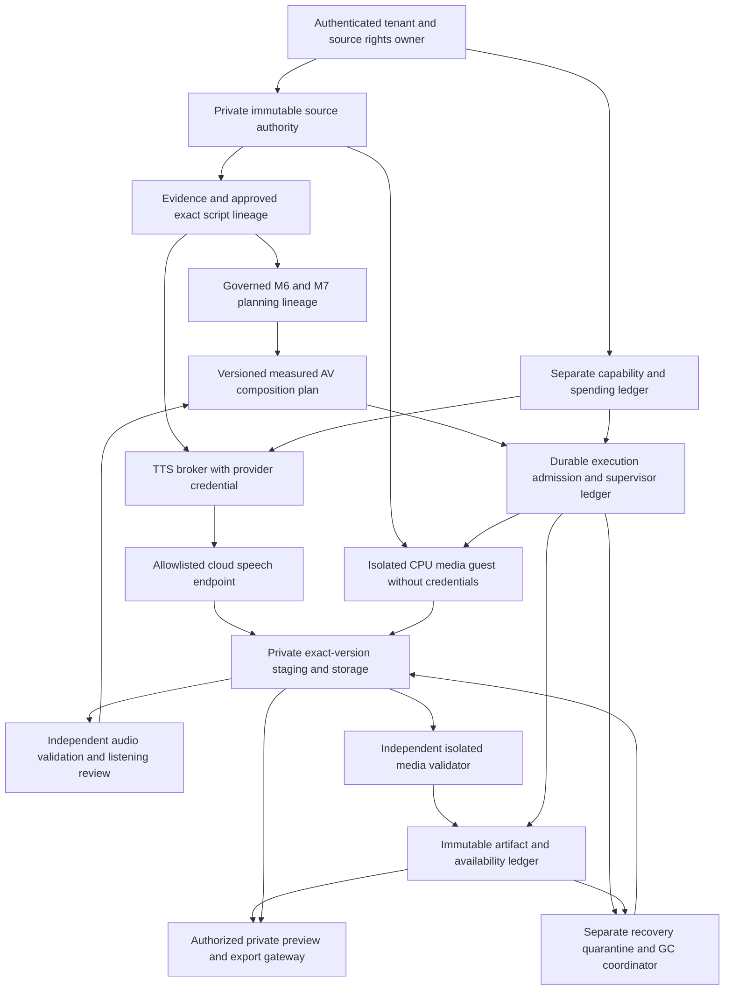
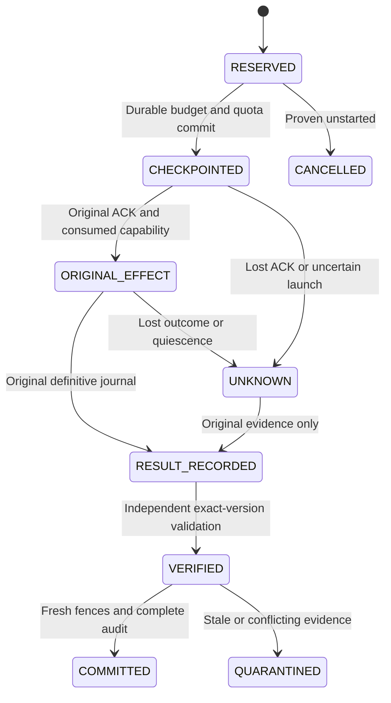

# Real media, Myanmar TTS and MP4 feasibility/security design

Date: 2026-10-20. Status: **DESIGN_ONLY — architecture review complete; real execution and production integration NO-GO.** This document proposes gates, contracts and evidence. It grants no source access, host probe, provider request, spending, approval, deployment or future implementation authority.

## 1. Executive decision and baseline

A CPU-based private recap pipeline is a plausible engineering direction, but no real end-to-end pathway is established by the current repository. Preserve M8's accepted fake foundation. Start with independent source rights, enforceable byte ownership, production identity and sandbox feasibility; do not connect the existing legacy encoder or flip synthetic flags. Myanmar speech has credible documentation-backed candidates, but no provider was called and no pronunciation, duration, account entitlement or cost-control behavior was tested.

The checkout is **`main`**, not the earlier recovery branch. Initial HEAD and cached `origin/main` both equal accepted M8 commit `518bc953c33a54138c133013835267d0c1319db8`; upstream is `origin/main`. The index, unstaged tree and nonignored untracked inventory were empty. The origin matches the user-specified [public repository](https://github.com/hanlinko1182/movie-translator); accepted ancestry was checked locally. No branch switch, fetch, remote API/catalog call, push or claim of newly verified live GitHub state. Public source hosting does not establish that an application is publicly deployed or safely authorized.

Read [AGENTS](../AGENTS.md), [CLAUDE](../CLAUDE.md), [M8 final acceptance](STORYLINE_M8_FINAL_ACCEPTANCE.md), [M8-02 design](STORYLINE_M8_02_MEDIA_EXECUTION_SECURITY_DESIGN.md), [M8-01](STORYLINE_M8_01_RENDER_PLANNING.md), [M8-03](STORYLINE_M8_03_FAKE_EXECUTION_FOUNDATION.md), [M8-04](STORYLINE_M8_04_FAKE_EXECUTION_SECURITY_ACCEPTANCE.md), and [M7](STORYLINE_M7_FINAL_ACCEPTANCE.md), [M6](STORYLINE_M6_FINAL_ACCEPTANCE.md), [M5](STORYLINE_M5_FINAL_ACCEPTANCE.md) acceptance and the retained M4 expiry evidence. Source inspection, not historical PASS counts, grounds the inventory below. Those reports remain unchanged.

**Critical decisions:** no existing synthetic narration/highlight/timeline/recipe/fake audio/fake artifact is eligible for real TTS or rendering. Require new non-synthetic evidence and explicitly approved exact narration under separately versioned contracts. Reuse M6/M7 planning rules and lineage concepts through reviewed sibling contracts, not their disposable authentication/gateways. Approve an M8-05 fake-only operational-hardening design **and accept its implementation/tests before reusing any shared ownership/recovery/GC primitive**. Independent M10-01 design work need not wait if it reuses no such primitive. No M8-05 report currently exists in this checkout.

## 2. Current source-grounded inventory

“Tests present” below means inspected executable test source, **NOT RERUN** in this milestone. No production-readiness verdict follows from test presence. File references are repository-relative; no actual media, `.env` secret file, private user content or operational storage was opened.

| Subsystem and actual source | Implemented / tests present | Synthetic boundary, missing real gate, safe reuse |
| --- | --- | --- |
| Upload/movie persistence: [upload route](../app/api/project-uploads/route.ts), [schema](../prisma/schema.prisma), [upload policy](../lib/movie-upload-policy.ts) | Bounded multipart upload, generated storage key, Project/Movie relationship, file-size metadata and immediate `inspectMovie` call. `tests/storage/config.test.ts` covers storage configuration. | Project/Movie models do not establish tenant/user membership. Upload probing occurs in the web process. No rights grant or enforceably immutable source version. Reuse validation ideas only; public hostile-input intake needs authenticated quarantine and a separate probe reservation. |
| Storage/source playback: [provider](../lib/storage/provider.ts), [local storage](../lib/storage/local.ts), [source stream](../lib/source-video/stream.ts) | Private local roots, constrained keys, no-follow descriptors, exclusive creation, byte ranges; `tests/source-video/{stream,database,playback}.test.ts`, `preview.test.tsx`. | `put` can replace; `resolveInput` exposes a local path; no object version/tenant authority. `streamSourceVideo` explicitly describes relationship checks as trusted-local scoping. Descriptor pinning does not prevent same-UID mutation. Reuse range/header logic only after new auth/immutable-version review. |
| Media/STT: [media utilities](../lib/media.ts), [processing](../lib/media-processing.ts), [transcription](../lib/transcription/transcribe-movie.ts), [OpenRouter STT](../lib/transcription/openrouter-provider.ts) | Existing direct FFprobe/FFmpeg utilities, extraction/chunking, timestamped STT, persistence; `tests/storyline/media.test.ts` exercises the Storyline inspection seam; no dedicated transcription test file was found in tracked test paths. | Source audio extraction is for recognition, not recap audio authorization. `OpenRouterTranscriptionProvider` invokes `stt.createTranscriptionMultipart`, not TTS. Existing parser invocation is not a hostile-media sandbox. Reuse bounded transcript DTOs and alignment checks after provenance/currentness review. |
| Chinese→Myanmar translation/QC/review: [translation](../lib/translation/translate-movie.ts), [provider](../lib/translation/openrouter-provider.ts), [review](../lib/translation-review/service.ts), [QC](../lib/translation-qc/service.ts) | Context batches, glossary/memory, strict aligned text outputs, manual revisions/review and persistence; no dedicated translation/QC/review test files were found in tracked test paths; real provider correctness is unproven. | Subtitle approval is not approval of narration, source rights or paid TTS. Preserve source-to-text timing and hashes; do not reuse permissive legacy time rounding for exact render math. |
| Character/recap analysis: [character provider](../lib/character-analysis/openrouter-provider.ts), [recap provider](../lib/recap/openrouter-provider.ts), [M3 validation](../lib/storyline/evidence-analysis/validate.ts) | Structured text analysis, uncertain identities, Chinese evidence, observed/inferred distinctions and validation. `tests/recap/response-diagnostics.test.ts` and M3 evidence suites exist. | Legacy AI text can be wrong; evidence-backed synthetic replay proves structural lineage, not psychology or movie truth. Reuse anchors/claim/basis/contradiction validation; require real-source grounding and human editorial review. No prompt/tool authority from transcript text. |
| M4/R4 script: [narration contracts](../lib/storyline/narration/contracts.ts), [validator](../lib/storyline/narration/validate.ts), [versions](../lib/storyline/studio-versions/service.ts) | Provisional narration, exact stored-original identity, immutable edited versions behind disposable auth; M4 and R4/M9 test suites. | Production version flag is false; R4 saves SYNTHETIC_TEST_EDIT. Approved review types do not implement an issuer. No existing artifact is approved for real synthesis. Reuse exact text/parent/claim binding rules, never synthetic-to-approved casts. |
| M5 voice: [handoff](../lib/storyline/voice/handoff.ts), [contracts](../lib/storyline/voice/contracts.ts), [chunk planner](../lib/storyline/voice/foundation/chunk-plan.ts), [fake verification](../lib/storyline/voice/audio-verification/contracts.ts), [durable fake service](../lib/storyline/voice/durable-fake/service.ts) | `planMyanmarVoice`/`validateVoicePlan`, grapheme-safe chunks, fake PCM sample counts, byte verification and private fake ownership/recovery. Voice-foundation/audio-verification/private-artifacts/durable-fake suites exist. | FAKE_ONLY, speech NOT_VERIFIED; `FutureVoiceAdapter`/`VoiceAudioArtifact` are handoff types, not an implemented real sender/verifier. Reuse segmentation/reconstruction and lifecycle principles only through new real schemas. Do not use fake silence or its duration. |
| M6: [planner](../lib/storyline/highlights/planner.ts), [resolution](../lib/storyline/highlights/resolution.ts), [repository](../lib/storyline/highlights-persistence/service.ts), [scratch SQL](../tests/storyline/highlights-persistence/schema.sql) | Deterministic evidence intersections/rubric/selection, immutable saved records/head/history and currentness fencing; foundation/persistence/security/Studio tests. | SYNTHETIC_ONLY with fixture-owned capture/auth. Need authoritative non-synthetic narration/evidence and reviewed production repository. Reuse source selection semantics, reasons, provenance and ordering; do not import its private DB owner/session fixtures into production. |
| M7: [planner](../lib/storyline/timeline/planner.ts), [replay](../lib/storyline/timeline-persistence/resolution.ts), [repository](../lib/storyline/timeline-persistence/service.ts), [scratch SQL](../tests/storyline/timeline-persistence/schema.sql) | Exact integer-ms CUT_ONLY/1:1/contiguous placement; full saved M6 identity and immediate-parent/currentness replay. Timeline/persistence/Studio suites exist. | Permanent synthetic restrictions. Preserve exact selected intervals/presentation and distinguish M7 saved version from its inner M6 head revision. Real lineage and audio-aware composition need separate domains; no rewriting old M7 bytes. |
| M8 planning/execution: [planning index](../lib/storyline/render-planning/index.ts), [recipe generator/replay](../lib/storyline/render-planning/planner.ts), [fake index](../lib/storyline/render-execution-fake/index.ts), [service](../lib/storyline/render-execution-fake/service.ts), [SQL](../tests/storyline/render-execution-fake/schema.sql) | Seven metadata domains, fourteen fake execution domains, original-work reservation, one-use simulator, exact fake blobs, verification, quarantine/GC; all planning/execution/security/SIGKILL suites present. | Metadata recipe disabled; fake measurements NOT_MEASURED. No source possession, real process/track/fidelity verifier, durable production control plane or safe automated stranded-hold/fence recovery. Preserve tests as a differential oracle and protocol design evidence, not executable real authority. |
| Studio: [shell](../components/storyline/recap-studio-shell.tsx), [highlight bridge](../lib/storyline/studio-highlight-types.ts), [timeline bridge](../lib/storyline/studio-timeline-types.ts) | Six destinations and injected synthetic workspaces; component/Chromium suites. | Production Voice says no configured TTS; Export says no recap video output. Type bridges erase. No new UI, endpoint, player or adapter is added here. Future UI must independently obtain authorized verified metadata. |
| Legacy full-movie subtitle render: [contracts](../lib/video-render/contracts.ts), [snapshot](../lib/video-render/snapshot.ts), [runner](../lib/video-render/runner.ts), [supervisor](../scripts/render-supervisor.ts), [download](../lib/video-render/download.ts) | Separate BURN_IN/SOFT_SUBTITLE profiles, real CPU runner, process group/flock/prlimit, output hashing/probe, durable dispatch and download; `tests/video-render/` suites exist. | Preserves/transcodes original audio, permits FAILED/CANCELLED retry generations, different serializer/tolerant duration policy and age-based attempt cleanup. Scope checks are project/movie membership, not user authorization. Not the M8 recap executor; reuse neither authority, retry semantics, source-audio policy nor cleanup. Real tests in this family are not run here. |
| Runtime/config: [env](../lib/env.ts), [template](../.env.example), [Prisma](../lib/prisma.ts), [queues](../lib/queue/types.ts), [launcher](../workers/start.ts), [lifecycle](../lib/worker-runtime.ts), [Dockerfile](../Dockerfile) | Lazy PostgreSQL Prisma, BullMQ/Redis, explicit role/model/storage config, drain controls; current OpenRouter chat/STT adapters disable SDK retries. Installed SDK declares `TTS.createSpeech`. | No application TTS adapter, TTS runtime role/model config, production narration approval or spending ledger for this path. Queue retries/deduplication are not paid exactly-once. Docker image includes web/workers/media tools together and does not pin an FFmpeg build/digest or declare hostile-media isolation. No process is launched. |

For production readiness, each row requires current executable evidence on its own real authorization/storage/currentness boundary, adversarial tests and a reviewed operating environment. Legacy implementation existence does not certify its deployment. A production security review must cover the existing upload/source/render endpoints before any public exposure; private cache headers and hard-to-guess IDs are insufficient access control.

## 3. Existing versus proposed capabilities

The configured OpenRouter base URL is pinned to its HTTPS `/api/v1` endpoint. Repository adapters call chat generation or STT only; the installed SDK's speech declaration is not application integration or a verified voice capability. `.env.example` has no TTS model/voice settings. No actual credentials were read or validated.

Preserve the exact M8-01 domain set `story-recap-render-{planning-input,policy,profile,source-observation,dependency-snapshot,recipe,request-proposal}-v1` and M8-03 set `story-recap-execution-{request,source-binding,admission,submission,checkpoint,result,stage,fake-byte-verification,artifact,access,lifecycle,recovery,audit,profile}-v1`. No existing M1–M8 domain changes. Source SHA-256, content-domain hash, exact storage version, authorization proof and approval are five separate identities.

All following interfaces, tables, domains, profiles, permissions and milestones are **proposals**, not existing exports. None of the proposed folders is created. New real protocols must reject all fake discriminators and synthetic ancestry before resource or spending admission. A real source hash matching a synthetic fixture cannot change that fixture's origin.

## 4. Real trust boundaries and dataflow



Only the TTS broker has narrow provider egress/credentials; it receives approved chunk text, not movie files. The media guest and independent validator get scoped read-only source/audio snapshots and an exclusive output sink, never database, provider or GC credentials. Trusted brokers validate their bounded reports before issuing ledger proofs. Scheduler/control traffic belongs outside the media guest's denied network boundary. No general command runner is a public interface.

Identity/rights service owns principals, membership and rights epochs; source authority owns bytes/versions; editorial service owns immutable script decisions; planning owns selection/timing metadata; spending service owns quotes/consent/reservations; supervisor owns original process/containment identities; storage owns exact bytes; validator owns technical observations; artifact service owns lineage/availability; delivery owns current access; operator service owns fenced reconciliation. No subsystem can confer another's capability through a hash, model response or queue receipt.

## 5. Source possession, rights and immutable binding

Propose `SourceAuthority.acquireExact` taking a server-resolved scoped source identity and action grant, never a client path/URL. Return an opaque handle bound to tenant/project/movie/studio, source ID/version, storage-owner namespace, exact object generation, actual full-content SHA-256/count, rights-policy epoch, revocation epoch, handle generation/expiry and retained operation/read holds. Rights record separately identifies processing, cloud-text disclosure, private preview, export/distribution and publication permissions plus provenance of the authorized decision. File possession/hash equality alone establishes none of those permissions. Rights interpretation and jurisdiction-specific policy require the responsible owner/legal reviewer; this document makes no copyright clearance finding.

Future intake: authenticate/limit admission before accepting bytes → exclusive quarantined object → complete bounded digest/count independent of client metadata → enforce immutable sealing/version → register rights/source binding → separately reserved sandboxed probe. Never probe during ordinary web upload. Filenames are inert labels, excluded from authority/path construction. No remote URL download fallback, redirects, playlists, arbitrary external lexicons or alternate-source search. Treat all content as hostile until independent acceptance.

Use an authority-enforced immutable object version or sealed snapshot that prevents all untrusted writable aliases. A pinned FD, chmod, stat-before/after and matching inode do not create immutability against the same UID. Enforce private namespaces, encryption at rest with scoped key custody, TLS, storage IAM, owner-generated keys, no-follow descriptor-relative resolution, regular-file/single-link rules and create-only stage versions. Root/temp/storage configuration cannot come from requests. Storage version delete is conditional on exact owner/generation/hash/count and ledger intent, never prefix/latest/path deletion.

Without media parsing, a future authorized byte authority can verify ownership documents, access policy, object immutability, complete SHA/count and handle/version binding. It cannot establish actual stream topology, encryption, decodability, duration, frame rate, codec or accurate cuts. Those need a separately authorized isolated probe/decoder; even header probing is hostile parser execution. This milestone performs neither byte access nor those checks. Malformed/truncated/encrypted/ambiguous/excessive input rejects without repair, decryption or fallback. Revocation denies new redemption/finalization/delivery, requests cancellation of admitted work and holds evidence; it cannot recall bytes already consumed or previously delivered.

## 6. CPU renderer host and sandbox feasibility

No host sandbox or installed binary was probed, and no host is certified here. **Required isolation unproven → NO-GO even for FFprobe.** CPU feasibility is a design assumption pending measured capability and resource tests; no local GPU/model is required.

| Option | Assessment | Required closing evidence |
| --- | --- | --- |
| Dedicated isolated cloud CPU worker | Good placement for independent quotas and credentials, but “dedicated” alone is no containment guarantee. | Separate guest/service identity, immutable images, provider-independent original process ledger, no media egress and enforced resource/descendant controls; measured runtime/cost. |
| Hardened container on reviewed host | Potentially usable only with an explicit accepted hostile-parser threat model; a container alone is insufficient. Do not run beside the credential-bearing web/provider process. | Reviewed host/kernel/runtime patch policy, dropped privileges, user/mount/PID/network isolation, no host/runtime sockets or devices, syscall confinement and cgroup/disk controls; escape/descendant tests. Otherwise unsupported. |
| Disposable VM or equivalent stronger isolation | Preferred research target: one owned operation/phase per disposable CPU guest, with a separate trusted supervisor. Still not immunity to host/supervisor compromise. | Image/binary attestation, pinned source/output handoff, denied network, no guest secrets, bounded guest/host storage, durable boot/containment identity, proven shutdown and unknown-outcome reconciliation. |

Pin image digest, executable path/digest, library/build/codec capabilities and argument-policy version. Do not inherit current Dockerfile's apt-installed media tool as a pinned capability. Use direct subprocess invocation with a fixed reviewed argument array, no shell interpolation, request-supplied executable/argv/filter graphs or arbitrary plugins/fonts. Any internally generated graph is derived only from validated immutable numeric plans. Protocol/demuxer/decoder allowlists complement OS egress/filesystem isolation; flags alone are insufficient.

Minimal explicit environment, private home/temp/cwd, read-only root/source snapshots, no provider/database/cloud tokens, no inherited sockets/extra FDs, bounded diagnostic pipes. Enforce CPU time, wall time, memory, pids/threads/FDs, I/O/disk, source/output/log bytes, dimensions, decoded pixels, frames, duration and aggregate concurrent reservations. Keyframe pre-roll and independent verification consume quota too. Never infer available disk from one statfs check or release capacity on lease expiry. Supervisor must own/cancel/reap the whole containment tree using durable boot/guest/phase identity and non-reusable process handles; PID/group exit alone is not sufficient quiescence evidence. Host failures, unknown descendants or lost supervisor evidence retain UNKNOWN and prevent adoption/GC.

Research-only initial ceilings to review in M10-01: one admitted effectful phase per evaluation realm, ≤64 selected segments, ≤60-second recap, ≤120-second/64-MiB deliberately authored source, 640×360/25 FPS supported source only, ≤1-MiB parser metadata, ≤64-KiB diagnostics, 2-vCPU/2-GiB guest and explicit staging/recovery reserve. These are proposed test-budget starting points, not measured capability or permission to allocate resources; supervisor, parser and disk budgets must be frozen and evidenced before use. Full-length Chinese movies need a later enlarged, reviewed resource profile. Current fake blob ceilings and legacy 24-hour/large-file limits do not authorize real workloads.

## 7. Myanmar TTS feasibility and evidence

Evidence checked through public official documentation on 2026-10-20. **DOCUMENTED** means a vendor claim was located, **LOCALLY IMPLEMENTED** means source exists, and **EVALUATED** would require a separately authorized request/listening/decoding trial. No candidate is EVALUATED. No authenticated model/voice discovery API, sample player, synthesis, audio download or account inspection was used.

OpenRouter documents genuine speech synthesis at `/api/v1/audio/speech`, returning raw audio rather than chat text, with MP3/PCM options and a generation ID. Its speech routing documentation says `provider.order`/`only`/`ignore` do **not** apply, although data-policy routing is described. Therefore chat routing assumptions cannot pin a speech provider; strict provider/region/privacy requirements need an evidenced speech-specific contract or direct access. [OpenRouter TTS reference](https://openrouter.ai/docs/guides/overview/multimodal/tts).

| Candidate | Documentation-backed capability | Unknown / evaluation gate |
| --- | --- | --- |
| OpenRouter → `google/gemini-3.8-flash-tts` | Public OpenRouter collection lists the full Flash TTS model. Google's current speech guide marks Burmese supported for full 3.8 Flash TTS, while Flash-Lite's Burmese entry is absent. This is an inference across two vendor documents, not route-level proof. [OpenRouter collection](https://openrouter.ai/collections/text-to-speech-models), [Google speech guide](https://ai.google.dev/gemini-api/docs/speech-generation). | Preferred gateway candidate for evaluation only if approved route/privacy/billing controls can be established. Actual Myanmar input, selected stock voice, endpoint schema, raw-audio format/rate and completeness need tests. Do not substitute Lite or a similarly named text model. |
| Direct Azure Speech, `my-MM-NilarNeural` / `my-MM-ThihaNeural` | Microsoft lists Burmese voices and a regional authenticated synthesis REST API. [Language table](https://learn.microsoft.com/en-us/azure/ai-services/speech-service/language-support?tabs=tts), [REST reference](https://learn.microsoft.com/en-us/azure/ai-services/speech-service/rest-text-to-speech). | Strong direct-provider comparison candidate. Resource/region availability, exact voice formats, delivery styles, limits and listening quality are not established. These voices are not automatically available through OpenRouter's separate Microsoft MAI models. |
| ElevenLabs `eleven_v3`, direct; newer `eleven_v4` optional separate candidate | Current model documentation lists Burmese for v3 and v4, but not for Multilingual v2's listed language set. [Model reference](https://elevenlabs.io/docs/overview/models). Direct TTS supports explicit model/voice and a separate timing endpoint. [Convert](https://elevenlabs.io/docs/api-reference/text-to-speech/convert?explorer=true), [Timing](https://elevenlabs.io/docs/api-reference/text-to-speech/convert-with-timestamps). | Do not use the API's Multilingual v2 default for Burmese. Voice entitlement, plan-specific formats, timestamp accuracy for Myanmar graphemes, pronunciation and any gateway equivalent remain untested. No cloning, reference voice upload or effects in the first evaluation. |
| Existing configured chat/STT models; other advertised multilingual models | Current repo uses chat and transcription. A speech SDK method or recognition language list supplies no evaluated TTS capability. | NO-GO as implicit TTS. No current official model-specific Myanmar synthesis evidence was established for other routes in this review. This is UNKNOWN, not a claim that all other vendors lack Myanmar speech. |

For Google, the guide describes text-only/audio-only synthesis, stock voices and style controls; the demonstrated direct output is WAV. Provider-reported format or duration is not an independent measurement. Automatic language detection requires explicit negative tests for language substitution. [Google speech guide](https://ai.google.dev/gemini-api/docs/speech-generation). For Azure, use fixed safe SSML construction with escaped text; voice-specific style support is UNKNOWN until confirmed. For any provider, user/transcript text cannot inject stage directions, tags, tools, URLs or authorization. Model/voice/style/normalization are server-owned, versioned settings; no caller options passthrough.

Pricing evidence is deliberately narrow: the public OpenRouter collection displayed **USD 0.50 per million input tokens and USD 9 per million output tokens** for full Gemini 3.8 Flash TTS at review. This is a dated listed rate, not an account quote, per-minute estimate or approved spend. Direct Azure/Google/ElevenLabs account/region/plan charges, taxes, credits and effective ceilings are **UNKNOWN** here. Requote exact billable units before evaluation; do not derive cost from byte length or script duration. [Published listing](https://openrouter.ai/collections/text-to-speech-models).

Privacy/limits findings:

- Azure documents no retention of real-time synthesis input/output content; batch/long-audio storage differs. Contract, resource geography and application logs still need approval. Its quota page distinguishes voice/region capacity from quotas; no account throughput was measured. [Privacy](https://learn.microsoft.com/en-us/azure/foundry/responsible-ai/speech-service/text-to-speech/data-privacy-security), [Quotas](https://learn.microsoft.com/en-us/azure/ai-services/speech-service/speech-services-quotas-and-limits).
- Google paid-service terms distinguish model-training use from retention. Its ZDR page separately discusses abuse-monitoring logs; “paid” is not blanket zero retention. Rates/limits depend on project/model/tier. [Terms](https://ai.google.dev/gemini-api/terms), [Retention](https://ai.google.dev/gemini-api/docs/zdr), [Limits](https://ai.google.dev/gemini-api/docs/rate-limits).
- ElevenLabs documents logging enabled by default and enterprise restrictions on disabling retention; format entitlements also vary. Language codes may be ignored when unsupported. Timestamp/normalized-text output remains a provider claim to validate, not speech truth. [Convert](https://elevenlabs.io/docs/api-reference/text-to-speech/convert?explorer=true), [Timing](https://elevenlabs.io/docs/api-reference/text-to-speech/convert-with-timestamps).
- Gateway and upstream privacy both matter; route changes require new capability/privacy approval. OpenRouter's privacy policy says provider practices vary. [Gateway privacy](https://openrouter.ai/privacy). Documentation examples, SDK types and live entitlement can diverge; no generic retry advice overrides original-operation UNKNOWN safety.

Future M10-02 evaluation proposal: six newly authored, non-sensitive Myanmar passages × two explicitly selected candidate configurations = at most twelve original paid requests, one at a time, no automatic retries. Cover Burmese punctuation/graphemes, Chinese proper names rendered as approved Myanmar text, numbers/negation, code-switching and cautious psychological qualifiers. Freeze corpus/text hashes, stock voice, delivery/normalization profile, model/endpoint evidence, consent, signed micro-USD maximum and total billable-unit bound before any request. No movie dialogue, personal information or voice cloning. A provider-side hard budget or defensible maximum charge bound is mandatory; a client timeout does not stop remote billing. No budget amount is approved here.

Acceptance requires complete decoded audio for every chunk; measured sample count/rate/channels and exact duration; two qualified Myanmar listeners independently checking every intended word/critical proper name, number, negation and qualifier against the exact script; no omissions/additions/unexpected language or non-speech output; reviewed pauses/pacing and deterministic chunk coverage. Resolve disagreements before acceptance. Record listening decisions tied to exact byte hashes, not an invented numeric quality score. Optional ASR/alignment is advisory and would need its own model/privacy/spend authorization; it cannot replace listening. A changed voice/model, silent vendor update, expired credentials, unsupported language or outage invalidates capability/admission or retains UNKNOWN as appropriate, never selects a fallback or silently switches language.

## 8. New real voice artifact lifecycle

Propose server-only `RealVoiceRequest`, `RealVoiceResult`, `RealAudioVerification` and `RealVoiceArtifact` under separate real domains in section 14. An approved saved narration reference binds tenant/project/movie/studio, exact immutable record ID/version/domain/hash, original parent/source/candidate/evidence revisions, paragraph/section/chunk identities and editorial approval decision. A saved edit alone is not approval. Non-sensitive evaluation text uses a separate evaluation-consent domain and remains ineligible for production publication.

Freeze **EXACT_UTF8_NO_NORMALIZATION_V1** initially: preserve approved Unicode, spaces, newlines, Myanmar characters and separators byte-for-byte; reject invalid surrogates/control/bidi hazards rather than silently strip or convert Zawgyi. Any normalization or name-pronunciation transformation becomes a separate proposed text artifact, displayed/diffed/reapproved, with its own hash/map. Provider-side number/text normalization settings are explicit profile inputs and must be evaluated. Reuse M5 grapheme-boundary/reconstruction algorithms only through a reviewed neutral implementation/new schema; their FAKE_ONLY output cannot be sent.

Request identity binds exact chunks and hashes, segmentation Unicode/ICU version, provider/gateway/model deployment or observed version (UNKNOWN if unavailable), stock voice/config hash, language `my`/locale `my-MM`, trusted delivery instructions, capability evidence, desired native format, cost quote, consent and one original submission. No API key/token is a content field. Provider revision must be attestable or treated as mutable with capability re-evaluation; never claim bit-deterministic speech from the same text.

Lifecycle: reserve original canonical work/scoped key and pessimistic budget → acknowledge durable admission/checkpoint → original nonserializable one-use send capability → original result journal → private exact native-byte capture → independent isolated audio verification → fresh authority/currentness fence → immutable verified voice artifact. Store raw native byte SHA/count/version and a separately versioned canonical PCM derivative SHA/count if decoded/resampled; never confuse the two. Record codec/container/sample rate/channel layout/bit depth, integer decoded sample count, rational duration, decoder/software policy hash, exact coverage/alignment evidence and listening receipt. Header duration, extension, Content-Type and vendor timestamps alone cannot verify audio.

Each chunk owns an immutable original request/submission and budget hold. Parent collections require every approved chunk exactly once in order, no gaps/duplicates, exact text reconstruction, consistent permitted voice/profile and cumulative sample arithmetic. A partially successful collection is not complete narration; keep successful chunks, hold uncertain chunks, issue no full render eligibility. A new key/worker does not evade the original operation. SDK/HTTP/gateway retries must be disabled or independently proven idempotent under the same original identity; current gateway internal retry behavior is unverified.

Timeout/disconnect/partial stream/lost ACK/ambiguous server response → UNKNOWN with original source/text/key/provider/stage identity and held budget. No automatic paid retry, new generation, provider fallback or replacement key. Provider request/generation ID is a correlation clue, not proof of reusable bytes or rollback. Recover only original definitive journal/equivalent provider evidence and original exact stored response; if unrecoverable, retain UNKNOWN and stop. Any later different work requires a separately reviewed resolution/consent policy, not a hidden retry. Cancellation may stop local receipt but cannot prove remote work/billing stopped. Successful technical audio remains separately unapproved for publication; revocation/stale lineage prevents new finalization/read without rewriting facts.

## 9. M6/M7/M8 integration and non-synthetic lineage gate

Current M6/M7 and M8 parsers permanently require synthetic execution/restrictions. **No production-compatible record exists simply because real media bytes are now present.** Before M10-03/04, separately review the non-synthetic source/evidence/script issuance, exact-version human approval and production persistence/currentness boundary. A proposed `media-planning/` sibling must use the existing M6 connected-evidence intersections/rubric/selected-set semantics and M7 prefix-sum/presentation rules as its authoritative planning model, with new real domains/repositories and differential tests against unchanged algorithms. Avoid a second unrelated clip scorer or ad hoc renderer-generated timestamps. This prerequisite is part of M10's admission design gate; it does not authorize editing existing modules here.

Keep exact M6 candidate/finding/claim/character/relationship/evidence/basis/contradiction identity and approved narration mapping; real evidence qualification must be independently reacquired, not derived from saved text or a self-consistent synthetic hash. Recompute real-governed records from authorized inputs, never relabel/cast synthetic records. Original synthetic M6/M7/M8 identities can be comparison/test ancestry only, never the new execution entitlement. This requires its own schema/contract review and authorization before implementation.

Preserve immutable M7 video-only source intervals and exact presentation order. A real video recipe is a distinct sibling referencing the approved real M6/M7 lineage, full source fingerprint/version, profile and dependency hashes. At 25 FPS every source/output endpoint must be exactly divisible by 40 ms using checked rational/BigInt arithmetic; reject unsafe/non-integral conversions with no rounding. Do not change old M7 timing, M8 identity, speed 1:1, CUT_ONLY, overlap rejection or no-filler rules to accommodate an engine. Actual source FPS/timebase mismatch is UNSUPPORTED in the first narrow profile, not implicit retiming.

Narration has its own approved immutable text/use manifest mapping selected spoken sections/chunks to evidence and output clip groups. Do not play the entire script indiscriminately over an incomplete highlight set. A voice change invalidates its AV composition/render descendants, not the immutable video-only M7 plan; a changed script/source/M6/M7 head invalidates affected voice/alignment/render eligibility. Reobservation of historical integrity never supplies current processing permission. Original movie audio remains excluded from recap video. Recognition's separate source-audio access does not imply a right to copy it into output.

## 10. Audio/video synchronization model

Keep four independently reported facts: **timeline metadata validity**, **decoded audio validity**, **semantic/sample alignment**, and **final encoded media validity**. No metadata-only manifest says synchronization VERIFIED. A human reviews claim-to-scene alignment, sentence order, inference qualifiers and scene changes against the actual permitted private preview.

Propose an immutable `RealAvCompositionPlan` binding the exact real video timeline/recipe, voice collection/native/canonical hashes, approved narration-use map, exact sample placements, explicit silence and alignment-policy/software hashes. No clock estimates or fake WAV durations. Use rational integers throughout; for an initial 48,000-Hz mono working track, one 25-FPS frame is exactly **1,920 samples**. A proposed master clock of **240,000 ticks/second** represents each frame as 9,600 ticks and each 48-kHz sample as five ticks (24-kHz native sample: ten ticks). Preserve M8's existing 1/1000 metadata timebase; this new composition clock is a new contract, not a modification. Checked conversions reject overflow/non-integral boundaries; never accumulate rounded per-chunk milliseconds.

Measure native audio first. If canonical resampling is needed, use a pinned, separately authorized offline conversion with exact input/output sample accounting and a new derivative artifact/verification receipt. No arbitrary speech truncation, automatic time stretching, unapproved rate change, video freeze/loop/filler, source extension or new transitions. AAC packet duration/encoder priming and MP4 edit lists do not generally equal useful speech samples; section 11 must reconcile these explicitly rather than use a millisecond tolerance.

Initial fit policy: map each approved narration group to a contiguous set of saved presentation clips; require actual speech samples to fit that group's exact frame budget. Too long → ALIGNMENT_REVIEW_REQUIRED, no render: a human may explicitly revise the script/selection through new versions and reapprove/requote any new paid work. Too short → also require an explicit silence policy; proposed opt-in trailing/inter-sentence silence is separately bounded and hashed per group, with no voice artifact alteration. Maximum silence and allowed scene transitions must be frozen in M10-05; default is no automatic padding. Any video extension or non-frame-aligned profile needs separately versioned timing/selection contracts and review. Duration equality alone proves no semantic alignment.

## 11. Real MP4 execution and independent verification

Use new capability-specific profiles: a first real **video-only** research profile with MP4/H.264/AVC/YUV420P/640×360/25 FPS and no audio, followed only after M10-05 by a separate **narration-AV** profile. Candidate final audio is AAC-LC/48-kHz/mono, but selection is **not approved until pinned encoder/decoder/container capability review**. M8's EXCLUDE_ALL/zero-audio profile cannot become the AV profile. No source audio, subtitles, data, attachments, cover art or unreviewed metadata; one intended video and, for AV only, one separately verified narration audio track.

Immutable `RealRenderRequest` binds scope, rights/approval/currentness epochs, exact real M6/M7/source/narration identities, video recipe, AV plan, profiles, capability evidence, software digests, original work/key and quotas. Separate execution authority—not an M8 permit or hash—reserves ledger/work/resource claims and a source/audio hold. Only the original acknowledged live flow may consume its one-use phase launch capability. A queue delivery, stored checkpoint or owner-generation takeover never starts a replacement. Supervisor owns the original guest/phase/process tree and output descriptor; no credential-bearing database worker itself parses media.

Reserve exclusive private staging/version before launch. Decoder reconstructs required pre-roll from the sealed source; only exact selected presentation frames enter output. First real executor must decode/re-encode; stream copy is unsupported for arbitrary cuts. Hash/measure a sealed exact output capture only after original definitive success and proven containment/writer quiescence. Independently sandboxed verification reopens that immutable version; trusted brokers fence metadata finalization after full checks. No post-commit public copy/rename/publish step.

| Independent final check | Required evidence / rejection |
| --- | --- |
| Exact bytes and ownership | Full-file SHA-256/count, immutable storage version/generation and original operation/stage/result binding. Reject missing/truncated/extra/corrupt/replaced bytes even with matching claimed outer hashes. |
| Container/track topology | Actual parsed MP4 and exact permitted video/narration counts; no hidden/alternate original audio, subtitles/data/attachments/external refs/unreviewed edit structures. Command flags or declared profile are not the oracle. |
| Video timing/capability | Actual H.264/pixel format/dimensions, rational rates/timebases, all decoded frames and source→output mapping. Exact frame sum and presentation PTS, independently reconcile packet DTS/decode order, duration/endpoints and source cut order. Reject duplicates/missing/filler/wrong frames. |
| Audio identity and duration | Decode the actual output narration stream; compare against approved canonical PCM under a reviewed codec fidelity policy, exact useful sample count/rate/layout, priming/padding/trim accounting and placements. No inference from fake samples/header duration. |
| Semantic/content fidelity | Independently associate decoded source/output frames and narration spans with the approved plan. Lossy H.264/AAC cannot promise identical pixel/sample hashes. Freeze a bounded reviewed fidelity policy and its detection limits; human preview review remains necessary. A perceptual threshold is not cryptographic source proof. |
| Safe finalization | Current identity/rights/approval/source/M6/M7/voice/profile/availability, exact owner/revision CAS, original successful result, independent verification and complete artifact/audit commit. Any failed audit rolls back metadata; no unsafe adoption after stale/unknown facts. |

AAC commonly operates on audio packets that do not align to a video frame's 1,920 samples. The approved future encoding policy must state encoder delay, discard padding and any narrowly allowed gapless edit-list representation, and prove exact effective decoded presentation length on supported independent decoders. Do not force a false integer packet/frame equivalence or import legacy `verifyOutput`'s 500–2,000-ms tolerance. If exact permitted reconciliation cannot be demonstrated, that AV profile is unsupported.

Final `RealMediaArtifact` is immutable evidence: complete lineage, request/profile/software/source/audio/result/verification hashes, exact output version/SHA/count and independent measured topology/timing/fidelity. **Publishable is a separate current decision**, not a permanent artifact flag. Private review needs a scoped review grant and approved script/rights/technically verified artifact; final export/download additionally needs exact-output human approval and distribution permission. Publication is a further distinct permission. Evaluation listening uses an isolated evaluation grant, never a production-preview shortcut. Stolen IDs/URLs cannot authorize; prefer an authenticated same-origin gateway with exact-version access, short bounded read holds, no shared cache and current availability checks. Previously delivered copies cannot be revoked retroactively. Streaming/range reads require chunk integrity and bounded delivery fences so no unchecked bytes leak; the small evaluation harness can fully buffer verified bytes first. No such endpoint is implemented now.

## 12. Authorization and threat matrices

| Action | Independent capability and bound evidence | Must not imply |
| --- | --- | --- |
| Acquire/inspect source | Authenticated tenant membership, explicit source possession/inspection rights, exact version/rights epoch and resource reservation for any parser | Approval, TTS spend or export |
| Approve narration | Authorized human reviewer over exact non-synthetic text, source/evidence/parent and current policy | Provider spending or final-output approval |
| Reserve paid TTS | Separate budget owner consent, fresh quote/units/currency/cap, approved exact chunks/model/voice/privacy capability | Generic model/provider/other text fallback |
| Generate voice | Current voice.execute plus one original send capability, spending hold and approved/evaluation text identity | Valid audio, approved speech or re-send after UNKNOWN |
| Verify audio/media | Narrow validator grant, exact owned input/result/version and pinned sandbox/software policy | Launching an encoder, paid call, approval or private delivery |
| Execute video | Explicit media.execute, source/audio/plan eligibility, quotas and original one-use phase admission | New paid TTS, publication or M8 fake promotion |
| Private review/listen | Independent artifact.read/review scope, exact verified version, rights/script approval or isolated evaluation consent, availability/read hold | Download/public share/final human approval |
| Download/export | Explicit distribution right plus artifact.read/export, current exact-output approval and final verification | Public publication or access to unrelated source |
| Publish | Separate publishing authority, destination/rights/policy and exact-output human decision | Other artifact/tenant access |
| Quarantine | Separate current coordinator identity/grant, expected artifact/revision and reason/evidence | Reader privilege elevation or immutable fact rewrite |
| Recover | Separate scoped recovery identity, original operation/journal/version and owner/revision CAS | Reconstructed launch/send permit or new submission |
| GC/reconcile storage | Separate operator/GC authority, resolved quiescence, retention/legal/read/source/recovery holds, exact intent/version/hash/count | Prefix deletion, lease-based cleanup or UNKNOWN quota eviction |

All mutations need authenticated server identity, exact scope, method/origin/Fetch Metadata/CSRF where exposed, live authorization and backend agreement. Native and database principals must agree; browser roles and supplied hashes never grant authority. Keys are private service secrets with purpose rotation/revocation, no logs/client bundles or public examples. Application code cannot assume schema owner, CREATE/TEMP or direct private table/column privileges. Narrow SECURITY DEFINER wrappers use qualified fixed search paths, no PUBLIC helper execution, explicit NULL-denial and one-use backend/transaction-bound proofs. Adoption/availability/audit transitions must complete atomically.

| Threat | Required mitigation and future negative evidence |
| --- | --- |
| Untrusted movie/parser exploit/resource exhaustion | Quarantined immutable input, bounded independently reserved parser phase, denied egress/mounts/credentials, real OS ceilings and malicious/truncated/encrypted/oversized corpus tests. |
| Forged source/hash/cross-tenant identity | Server-owned registry, four-part scope/namespace FKs, exact immutable version, independent full-byte digest, live rights epoch; swapped handle/hash/owner/key cannot read or admit. |
| Fake-to-real confusion | Disjoint constructors/domains/environments and permanent origin restrictions; reject M5/M8 artifacts even after coordinated rehashing. No imports from fake auth/DB/process/storage into real composition. |
| Prompt injection in transcripts/metadata/TTS tags | Treat content as data, allowlist exact DTOs, no tools/authority from models, fixed instructions/escaped SSML, human exact-text review; adversarial strings must not change route, voice, argv or output policy. |
| Shell/argument/SSRF injection | No caller command/filter/path/URL/options; pinned direct invocation, descriptor handoff, no network fallback or external media references. Test hostile names/options and traversal/symlinks/writable aliases. |
| API-key exposure or compromised operator | Separate broker identities, scoped short-lived secrets, non-secret correlation logs, purpose-specific keys and auditable revocation; compromised/obsolete coordinator cannot read source, launch, forge facts or delete. |
| Unauthorized/duplicate paid work after lost ACK | Canonical original claim, quoted capped budget, observed checkpoint, one attempted send, immutable journal and no unknown retry/fallback/new key. Test every cut and assert provider-call counter unchanged in recovery. |
| Stale source/script/head/voice/profile or source TOCTOU | Sealed versions plus independent replay/currentness locks on committing backend; concurrent writers block/serialize, late stale outputs quarantine. Source rights and delivered bytes are separately checked. |
| Process escape/leaked descendants/stale owner | Dedicated reviewed containment, non-reused original boot/phase/process handles, complete-tree quiescence and owner/revision fences. Missing evidence remains UNKNOWN; no lease-based restart. |
| Forged results/unverified output/quarantine bypass | Independent original journal, exact stage, fact proof and complete decoded/byte verification; audit rollback and rehashed/forged codec/track/frame tests cannot make AVAILABLE. |
| DB/storage/process split or storage mutation race | Explicit reservation→checkpoint→one original effect→sealed capture→verification→fenced commit; exact-version create/delete CAS, no mutable latest aliases or assumed rollback. |
| Reader/GC race/stolen preview link | Authenticated exact-version delivery, integrity before exposure, current read/availability fence, live holds; GC rejects readers, retention, unresolved processes and foreign versions. No public bearer URL by default. |
| Copyright/privacy/distribution violation | Separate recorded source/voice/content rights and permitted purposes, provider disclosure approval, retention and human publication/export decision. Technical hashes or synthetic status do not settle rights. |

## 13. Concurrency, recovery and operational limitations

The inspected disposable cooperating order is M7 scope/session/grant → M6 scope/session/grant/policy/current dependency/head → M7 policy/head → execution scope/session/grant; critical replay takes source SHARE before fixture quota/work mutation. Standalone maintenance paths take quota before immutable work/source/state. Existing M6 writers acquire no M7/execution rows; M7 writers acquire no execution rows. This is evidence about current scratch code, not a certified production global order.

Before new SQL, freeze every production writer/rights-revoker/finalizer/GC lock order. Proposed integration retains the M7→M6→M7 sequence, then adds stable ordered rights/source/approval/voice/AV-plan/op/quota/availability/hold locks. All participating writers must cooperate; do not acquire a new source/rights lock then invert into an old head lock. Prove safe ordering on actual separate backends through COMMIT, NULL-denial, one-use proof/body/action/PID/transaction binding, lock-wait expiry, deferred currentness/audit completion and rollback. No provider/media/blob I/O under SQL locks. If same-database fences or equivalent coherent independent authority cannot be established, admission is NO-GO. A read-time CURRENT flag is not a lease; no distributed atomicity is claimed.



Availability and human decisions are separate axes: COMMITTED does not mean publishable; AVAILABLE may become QUARANTINED; only an exact fenced delete intent with resolved holds reaches DELETED. Submission identity remains fixed for an unresolved original operation; owner generation changes observation authority only. Result facts never overwrite conflicting originals. No transition from UNKNOWN creates a new invocation permit.

| Crash/failure cut | Required behavior and closing test |
| --- | --- |
| Before reservation / reservation commit ACK lost | Same scoped key/work lookup; NOT_FOUND is not proof of rollback. No automatic new original operation. |
| Checkpoint ACK lost / permit burned before effect | UNKNOWN may have zero observed starts; never reconstruct authority from stored state. |
| After provider/guest start, before result journal | Hold original spending/resources/source/stage. Recover original evidence only; no automatic paid resend/rerender, provider switch or new generation. |
| Definitive result but uncertain quiescence | Preserve fact; deny capture/adoption/GC until original containment/writers proved stopped. |
| Lost storage-create ACK / partial response | Inspect only reserved exact version, never overwrite/new version; partial/corrupt bytes quarantined and original budget unresolved as necessary. |
| Lost verification/finalization ACK | Independently discover same receipt/artifact, CAS converges; no replacement effect or fabricated rollback. |
| Concurrent/stale finalizers / audit failure | One immutable artifact or conflict/atomic rollback; retain original facts and isolate late callback. |
| Read revocation/quarantine / lost reader cleanup | Deny further response, retain uncertain descriptor hold; GC cannot infer closure from time/session expiry. |
| Lost delete ACK / surviving corrupt bytes | Same intent/version/hash/count/tombstone reconciliation; do not delete substituted evidence or treat unproved absence as completion. |
| Restore/host restart/supervisor loss | Stop admission/adoption/GC until source, journal, storage and authority epochs reconciled. A service restart test is not power-loss/multi-host durability evidence. |

**M8-05 prerequisite:** the stranded `MUTATION_LOCK`, stranded read holds, unavailable quarantine coordinator and retained UNKNOWN quota are deliberate fail-closed conditions. Real processing increases their operational cost; it does not justify TTL unlock, reader expiry, forced deletion or speculative resend. Require separately accepted fake-only operator/recovery design plus adversarial implementation acceptance before sharing a primitive. Operator takeover needs independently proved ownership/quiescence, scoped non-launching capability, CAS/audit and non-destructive exact-version reconciliation. Storage health/quota reporting and coordinator escalation expose no content/secrets. A fresh unrelated real implementation must meet equivalent gates independently; it may not copy the unsafe parts and call them new.

The M4 historical positive M1-last actual-wire-before-expiry repeat 2 in the retained [expiry controls](../tests/storyline/checkpoint-expiry-acceptance-postgres.test.ts) observed zero sends instead of one. Root cause remains **UNRESOLVED**. Preserve all sixteen controls, unchanged 700-ms positive confirmation and source SHA-256 `8330f222f1d74bcd21a8aec20f0b7b4569bac9b557e478df8412063bb41c55d7`. No test is rerun here and no root-cause repair is claimed. Future recurrence must retain checkpoint ACK, DB transaction/current wall times, lock waits, lease/confirmation epochs, monotonic permit deadline, owner and actual-wire entry evidence. Never widen the deadline, weaken assertions or dismiss a positive-control miss as flaky. Real sending needs a separately reviewed clock/admission protocol; do not inherit an unexplained timing guarantee.

## 14. Proposed schemas, domains and folder boundaries

These are conceptual records only: **no DDL, migration, source module or fixture is created**. All future runtime entry points are server-only and default disabled; real capabilities cannot be activated by environment variables alone. Media guests import no application library or authority. New namespaces below fit alongside existing folders and require a separate architecture/contract review before implementation.

| Proposed folder | Proposed ports / responsibilities |
| --- | --- |
| `lib/storyline/media-source/` | SourceAuthority acquire/seal/revoke/hold; real immutable byte registry, not legacy `StorageProvider.resolveInput`. |
| `lib/storyline/media-authorization/` | Identity/resource membership, exact-version editorial/source rights decisions, spending consent, purpose-separated proofs and revocation. Not synthetic-auth reuse. |
| `lib/storyline/voice-real/` | Approved/evaluation text parser, neutral chunk reconstruction, capability registry, one-use provider broker, original journal and voice collection. |
| `lib/storyline/media-planning/` | Governed non-synthetic M6/M7 semantics and differential replay, real video recipe, narration-use map and measured AV composition. No unrelated clip planner. |
| `lib/storyline/media-probe/` | Admission-scoped inspection phase, opaque snapshot descriptors, bounded parser observations; cannot encode or send paid requests. |
| `lib/storyline/media-render/` | Execution ledger/broker/supervisor protocol and fixed reviewed profiles; separate isolated guest executable packaging later. |
| `lib/storyline/media-verification/` | Independent audio/video byte and decoded-media/fidelity observations with software/policy identity; no launch authority. |
| `lib/storyline/media-artifacts/` | Immutable voice/video records, separate availability/approval, exact private access/holds/quarantine/GC intent/tombstones. |

Proposed new content domains (not exports; collision-checked against existing tracked source):

```text
story-real-media-source-binding-v1
story-real-media-rights-v1
story-real-narration-approval-v1
story-real-voice-text-v1
story-real-voice-request-v1
story-real-voice-result-v1
story-real-audio-verification-v1
story-real-voice-artifact-v1
story-real-highlight-plan-v1
story-real-timeline-plan-v1
story-real-video-recipe-v1
story-real-av-plan-v1
story-real-media-request-v1
story-real-media-result-v1
story-real-media-verification-v1
story-real-media-artifact-v1
story-real-media-access-v1
story-real-media-audit-v1
```

Freeze exact strict fields, discriminators, bounded canonical serialization and proof projections before any schema. Reuse existing safe integer/Unicode canonicalization principles; new wire domains never change old payloads. Distinguish evaluation versus production-authorized input, real versus fake validation, byte hash versus canonical content hash, current eligibility versus archival integrity, and media validity versus approval. Use explicit UNKNOWN for unattestable provider versions; missing required capability blocks admission.

Proposed normalized ledger aggregates: scoped principals/resource grants and rights epochs; immutable source versions/holds; approved narration/decision references; provider capability manifests; quote/consent/budget reservations; unique canonical work/scoped key aliases; original submission/checkpoint; phase boot/containment journal; exclusive stage; native audio/canonical derivative/collection and alignment facts; render verification/artifact; availability/revision; reader/source/recovery/legal holds; exact-version GC intent/tombstone; append-only audit. Composite FKs include realm and four-part scope; unique original work/submission/version claims; immutable row/truncate guards; no NULL permission success; owner/revision CAS and deferred complete-audit/currentness checks. Retain original result and verification even if later revoked/stale/quarantined. Budget/resource release requires definitive evidence, not a lease clock or a missing queue item. Table/index/retention design remains review work, not executable SQL in this report.

## 15. Gated implementation roadmap

Every milestone below needs its own explicit authorization. “GO” means its acceptance obligations can be met under that authorization, not that this document grants execution. Tests listed are future requirements, not performed checks. Any schema/route/provider/host change requires the relevant separate scope. No milestone may borrow M8 disposable identities/keys/roles.

### M10-01 — Source possession and sandbox feasibility

- Scope/dependencies: accept source rights/identity/storage model and intended-host feasibility; default no real media. M8-05 design/implementation acceptance precedes shared operational primitive reuse. Host inspection/byte acquisition/probing requires specifically enumerated separate permission.
- Interfaces/contracts: SourceAuthority, RightsDecision, HostCapabilityManifest; source/rights domains, exact immutable versions and phase admission.
- Owned future boundaries: `media-source/`, source-related `media-authorization/`, deployment design/tests; no legacy upload rewrite without separate scope.
- Security/tests: cross-tenant handles, immutable alias/symlink attacks, rights revocation, private encryption/IAM, unsupported isolation and quotas, lock-order model. Authorized host tests must prove containment before a parser.
- GO/completion: reviewed evidence of rights, snapshots, no-egress/least-privilege/descendant/resource enforcement and an approved exact host profile; otherwise NO-GO. Risks: privileged host/storage compromise, legal restrictions and unmeasured performance.
- Cross-cutting prerequisite: separately approve the real source/evidence/narration issuance and exact-version human-approval contract, plus production M6/M7 persistence/currentness migration design. No existing synthetic artifact can satisfy it; M10-03/04 block until implemented and accepted under a separate scoped subtask.

### M10-02 — Myanmar TTS provider evaluation

- Scope/dependencies: explicitly consented non-sensitive corpus only; vendor terms/privacy/account entitlement and capped spend approved first. Source movies are unnecessary. M10-01's identity/privacy principles apply; any audio decoding needs its own supported sandbox.
- Interfaces/contracts: evaluation-only consent, exact text/chunk profile, ProviderCapabilityManifest and original request/journal/quote. No production approval.
- Owned boundaries: review-owned evaluation harness under `tests/storyline/voice-real/` and capability documentation, subsequently authorized broker code only; no UI/route.
- Security/tests: ≤12 original requests as proposed; no retry/fallback, lost ACK/partial response budget holds, fixed model/voice, response format/limits, transcript injection, two-listener completeness/pronunciation review and independent duration.
- GO/completion: signed capability/listening report with exact text/bytes/version evidence, rates/limits/privacy and defensible budget bound; no unexplained missing words/language substitution. Risks: model drift, disputed billing and unverifiable provider routing. No numeric quality score inferred from marketing.

### M10-03 — Durable real voice artifacts

- Scope/dependencies: approved non-synthetic narration/rights boundary, accepted M10-02 capability and independent authorization/spending/recovery gates; retain evaluation-only separation. M8-05 acceptance before shared primitive reuse.
- Interfaces/contracts: RealVoiceRequest/Result/Artifact, RealAudioVerification and complete collection; exact UTF-8 policy, native/canonical audio versions and measured samples.
- Owned boundaries: `voice-real/`, audio portions of `media-verification/`/`media-artifacts/`/`media-authorization/`, separately reviewed production schema and private storage adapter.
- Security/tests: catalog/proof/NULL-denial, source/script drift under actual writers, duplicate/chunk aliases, budget/audit rollback, every send/capture/commit crash cut, UNKNOWN no-resend counters, actual audio decoding and exact text coverage, revocation/read/GC races.
- GO/completion: original paid-operation ownership and immutable independently validated/listened voice collections, all adversarial gates green. Risks: unavailable provider result retrieval, unknown remote billing/quiescence and stranded holds; these must stop progression rather than trigger retries.

### M10-04 — Exact video highlight extraction

- Scope/dependencies: separately authorized bounded real source/decoder work on M10-01's accepted host; approved real M6/M7 lineage/persistence and source rights. Video-only; no original output audio or TTS.
- Interfaces/contracts: real-governed M6/M7 records, RealVideoRecipe and inspection/extraction phase journals; preserve 25-FPS/40-ms/1:1/CUT_ONLY source selection.
- Owned boundaries: `media-planning/`, `media-probe/`, narrow video-only `media-render/`/`media-verification/`, isolated guest packaging/tests.
- Security/tests: differential M6/M7 replay and rehash attacks, independent actual source-frame selection and cuts/pre-roll/PTS/DTS, hostile stream inputs, exact topology/no audio, resources/descendants and no duplicate uncertain launch.
- GO/completion: exact frame-association and private video-only artifact evidence, no silent interval change or stream-copy assumptions. Risks: unsupported VFR/rotation/colors/cuts and lossy fidelity; unsupported input remains rejected.

### M10-05 — Audio/video synchronization

- Scope/dependencies: verified real voice and video-only lineage, approved narration-use map and human semantic review; no encoder activation implied.
- Interfaces/contracts: RealAvCompositionPlan, rational master clock/sample mapping, versioned silence/fit/resampling policies and alignment receipt.
- Owned boundaries: AV parts of `media-planning/` and `media-verification/`; separately scoped controlled resampling harness only if authorized.
- Security/tests: too-long/short narration, variable sentence lengths, grapheme/chunk coverage, cumulative sample/frame drift, overflow/non-integral clocks, wrong-scene speech and all dependency changes. No automatic speed/freeze/loop/pad.
- GO/completion: actual measured sample placements and signed human semantic alignment over exact artifacts; infeasible fit requires new approved script/selection versions. Risks: speech variance, ASR/alignment uncertainty and codec priming still pending final AV verification.

### M10-06 — Real MP4 execution foundation

- Scope/dependencies: separately authorized isolated encoder, accepted source/voice/AV plan, M8-05/shared-control acceptance and **M10-07 verifier contract/tests designed before the first encode**. Produced candidates stay private/unavailable until M10-07 acceptance.
- Interfaces/contracts: RealRenderRequest, phase admission/original result and immutable stage; new video-only versus narration-AV profiles. AAC choice requires capability review first.
- Owned boundaries: `media-render/`, execution portions of `media-artifacts/`/`media-authorization/`, independently packaged CPU guest and scoped schema/tests.
- Security/tests: one original launch, quota admission, startup/ACK/SIGKILL/descendant cuts, fixed argv/environment/FDs, currentness writers/CAS, partial storage/output and bounded diagnostics; no fake or legacy dispatch path.
- GO/completion: durable original process/effect ownership, proven quiescence and private sealed candidates; never mark candidate finished/publishable on exit zero. Risks: supervisor/guest/DB/storage gaps and unknown original process outcome retain holds.

### M10-07 — Independent media verification

- Scope/dependencies: isolated validator design starts before M10-06; acceptance uses its permitted outputs plus explicitly authorized malformed/adversarial media. No encode authority.
- Interfaces/contracts: RealMediaVerification/Artifact, exact bytes, decoded video mapping and narration/priming/timing/topology/fidelity receipt.
- Owned boundaries: `media-verification/`, finalization/availability/quarantine/GC in `media-artifacts/`, separately restricted verifier broker/tests.
- Security/tests: wrong-frame but matching duration, hidden/source/extra audio, subtitle/data/attachment leakage, corrupt/truncated/replaced blob, wrong voice/priming, forged receipt/hash, stale owner, concurrent finalizers/audit rollback and reader/GC conflicts.
- GO/completion: independent actual decoded/byte verification plus final currentness/audit fences and approved fidelity limits. Risks: correlated encoder/validator faults, decoder differences and false perceptual matches require documented limits/human review.

### M10-08 — Studio private preview and export

- Scope/dependencies: production identity/membership, accepted voice/render verification, rights/approval policy, private storage and read-hold operations; separate explicit UI/API authorization.
- Interfaces/contracts: safe verified-artifact DTO, scoped review/export grants, authenticated exact-version delivery and current approval decision; no keys/paths/process authority in client.
- Owned boundaries: existing six-destination shell/Voice/Export integration, new narrowly scoped delivery routes only after review, type-only bridges and component/browser/production-bundle audits. No seventh destination or redesign by implication.
- Security/tests: wrong tenant/expired/revoked principal, stolen IDs/links, range/chunk integrity/hold lifetime, final response fence, quarantine/retention/GC races, no-cache headers and accessible 1440/1024/390 layouts. Synthetic artifacts never appear as finished media.
- GO/completion: private verified playback/review and exact-output approved distribution with audited access; public publication remains a separate product/security decision. Risks: browser copies, long-lived readers and token leakage; previously delivered copies cannot be recalled.

### M10 Final — Authorized end-to-end acceptance

- Scope/dependencies: all approved milestones, legitimate bounded Chinese source, independently approved evidence-backed Myanmar narration, explicit provider consent/spending, real verified voice/video and human alignment/output decisions.
- Interfaces/contracts: frozen complete dependency/approval/rights/currentness manifest across existing planning semantics and new real domains; immutable final artifact with separate eligibility decisions.
- Owned boundaries: acceptance documentation and only reproduced narrow fixes/tests; production activation/deployment still requires its own explicit scope.
- Security/tests: entire negative/crash/UNKNOWN/authorization/currentness/bytes/decoded fidelity/GC matrix on the accepted deployment profile; unchanged M1–M8 regressions and all sixteen original M4 controls, exact accounting, component/Chromium/audit/build/secret checks then.
- GO/completion: retained independent execution/listening/media/access evidence and no unresolved mandatory security blocker; honest unsupported outcomes. Risks: unresolved M4 timing, operating recovery, provider drift or rights revocation block the affected real pathway; historical fake PASS counts establish no real-media safety.

## 16. Unresolved decisions and external dependencies

Need explicit decisions on deployment host/isolation and patch ownership; source rights/storage/key/retention geography; real source/evidence/narration issuance and approval authority; reviewed production M6/M7 persistence domains/migration; exact provider/voice/region/account and gateway privacy/routing; defensible maximum charge and original-result retrieval semantics; canonical audio/resampling/AAC priming policy; silence/semantic alignment acceptance; lossy frame/audio fidelity criteria; streaming/read-hold durability and operator escalation; backup/restore and multi-host revocation/containment. None is satisfied by a fixture, type declaration or model catalog.

No account-specific prices/limits, licensed media rights, host capability, genuine Myanmar quality, provider idempotency or hard spend cap is verified. SDK speech-format declarations and documentation examples are not a promise of model support. Obtain exact per-model/provider request/response/retention/rate/billing terms and independent evaluated receipts in M10-02, not by experimenting without authorization here. If provenance or required version attestation is unavailable, remain unsupported rather than fabricate a stable version.

## 17. GO / NO-GO decisions

| Decision | Current result | Evidence needed to change it |
| --- | --- | --- |
| Complete this document-only architecture review | GO after static checks | Only this reviewed Markdown file, unchanged baseline/contracts, valid references/links, secret/whitespace/staged checks. |
| Treat OpenRouter as having documented genuine TTS | DOCUMENTED, not integrated/evaluated | Exact route/capability/privacy/account/response/billing verification before sending. |
| Claim Myanmar quality or production voice readiness | NO-GO | Consented bounded M10-02 trials, complete independent audio/listening evidence, approved real text and durable authorization/spend controls. |
| Launch a media probe/encoder on current host | NO-GO | Explicit later permission and demonstrated mandatory isolation, source possession/rights and phase quotas before even a probe. |
| Reuse synthetic M5/M6/M7/M8 as real authority | PERMANENT NO-GO | No conversion path. Independently recompute authorized non-synthetic lineage under new contracts; old artifacts remain synthetic. |
| Reuse shared M8 operational primitives | NO-GO | Accept M8-05 design and its fake-only hardening implementation/adversarial tests first, plus real-specific review. |
| Activate existing legacy upload/render routes for this pathway | NO-GO | Production tenant/user auth, hostile-input containment, immutable source/operation controls and separate integration review; unchanged legacy behavior is not acceptance. |
| Render voiced MP4 / preview / download / publish | NO-GO | Accepted source/voice/AV/execution/independent verification/access/rights/approval gates and explicit separate authorization. |
| Begin another milestone automatically | NO-GO | A new explicit user request with precise boundaries. Recommended next: M8-05 fake-only operational-hardening design, then M10-01 source/sandbox/real-lineage feasibility. |

## 18. Verification, scope limits and Git disposition

Only source text, local Git metadata, installed SDK declaration text and public documentation were inspected. No runtime project module was imported, host sandbox tested, movie opened/downloaded, media binary invoked, provider catalog/inference/speech API called, sample audio retrieved, database/Redis/worker started, schema changed, package installed, approval issued or money spent. Public documentation browsing is research, not an external model invocation. Runtime/server/component/browser tests, lint, TypeScript and build are **NOT RUN** in this document-only milestone. No historical PASS counts are presented as new results.

Static review **PASS**: exact branch/HEAD/upstream/cached origin and accepted ancestry; clean entry; actual referenced symbols and paths; all tracked-source preservation against entry hashes plus Git diff scope; frozen M8 domain/expiry hashes; proposed-domain collision scan; relative link targets; balanced/structurally reviewed Mermaid blocks; secret/sensitive-value and whitespace scans; exact one-file index/byte audit. Diagram checks are structural/manual, not a rendered-syntax or runtime security certification. Review receipts remain in an ignored local coverage directory and contain no operational credentials; they are not committed. The installed SDK declaration was read as text without importing it; no application speech capability was inferred from its presence.

Completed pre-stage checks preserved all 654 tracked text-file entry hashes, resolved all 64 local links, confirmed all 21 existing M8 domains unchanged, found no collision for the 18 proposed real domains, and structurally checked two Mermaid blocks (16 flow nodes/24 edges; 11 lifecycle transitions). `git diff --check` and `git diff --cached --check` passed. Exact-path status/index, report-byte equality and secret checks are repeated after staging; only the authorized report may enter the commit. These are static checks, not runtime test cases.

After static review passes, stage only `docs/STORYLINE_REAL_MEDIA_TTS_FEASIBILITY_SECURITY_DESIGN.md` and create the authorized local commit `docs(storyline): design real media and Myanmar TTS feasibility`. Report its full hash and final tree outside this document. No push, branch operation, runtime code/schema/UI change or new capability. Stop after this design; no M8-05 or M10 work starts.
