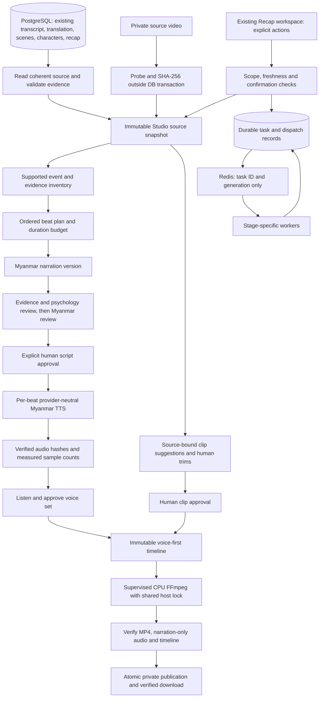
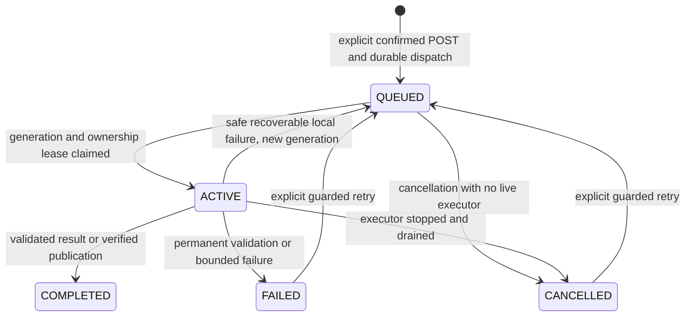
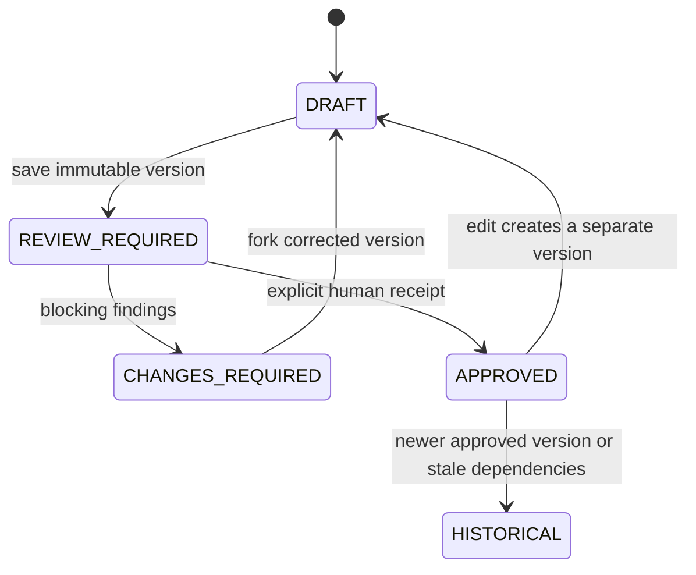

# Character Psychology Storyline Recap Architecture

## Status and boundaries

Phase 23.1 architecture proposal, audited against commit `b3de909` on 2026-10-11. **Nothing in this document is implemented by this phase.** Proposed model, route, profile and queue names below are design contracts, not descriptions of available functionality. Implementation requires separately authorized milestones in [the implementation plan](STORYLINE_RECAP_IMPLEMENTATION_PLAN.md).

Phase 23.1A revises the Studio translation-context policy to the approved `ALL_CURRENT` decision. It supersedes the earlier Approved Only prerequisite; it does not change existing subtitle export scopes or legacy recap behavior.

Approved product decisions:

- Style: `CHARACTER_PSYCHOLOGY`; duration mode: `AUTO_STORY_COMPLEXITY`.
- Translation context: `ALL_CURRENT`, including every valid, current, aligned Myanmar row regardless of subtitle approval. Context inclusion is separate from source verification and script approval.
- Natural Myanmar narration about supported behavior, decisions, relationships and consequences. Motivation must be identified as inference, never promoted to observed fact.
- Storyline highlights assembled from selected source clips, not full-movie dubbing.
- Final MP4 contains narration audio and **no original movie audio**. No music, source dialogue mix, TTS dubbing, GPU or local AI model is implied.
- Myanmar TTS first; voice cloning is optional and requires specific authorization and a compatible provider.
- Measured narration audio determines the timeline. CPU FFmpeg produces H.264/AAC MP4.
- Existing OpenRouter access is reusable for supported text tasks. It does not establish Myanmar TTS or voice-cloning support.
- [UI/UX v1.0](UI_UX_BASELINE.md) remains locked. Existing Recap, subtitle exports, render jobs and source preview retain their behavior.

Deployment remains trusted-local Linux. Project/movie relationship checks are not multi-user authorization. This proposal does not approve public deployment, provider selection, new paid requests, environment changes or numeric tuning defaults.

## 1. Repository audit: what exists

Current source code takes precedence over historical phase descriptions in README and render documents.

| Existing implementation | Safe reuse | Boundary or missing capability |
| --- | --- | --- |
| `Transcript`, `TranscriptSegment`; `lib/character-analysis/source.ts` | Ordered Chinese text, original millisecond timing, alignment validation and bounded batching | No speaker diarization or semantic event inventory; transcript text is not visual proof |
| `Translation`, `TranslatedSegment`; `lib/translation-review/`, `lib/translation-refinement/`, `lib/translation-qc/` | Human-authoritative current text, provenance, explicit approval, stale-write protection, aligned source and advisory QC | No narration script approval; subtitle approval cannot approve a recap claim |
| `lib/subtitle-export/selection.ts`, SRT/ASS serializers | Exact All Current / Approved Only selection, preserved approval gaps and timestamps | These produce subtitles, not narration or a highlight timeline |
| `Scene`; `lib/scenes/`, `workers/scene-detection-worker.ts` | Real continuous intervals from visual/transcript heuristics; original source timing | Scene boundaries are not semantic events; no thumbnails or verified scene descriptions |
| `Character`, aliases, `CharacterAnalysisRun`, character/relationship evidence; `lib/character-analysis/` | Movie-specific evidence, project-scoped identities, uncertainty and confidence restrictions | Analysis is advisory; project-wide relationship summaries cannot establish facts about a different movie |
| `Recap` and its sections, insights and evidence; `lib/recap/` | Completed grounded Myanmar summaries, current/stale checks, bounded hierarchical generation and strict reference validation | One current result per movie; no editable/versioned narration, approval, voice, clips or timeline |
| `lib/recap/source.ts` | Transcript/scenes and current character context capture | Current recap intentionally excludes Myanmar translation targets from its provider input/hash. Studio needs its own explicit translation-aware source contract |
| `lib/recap/response-schema.ts`, `validate-output.ts`, `diagnostics.ts` | Shared schema/local limits; safe validation-stage/rule/path diagnostics; character-specific evidence checks | Existing eight-section/10,000-character result limits are for the legacy recap shape, not a long-form Studio script |
| `lib/queue/recap-queue.ts`, `recap-recovery.ts`; recap APIs/worker | Explicit paid actions, deterministic source job identity, stale failed-attempt confirmation and nonterminal reuse | Existing recap state relies on BullMQ plus the completed DB receipt; no durable per-stage Studio task/checkpoint model |
| PostgreSQL/Prisma, `lib/prisma.ts` | Transactions, existing lock ordering, bounded database operations | New Studio aggregates/receipts are absent; avoid concurrent queries on one transaction connection |
| Eight current BullMQ queues; `lib/queue/connection.ts`, `lib/worker-runtime.ts`, `workers/start.ts` | Bounded producer connections, worker connections, role startup and graceful drain | No TTS, script-review or highlight worker; queue concurrency alone does not limit all CPU workers on a host |
| `lib/storage/local.ts`, `provider.ts`, `lib/env.ts` | Private local root, generated-key allowlist, regular-file/symlink checks, bounded streaming | Current namespaces cover original movies, extracted audio and rendered MP4s. Studio audio and artifacts need an additive namespace contract |
| `lib/video-render/source-media.ts`, `snapshot.ts`, `service.ts` | Actual source SHA-256/probe, immutable content recipes, short final revalidation transactions | Hashing is expensive and belongs to explicit preparation/execution, not page GETs. A snapshot does not retain source bytes |
| `RenderJob`, `RenderOutput`, `RenderDispatch`; render lifecycle modules | Durable dispatch, generations, leases/fencing, recovery, verified receipts, secure scoped downloads | Current `BURN_IN` and `SOFT_SUBTITLE` recipes describe full-movie subtitle exports, not a highlight compositor |
| `lib/video-render/runner.ts`, `scripts/render-supervisor.ts`, render cleanup | CPU lock, process supervision, fixed argument arrays, limits, private staging, termination/drain | Current output verifier expects source-length video and source-audio behavior; it must not certify a recap output |
| `components/media/source-video-preview.tsx`, `lib/source-video/`, source API | Real original-source playback, saved-timestamp seeking, range streaming, explicit older-movie selection | Browser codec support varies; source preview is not a rendered Studio preview |
| `app/projects/[id]/recap/`, `components/export/`, shared UI | Locked context/list composition, five Recap tabs, explicit actions, bounded abortable polling | Recap Video remains unavailable; no existing Script/Voice/Highlights Studio controls |

Relevant references: [recap diagnostics](RECAP_RESPONSE_DIAGNOSTICS.md), [failed recovery](RECAP_FAILED_RECOVERY.md), [render foundation](VIDEO_RENDER_FOUNDATION.md), [lifecycle](VIDEO_RENDER_LIFECYCLE.md), [soft subtitle profile](VIDEO_RENDER_SOFT_SUBTITLE.md), [Export integration](VIDEO_RENDER_EXPORT_UI.md), [source preview](SOURCE_VIDEO_PREVIEW.md), [local operation](RUN.md) and [production runbook](production-runbook.md).

### Existing API and job contracts

- Recap reads use `GET /api/movies/{movieId}/recap`; submission/status use POST/GET `/api/movies/{movieId}/recap/generate`. Explicit failed recovery uses POST `/api/movies/{movieId}/recap/generate/retry` with `{jobId, failureToken, acknowledged: true}`. The failure token binds the retained failed attempt; refresh/poll never retries. The legacy `/api/recap` prototype is not the Studio integration point.
- Queue `movie-recap` carries `{movieId, sourceHash}` with deterministic `recap-{encodedMovieId}-{sourceHash}` identity, concurrency 1, three bounded exponential-backoff attempts and retained receipts. Invalid structured output is terminal. Studio must not mistake worker readiness for new submission or copy automatic paid retries without request checkpoints.
- Existing render POST/list/detail base is `/api/projects/{databaseProjectId}/movies/{movieId}/renders`; lifecycle POST suffixes are `/{renderId}/cancel` and `/retry`, and verified GET download is `/{renderId}/download`. Fixed pairs are `BURN_IN`/`myanmar-mp4-cpu-v1` and `SOFT_SUBTITLE`/`myanmar-mp4-soft-copy-v1` with All Current/Approved Only scope.
- Queue `movie-video-render` carries only `{renderJobId, generation}`. Generation IDs, local/global concurrency 1, durable dispatch and a shared host CPU lock protect execution. Live ownership uses a 60-second lease with five-second heartbeat/control checks. Cancellation records intent, drains the actual process and then commits terminal state; explicit retry advances generation while retaining the immutable recipe.
- Source GET/HEAD `/api/projects/{databaseProjectId}/movies/{movieId}/source` streams the selected private file with native byte ranges. It does not encode, hash the full source, enqueue or call AI. Slugs remain browser navigation identifiers, not substitutes for database project IDs.
- Existing render completion requires a verified output receipt plus private publication. Retry/reconciliation can recover publication candidates; progress comes from real FFmpeg duration processing, not predicted completion time. These mechanisms are reusable; their full-source duration/audio expectations are not a Studio verifier.

### Existing invariants to preserve

- Manual translation edits remain authoritative. Production reruns preserve them; selective refinement cannot overwrite them. A text change invalidates subtitle approval; manual TM and local QC updates remain the translation editor's responsibility.
- Approved Only omits unapproved rows without closing time gaps. All Current includes current targets without implying approval. QC is advisory and manual issues are not silently resolved.
- Recap generation and rendering begin only through explicit POST. GET, SSR, status polling, navigation and worker startup do not generate content.
- Current recap source validity permits a single scene and multiple transcript segments. Its output sections can share a scene. Studio must also allow many beats in one scene.
- Scene and recap persistence can replace child rows. New Studio history must not depend on those live child IDs remaining present.
- Existing render snapshots have custom SQL immutability/completion/profile guards beyond Prisma declarations. Preserve them and both existing render profiles.

## 2. Architecture and separation

Create a separate movie-scoped **Storyline Studio** aggregate. Do not convert existing `Recap` rows into editable scripts, reinterpret `RenderMode`, or write TTS audio into the extracted STT input key. A completed current recap may seed planning as advisory source material with its own frozen evidence; it is not an approved script.

Reuse existing mechanisms through narrow, tested helpers when implementation needs them. The render lifecycle is currently render-specific: a shared durable-task abstraction does not already exist. Extract only the ownership/dispatch/supervision primitives required by a milestone, with regression tests for existing rendering.



Source/video bytes, scripts, narration and consent assets never belong in Redis payloads or logs. Workers load immutable inputs from PostgreSQL/private storage after checking ownership. Original source audio has no path into the final timeline audio graph.

## 3. Source snapshots, evidence and freshness

### Capture contract

Proposed `story-source-v1` snapshot contains:

1. Database project/movie identity, language pair and capture audit time.
2. Actual source key **server-only**, SHA-256, bytes and verified video-stream metadata/time base/duration. No absolute path or environment values.
3. Ordered transcript IDs, sequences, exact text and unchanged integer millisecond bounds.
4. Translation context policy `ALL_CURRENT`; exact admitted target text, translation/segment IDs, language pair, sequence and original timestamps, translation/row revisions, provider/model, origin (including MANUAL), refinement reference, manual source binding, translation created/updated and segment created/edit/review timestamps, and unchanged subtitle review status. Freeze QC scan state and findings, including category, severity, source, resolution and timestamps. Record each row's admission/exclusion reason and missing sequence; never silently omit unapproved or warned rows.
5. Scene intervals and original IDs as historical values; immutable `(sceneSequence, segmentSequence)` anchor membership. A segment crossing intervals may have multiple permitted pairs with bounded intersections.
6. Only current movie-specific character/relationship evidence, identity uncertainty and permitted confidence. Freeze canonical names/aliases and evidence; never join a future project-wide relationship summary into an old snapshot.
7. Optional current completed legacy recap and its grounded references, copied as advisory context. No dependency on its children surviving regeneration.
8. Source/validator/prompt policy versions, deterministic event inventory when available, content and safety-context hashes.

Approved translation-context policy: **ALL_CURRENT**. Include every current, valid Myanmar row aligned to the selected movie's current Chinese transcript, including UNREVIEWED, NEEDS_REVIEW and APPROVED rows, human edits and rows with QC warnings. Zero approved rows is not a draft-generation blocker. Inclusion does not approve a subtitle, verify a claim, create an evidence anchor or authorize an inferred motivation as fact.

The existing proposed source prerequisites remain usable source video, transcript, scenes and CURRENT character analysis for CHARACTER_PSYCHOLOGY generation. Missing translation alone does not prohibit a source-grounded draft: use the valid Chinese source and explicitly label missing Myanmar context. Missing or stale character evidence still cannot satisfy the CURRENT prerequisite. No fallback to another movie, older translation, provider-generated replacement or automatic translation request.

### Translation admission and presentation

The original **Chinese transcript is primary dialogue evidence**. Myanmar text is contextual interpretation attached to a transcript anchor, never an independent evidence anchor. Subtitle approval, human origin, model quality and absence of QC findings do not prove semantic support for a Studio claim.

| Row condition | Studio context treatment | Review meaning |
| --- | --- | --- |
| Current approved | Include exact target with `reviewStatus: APPROVED` | Subtitle reviewed; Studio claims still need source verification |
| Current unapproved | Include exact target with UNREVIEWED/NEEDS_REVIEW | Provisional interpretation; draft use permitted, no inferred truth |
| Human-edited but unapproved | Include authoritative current target with MANUAL and original approval/edit metadata | Human edit is authoritative for target text, not proof of facts or motives |
| Current with QC warnings | Include with all active/resolved findings and scan state, alongside the conditions above | Warnings remain visible; affected material claims need explicit source comparison/disposition |
| Missing translation/row | Record `MISSING`, target absent; use Chinese-only evidence where valid | No invented Myanmar row, no false approval, no loss of source interval |
| Stale or invalid translation/row | Exclude from generation context, record `EXCLUDED_STALE` or `EXCLUDED_INVALID` and static reason | Never present as current or silently fall back; affected claims require valid source support or correction |

These dimensions can overlap: a MANUAL/NEEDS_REVIEW row can have QC warnings. Keep `admission`, `reviewStatus`, `origin` and QC separate rather than a single misleading badge. QC not scanned is explicit unknown, not “no issues”. Preserve exact text/metadata for admitted rows; retain bounded exclusion metadata and historical hashes for unusable rows without feeding stale text to the model.

Admission validates Movie/Project/Translation ownership, current `sourceTranscriptId`, language pair, unique sequence, exact source start/end alignment, nonempty bounded target text and manual source hash where required. A translation-level binding/language failure excludes that translation; a row-level missing/invalid binding is explicit for that row. Fail snapshot capture on incoherent/ambiguous identity or unsafe source data. Do not weaken existing translation editor/refinement loaders: `lib/translation-qc/service.ts` currently requires a complete aligned set, so Studio needs a separate read-only admission layer reusing its checks while representing missing/excluded rows honestly. Partial context is not a new permission to edit malformed translations.

Capture a coherent DB view in Repeatable Read, close it, then stream/hash/probe media. Under a short Project → Movie → Studio lock, recheck source binding and all dependency hashes before inserting the snapshot/task/outbox. No provider call or long file operation inside a database transaction. A changed dependency returns a controlled stale-source conflict.

### Evidence rules

- Every narrated factual clause maps to one or more immutable claim IDs. Each claim has exact scene/segment anchors and supporting text; composite sentences require coverage of all factual clauses.
- Scene membership alone is insufficient. A reference must name an existing source-snapshot segment, intersect that scene and fit its saved timing.
- Character claims must cite that character's permitted anchors. Relationship claims require the correct endpoints and permitted relationship evidence. A generic plot segment does not authorize a character's internal motivation.
- A translation context reference must resolve to an admitted row aligned with the claim's Chinese evidence. It cannot extend allowed character anchors, introduce a relationship endpoint, or borrow evidence from another movie. General plot references cannot be reused as character/relationship proof merely because a translation names someone.
- `OBSERVED` describes supported speech, actions or consequences. `INFERRED` requires an explicit cautious Myanmar formulation, its basis and no stronger confidence than its anchors. Unsupported inference is rejected, not softened automatically into acceptance.
- Uncertain identities and UNKNOWN relationships retain LOW confidence restrictions; reviewers cannot raise them through repetition. No diagnosis, invented personality history, face recognition, voice identity or clinical psychological claim.
- AI review can flag unsupported semantics; deterministic validation proves membership/ownership/bounds, not that prose is truthful. Native-language human review remains necessary.
- Human approval cannot bypass malformed references or ownership rules. Corrections create a new valid script version, not an exception flag.

### Claim provenance, source verification and review

Keep source support, translation provenance and review disposition separate. Every factual/psychological claim records its immutable claim-content hash, source anchor set, any translation context references/row hashes, OBSERVED/INFERRED kind and inference basis. A server-derived read view exposes:

| Label / field | Required meaning |
| --- | --- |
| Source verified — `verificationStatus: SOURCE_VERIFIED` | An explicit human source-comparison receipt supports the exact claim against its allowed Chinese anchors and current context. For an inference, it supports only the qualified inference and its observed basis, not access to a character's mind |
| Provisional translation context — `verificationStatus: PROVISIONAL_TRANSLATION_CONTEXT` | Interpretation relies on translation and has not yet received sufficient source comparison. This can apply even to an APPROVED subtitle; eligible for draft work only |
| Needs human review — `reviewStatus: NEEDS_HUMAN_REVIEW` | Semantic support, QC relevance, qualification or narrative use remains unresolved. May coexist with structurally valid anchors or source verification |
| Unsupported or invalid evidence — `verificationStatus: UNSUPPORTED_OR_INVALID_EVIDENCE`, `reviewStatus: BLOCKED` | Unsupported meaning or invalid references/ownership/freshness; cannot contribute supported events or pass script approval |

Chinese-only candidates without a source-comparison receipt have `verificationStatus: PENDING_SOURCE_REVIEW` and NEEDS_HUMAN_REVIEW; absence of translation is not evidence of either validity or invalidity. `reviewStatus: ACCEPTED` requires a permitted explicit human disposition and, for material claims, a current SOURCE_VERIFIED receipt. None of these Studio statuses writes `TranslatedSegment.reviewStatus`.

Proposed source-verification receipt binds source snapshot/context hash, claim/event content hash, exact Chinese anchor-set hash, translation row-context hashes, qualification/basis for inference, verification-policy version, human operator audit label, outcome and timestamp. It is append-only; new text, anchors or context require a new comparison. Human findings/dispositions do not mutate the script or subtitles. A changed claim requires a new script version. “Source verified” means assessed against the captured source, not guaranteed objective truth or independently verified transcript accuracy.

An event-level receipt must bind its essential constituent claim hashes and their source-comparison outcomes; approving an event label cannot implicitly verify unrelated or changed claims. Store unsupported/inconclusive outcomes as blockers, not approvals. Deterministically invalid provider references still fail response validation before a successful result receipt, even for drafts; the invalid-evidence label describes diagnostics/findings and never permits saving that output as validated content.

### Deterministic versus semantic review

1. **Deterministic validation** enforces identifiers, selected movie/project, allowed scene/segment membership, character/relationship ownership and endpoints, timing, freshness, provenance bindings, bounds and hashes. Valid anchors prove membership, not the meaning of prose. Invalid references/ownership are rejected and can never be waived, even by an operator.
2. **AI review** proposes factual/psychological/linguistic findings using exact source/translation comparisons and strict response contracts. It cannot issue a human source-verification receipt, approve a claim, clear manual findings or establish semantic truth by returning “pass”.
3. **Human disposition** explicitly compares supported meaning with Chinese evidence and records a permitted source-verification/disposition receipt. It may accept an advisory language finding or establish support for a previously provisional claim with existing allowed evidence; it cannot accept unsupported facts, manufacture anchors or waive structural violations. Unresolved meaning requires correction/removal or source repair in its separate workflow.

Unsupported motivation is never accepted through cautious wording alone. Supported INFERRED motivation requires observed basis claims, the same strict entity-specific ownership, no stronger confidence than its evidence, and cautious Myanmar wording. OBSERVED cannot contain an internal motive merely because a translation states it confidently.

### Hash graph and staleness

Canonical serialization uses sorted object keys, defined array order, finite integers, explicit nulls and UTF-8 SHA-256 with a version/domain prefix. Reject duplicate IDs/unknown fields. Preserve exact text; do not silently normalize Myanmar Unicode, collapse whitespace or rewrite narration. Canonical JSON is not a raw provider-response archive.

| Identity | Included dependencies |
| --- | --- |
| `sourceContentHash` | Project/movie, actual source SHA/metadata, exact Chinese transcript and every admitted ALL_CURRENT target text/timing, scene bounds, actual frozen character/relationship evidence and optional recap content |
| `translationRowContextHash` | Row/translation identity, source binding/alignment, exact target, language, revisions, provenance, manual/refinement metadata, subtitle approval/edit/review metadata and complete frozen QC state |
| `sourceContextHash` | Content hash plus ALL_CURRENT policy/version, admitted row-context hashes, missing/excluded-row identities/reasons and binding hashes, QC scan state, uncertainty and evidence-policy version |
| `scriptHash` | Source content/context hashes, style, ordered beats, narration, immutable claim content/context refs, evidence, editorial order and script policy; excludes derived verification/review statuses |
| `reviewHash` | Exact script hash, review type, validated findings, reviewer provider/model and policy version |
| `approvalDependencyHash` | Script hash, current source/context and source-verification receipt hashes, required review/disposition hashes and approval policy; cannot be supplied as “verified” by a model |
| `voiceRecipeHash` | Script/beat narration hash, provider/model/voice version, fixed settings, pronunciation policy and consent revision when relevant |
| `clipPlanHash` | Source SHA, script hash, ordered cuts, source bounds and clip policy |
| `timelineHash` | Script, approved voice set/audio SHA and decoded sample counts, approved clips, explicit pauses, composition profile |
| `renderRecipeHash` | Timeline hash, exact audio/source hashes and fixed encoder policy/version. Actual FFmpeg/library versions are retained as execution audit metadata; identical recipes do not promise byte-identical encoding across installations |

Actual text participates even when translation/refinement generation identifiers do not change. Capture timestamps, attempt/lease tokens and progress never affect content identities. Translation edit/review timestamps and revisions are preserved in row-context identity as domain metadata; a changed approval or QC state changes context even when target text is identical. Claim-content hashes exclude derived review outcomes to avoid circular receipt hashes. Reusing a content result does not establish current approval or renew consent.

Keep immutable historical outputs. On source/text/approval/QC changes, report dependency-specific staleness and block new downstream work until explicit review/rebase; do not delete old scripts or silently regenerate. Currentness derives from stored DB dependency hashes; long source checksums are refreshed only by explicit preparation/execution. GET can report “last verified” or unknown media currentness, never claim an unchanged file from a row timestamp alone.

Any translation text, approval state, QC finding/resolution/scan-state or alignment change invalidates the affected context bindings and source-verification eligibility. Snapshot-level `sourceContextHash` changes conservatively stale the script and approvals; changed row hashes identify affected claims. A newly missing/excluded row also changes context. Preserve historical script/voice/clip/timeline/render artifacts and their old approval receipts; label them historical rather than deleting or modifying them. Explicit rebase creates a new context/version and rechecks affected claims; unchanged verified audio can only be reused under the existing exact-recipe/current-approval rules. A Studio approval never approves subtitles, resolves their QC, changes provenance, overwrites a human edit or updates TM.

## 4. Story Beat contract

An ordered beat is a supported narrative unit, not a scene. Initial categories: `SETUP`, `OBSERVATION`, `CONFLICT`, `DECISION`, `CONSEQUENCE`, `RELATIONSHIP_CHANGE`, `TURNING_POINT`, `RESOLUTION`. Categories are optional editorial classifications, not a requirement to manufacture a full arc. A short source may have only observation/decision/consequence beats; unresolved stories must remain unresolved.

Proposed bounded contract: 1–60 beats per script; 1–12 claims per beat; 1–8 anchors per claim; narration 1–1,200 Unicode code points per beat, total script at most 36,000 code points; normalized source-event inventory at most 200 events. Treat these as initial safety ceilings pending workload calibration, not narration targets. Enforce code-point counts locally; provider JSON Schema limits are an additional check, not a replacement. Bound request bytes and serialized output independently (initial proposal 512 KiB per script). Batch long sources without dropping evidence or relaxing ownership.

Synthetic illustration: both beats belong to **scene 0**. The first uses an admitted MANUAL/NEEDS_REVIEW translation and remains provisional; the second has a synthetic human source-comparison receipt but still needs narrative review. Verification/review fields below are server-derived read metadata, not fields trusted from a provider or client save. The dialogue, names and content are fixture data, not repository movie content. Hashes are symbolic placeholders; production requires 64 lowercase hexadecimal characters.

```json
{
  "schemaVersion": "story-script-v1",
  "sourceSnapshotId": "snapshot-fixture",
  "sourceContextHash": "<sha256>",
  "translationContextPolicy": "ALL_CURRENT",
  "style": "CHARACTER_PSYCHOLOGY",
  "durationMode": "AUTO_STORY_COMPLEXITY",
  "language": "my",
  "beats": [
    {
      "id": "beat-01",
      "order": 0,
      "category": "OBSERVATION",
      "sourceBounds": { "startMs": 1000, "endMs": 9000 },
      "characterRefs": ["character-a"],
      "relationshipRefs": [],
      "narration": "သူက အဖြေမပေးဘဲ ခဏရပ်နေခဲ့တယ်။",
      "narrationClaims": [{ "sentenceIndex": 0, "claimIds": ["claim-01"] }],
      "claims": [
        {
          "id": "claim-01",
          "kind": "OBSERVED",
          "statement": "The character pauses without answering.",
          "confidence": "LOW",
          "characterRef": "character-a",
          "relationshipRef": null,
          "translationContextRefs": [{ "translationSegmentId": "translation-0", "rowContextHash": "<sha256>" }],
          "verificationStatus": "PROVISIONAL_TRANSLATION_CONTEXT",
          "sourceVerificationReceiptRef": null,
          "reviewStatus": "NEEDS_HUMAN_REVIEW",
          "evidence": [{ "sceneSequence": 0, "segmentSequence": 0 }]
        }
      ]
    },
    {
      "id": "beat-02",
      "order": 1,
      "category": "DECISION",
      "sourceBounds": { "startMs": 10000, "endMs": 18000 },
      "characterRefs": [],
      "relationshipRefs": [],
      "narration": "နောက်ဆုံးမှာတော့ စောင့်ဖို့ ဆုံးဖြတ်ခဲ့ကြတယ်။",
      "narrationClaims": [{ "sentenceIndex": 0, "claimIds": ["claim-02"] }],
      "claims": [
        {
          "id": "claim-02",
          "kind": "OBSERVED",
          "statement": "The speakers explicitly agree to wait.",
          "confidence": "LOW",
          "characterRef": null,
          "relationshipRef": null,
          "translationContextRefs": [],
          "verificationStatus": "SOURCE_VERIFIED",
          "sourceVerificationReceiptRef": "verification-02",
          "reviewStatus": "NEEDS_HUMAN_REVIEW",
          "evidence": [{ "sceneSequence": 0, "segmentSequence": 4 }]
        }
      ]
    }
  ]
}
```

For `INFERRED` claims additionally require `inferenceBasisClaimIds` referencing supported observed claims and `qualification` describing the uncertainty. Sentence splitting must be deterministic and versioned; a production contract may use explicit narration chunks rather than ambiguous punctuation offsets. Never accept the example sentence indexes as sufficient semantic validation by themselves.

Proposed typed distinctions (runtime validation is still mandatory):

```ts
type Anchor = { sceneSequence: number; segmentSequence: number };
type ClaimBase = {
  id: string;
  statement: string;
  characterRef: string | null;
  relationshipRef: string | null;
  confidence: "LOW" | "MEDIUM" | "HIGH";
  evidence: Anchor[];
  translationContextRefs: {
    translationSegmentId: string;
    rowContextHash: string;
  }[];
};
type StoryClaim =
  | (ClaimBase & { kind: "OBSERVED" })
  | (ClaimBase & {
      kind: "INFERRED";
      inferenceBasisClaimIds: string[];
      qualification: string;
    });
// Derived from server validation and append-only human receipts, never AI authority.
type ClaimReviewView = {
  verificationStatus:
    | "PENDING_SOURCE_REVIEW"
    | "PROVISIONAL_TRANSLATION_CONTEXT"
    | "SOURCE_VERIFIED"
    | "UNSUPPORTED_OR_INVALID_EVIDENCE";
  reviewStatus: "NEEDS_HUMAN_REVIEW" | "ACCEPTED" | "BLOCKED";
  sourceVerificationReceiptRef: string | null;
};
type SupportedEvent = {
  eventKey: string;
  kind: "ACTION" | "CONFLICT" | "DECISION" | "OUTCOME" | "RELATIONSHIP_CHANGE";
  sourceStartMs: number;
  sourceEndMs: number;
  characterRefs: string[];
  relationshipRefs: string[];
  claims: StoryClaim[];
  precedingEventKeys: string[];
};
```

Reject cyclic inference bases, absent observed basis claims and causal links to later/unrelated events. A referenced previous event is a proposed causal interpretation requiring review, not proof of causation from chronological order alone.

Source bounds are enclosing evidence bounds, not automatically approved clip trims. Default narrative order is chronological. A human may reorder beats only by saving a new version and re-reviewing it; preserve original source timestamps and make nonchronological narration explicit. Multiple clips may illustrate one beat, and one scene may support many beats.

### Editing and approval

Script payloads are immutable. Explicit Save creates a new version with parent ID, monotonically allocated version number, exact content hash and origin `MODEL` or `HUMAN`. Optimistic `expectedStudioRevision` prevents lost updates. No autosave paid calls, automatic retranslation or automatic Sol refinement.

An edit invalidates the new version's review/approval and downstream voice/timeline eligibility. Previous approved versions remain historical and downloadable outputs are not relabeled current. Reuse of an unchanged beat's verified voice requires identical voice recipe and valid consent; it does not approve a changed script.

Human-only approval is a separate immutable receipt bound to the script and review-policy hashes. Approval requires current dependencies, valid anchors, completed required reviews and explicit resolution of blocking findings. AI acceptance, no findings or successful TTS cannot create approval.

Draft generation is allowed with eligible unapproved translations and provisional claims. Final script approval requires current `approvalDependencyHash` and sufficient source verification for every narrated factual/psychological claim, including every essential claim that drives an event, arc, decision or inferred motivation. A provisional, unsupported, stale or insufficiently qualified material claim blocks approval until supported by allowed source comparison or corrected/removed in a new version. An APPROVED subtitle is not an exemption. Accepting an advisory wording finding cannot clear a factual blocker. Script approval has no write path to translation approval, QC, refinement or TM; downstream TTS/render require this exact script approval.

## 5. Deterministic Auto Duration Engine

The engine proposes a **maximum useful narration budget**, not a target to fill. It does not infer story complexity from scene count, file size, transcript length or model confidence alone. One scene with twelve grounded events can justify several beats; twelve paraphrases of one event count once.

### Inputs and deterministic features

Freeze a structurally validated candidate inventory first, then derive a supported inventory from current human source-verification receipts. Each candidate records evidence anchor keys, translation context/provenance, claim-verification outcomes, action/decision/outcome type, participating entities and optional links to earlier events. Normalize duplicate anchors/event keys deterministically; semantic duplicate candidates require review rather than automatically treating synonyms as new events.

Unverified translation-only claims contribute **zero** to supported E/A/C/R, supporting evidence coverage Q, eligible visual coverage V and duration allocation. Approved subtitle text, MANUAL origin, no QC warnings and AI-review acceptance do not remove this restriction. Count an event only when all essential constituent claims are source-verified; count an arc, relationship change or causal decision only when its required events/links are also supported. Invalid ownership is rejected, not a low-weight contribution. Keep provisional candidate counts separate for editorial review and never add them to complexity scores.

- `T`: verified source video runtime in seconds.
- `E`: distinct source-verified supported events selected for the plan.
- `A`: supported character arcs with at least two temporally distinct evidenced states/decisions; counting a character alone is insufficient.
- `C`: distinct evidenced conflicts or consequential decisions, counted once per event.
- `R`: evidenced relationship changes, not number of relationship records.
- `Q`: union of source intervals supporting verified claims in counted events divided by `T`, clamped to 0–1. A whole-scene interval does not inflate this coverage.
- `V`: union duration of eligible source clip intervals tied to those verified claims, intersected with actual video bounds; exclude unavailable material and duplicate ranges. Visual suitability remains provisional until human clip approval.

Proposed `auto-story-v1` coefficients, **uncalibrated and requiring approval**:

```text
e = min(E, 40); a = min(A, 6); c = min(C, 10); r = min(R, 6)
needSeconds = 6*e + 10*a + 6*c + 5*r
evidenceFactor = 0.65 + 0.35*min(1, Q/0.15)
hardCapSeconds = min(720, 0.20*T, V)
planningCapSeconds = hardCapSeconds * evidenceFactor
softFloorSeconds = min(30, 0.08*T, planningCapSeconds)
suggestedBudgetSeconds = min(planningCapSeconds, max(softFloorSeconds, needSeconds))
```

If `E=0`, no supported duration budget is issued; if usable `V=0`, block final visual planning. A bounded explicitly confirmed provisional draft can still be generated for human source comparison, labeled “supported duration pending verification”; pending claims do not receive supported event/arc counts or raise budgets. Draft text safety ceilings are not a target duration. The soft floor applies only after eligible events exist and is an editorial hint, never a minimum output requirement. Actual useful narration below it is valid. Tiny sources can produce a very short recap or “insufficient supported material”, not filler. Floors/caps must remain coherent (`floor <= cap`) for short or sparse sources. Cap event/arc contributions before arithmetic; validate finite values and bound runtime through source preflight.

Allocate the budget across selected beats with deterministic category weights (proposed decision/consequence/turning point 1.4, other categories 1.0), bounded by each beat's eligible visual coverage. Round only presentation values; store the full policy/version and feature counts. Overlap/reuse across beats is not extra visual availability. Proposed initial policy forbids duplicate source-frame intervals in one timeline; a future deliberate flashback policy needs explicit approval.

No formula proves semantic complexity. Inventory and human selection remain the basis; persist explainable counts and caps, not a fictional “complexity confidence” percentage.

### Calibration and measured duration

Myanmar does not support a reliable English word-count heuristic. Before a chosen TTS provider is enabled, calibrate a versioned estimate using authorized short/long Myanmar narration, names, numbers and dialogue references. Measure decoded audio durations, compare with Unicode grapheme counts, record a rate range and have a Myanmar speaker assess pace/intelligibility. Until calibrated, narration duration estimates are **unavailable**; the budget above is still an editorial cap, not a claimed voice duration or ETA.

Store calibration/provider/voice versions, estimate error and text-class coverage. Change coefficients only through an explicit policy version with deterministic regression fixtures. Calibration is a future separately confirmed paid experiment, not part of this audit.

Once TTS exists, decoded sample counts replace every text estimate. If narration exceeds approved budget or available approved clips, block timeline approval with the exact shortage. Offer an explicit script reduction/beat removal and renewed review/TTS confirmation; never pad narration, speed it up automatically, loop footage, freeze frames or truncate audio to fit.

## 6. Script generation and review stages

| Stage | Input → result | Gate and failure policy |
| --- | --- | --- |
| Evidence analysis | Chinese evidence + frozen ALL_CURRENT context → bounded candidate event/claim inventory | Strict source ownership; translation refs are contextual; current character anchors required; candidates are not automatically source-verified |
| Beat planning | Candidate/verified inventories + duration policy → ordered draft plan and eligible budget | Multiple beats per scene; provisional beats labeled; only source-verified supported events/arcs increase counts/budgets |
| Myanmar narration | Structurally valid plan, including labeled provisional candidates → draft script version | Natural Myanmar, cautious inference, clause-to-claim coverage; provisional does not mean approved or authorize known unsupported quotes/events |
| Evidence/psychology review | Exact script + Chinese anchors, translation provenance/approval and QC → findings | Separate pass; source comparison, motives/ownership/qualification; AI findings cannot create human verification receipts |
| Myanmar narrative review | Exact script + claim map → language/readability findings | Check natural phrasing, uncertainty, names and repetition without changing factual meaning |
| Human script approval | Current reviewed version + permitted human source-verification/disposition receipts → approval receipt | Explicit human action; essential claims source-verified; unresolved material/ownership blockers cannot pass; no subtitle approval side effect |

Use the existing provider abstraction pattern and OpenRouter envelope/finish-reason handling for text tasks. Define separate bounded schemas per stage. Align local and provider constraints where supported; reject malformed/incomplete/oversized output, never truncate or repair it silently. Reuse safe diagnostic fields (stage, static rule, static field path, counts/limits, safe finish reason, task correlation ID). Do not log source, narration, response bodies, voice assets, credentials or private paths.

Long sources use closed-reference windows and a validated hierarchy: synthesis may cite only anchors present in child results. Persist successful stage/chunk receipts to avoid repeating completed paid work. Proposed default is the existing configured production text provider/model; any reviewer/model change is explicit configuration and approval, not an automatic paid escalation.

ALL_CURRENT does not remove input/output safety budgets. Pair admitted translations and their provenance/approval/QC with the Chinese anchors in each bounded window; retain all rows in the immutable snapshot and track window coverage. Do not truncate exact target text or silently drop an eligible row to fit a prompt. If a single aligned unit cannot fit a stage's safe contract, return a controlled size/capability error or use an explicitly designed evidence-preserving partition, not an Approved Only fallback.

Required reviews block script approval until findings are explicitly resolved by a revised version or a justified human disposition permitted by policy. Local invalid-reference findings cannot be waived. Advisory Myanmar style findings can be accepted with an audit note. Manual findings are not automatically cleared by a model review.

Paid generation/review acknowledgement binds ALL_CURRENT context and current approval-dependency metadata where relevant. Changed subtitle approval/QC/alignment makes old confirmations stale, even with unchanged text. Snapshot capture, human source comparison, disposition, save and approval do not call a provider; GET/SSR/status cannot perform any of them as a side effect.

## 7. Voice, highlights and voice-first composition

### Provider-neutral voice interface

Proposed adapter methods: `capabilities()`, `synthesize(input, signal)`, optional `lookupRequest(id)`, and optional `deleteVoiceAsset(id)`. Capabilities explicitly declare Myanmar support, standard voices, cloning, request idempotency, maximum input size, supported audio formats, cancellation and retention behavior. Missing capabilities remain unavailable.

```json
{
  "schemaVersion": "story-voice-request-v1",
  "scriptVersionId": "script-fixture-v2",
  "beatId": "beat-01",
  "narrationHash": "<sha256>",
  "voiceProfileId": "voice-fixture",
  "voiceProfileRevision": 1,
  "language": "my",
  "audioProfileId": "myanmar-narration-pcm-v1",
  "expectedVoiceRecipeHash": "<sha256>",
  "acknowledgedPaidUsage": true
}
```

Server resolves exact approved text and provider settings; clients cannot submit arbitrary provider URLs, audio paths or FFmpeg arguments. Proposed intermediate profile: decoded PCM WAV, 48 kHz mono. Provider bytes are bounded, inspected and normalized locally; verify decode success, nonempty supported audio, checksum, sample rate/channels, decoded sample count and duration. Reject truncated or unexpectedly silent output with safe diagnostics. Record usage/cost only if provider reports it; unknown is not zero.

Generate one take per beat recipe with durable checkpoints, then explicitly listen/approve the exact voice set. A voice-set manifest binds every beat to a verified artifact, including unchanged takes reused by identical recipe. Pronunciation edits are explicit voice-policy changes; narration text changes create a new script version.

### Optional consent-based cloning

Standard Myanmar TTS is the initial release. Defer cloning until provider capability, legal/retention obligations and operator workflow are separately approved. A voice profile alone is not proof of consent. Require a consent receipt identifying speaker authorization, permitted project/use, provider, asset hash, expiry/revocation and policy version. Recheck consent before submission and publication; revocation blocks new use and triggers an explicit retention review. Do not silently delete existing outputs or claim a local checkbox establishes legal authority. External downloads cannot be recalled.

Consent samples are private assets with bounded upload/validation and explicit provider disclosure. No arbitrary remote fetch URLs; provider retrieval uses allowlisted configured hosts with byte/time limits and redirect checks. OpenRouter text access is not a voice-cloning interface. Trusted-local operator attribution is an audit label, not authenticated identity.

### Highlights and clip approval

Suggest real source intervals from each beat's supporting anchors, optionally adding bounded handles (proposed maximum 750 ms each side) within source/scene bounds. These are suggestions, not evidence that a face or action appears on screen. Humans use the existing source player to confirm suitability and approve trims.

Clip plan stores source SHA, beat ID, clip order, original start/end milliseconds and selection reason/anchor keys. Validate positive duration, permitted evidence interval, actual video bounds and no duplicate frame ranges. Human trim/reorder cannot edit transcript timing. A trim outside allowed evidence windows requires a new supported plan, not arbitrary unrelated footage. No automatic scene titles, posters, screenshots or semantic visual confidence.

Reorder clips within a beat by explicit save/approval. Reordering beats changes script order and requires script review again. Approving clips and approving narration are distinct acts. If original playback is unsupported, do not claim visual approval from a placeholder; operator verification in a compatible local player is an explicit documented alternative.

### Timeline contract

```json
{
  "schemaVersion": "story-timeline-v1",
  "scriptHash": "<sha256>",
  "sourceSha256": "<sha256>",
  "voiceSetHash": "<sha256>",
  "clipPlanHash": "<sha256>",
  "profileId": "myanmar-storyline-mp4-cpu-v1",
  "audioSampleRate": 48000,
  "originalAudioPolicy": "EXCLUDE",
  "items": [
    {
      "beatId": "beat-01",
      "timelineStartSample": 0,
      "voiceSamples": 240000,
      "pauseAfterSamples": 0,
      "audioArtifactId": "artifact-fixture",
      "audioSha256": "<sha256>",
      "clips": [{ "sourceStartMs": 1000, "sourceEndMs": 6000, "timelineStartFrame": 0, "frameCount": 150 }]
    }
  ],
  "totalAudioSamples": 240000,
  "totalVideoFrames": 150
}
```

Synthetic numbers assume measured five-second audio and the proposed 30 fps profile. General composition uses rational time bases, decoded samples and cumulative frame rounding to avoid per-beat drift. Any pause must be explicit (default zero initially), covered by approved footage and counted in duration. Normal final frame/AAC padding tolerance is bounded by verifier policy, not used to hide seconds of uncovered narration.

No implicit audio stretching, repeated footage, frozen frames or `-shortest` truncation. If the approved clips cannot cover the measured voice interval, return `STORY_VISUAL_COVERAGE_INSUFFICIENT`. Resolve through explicit clip/script decisions before rendering. Source VFR/timestamps require accurate decode/trim and fixed-output frame mapping; do not use keyframe stream copy for arbitrary highlight cuts.

### CPU FFmpeg strategy

Proposed fixed `myanmar-storyline-mp4-cpu-v1`: H.264/libx264, yuv420p, 1280×720 letterbox preserving aspect, 30 fps, CRF 20, AAC 192k/48 kHz mono, MP4 faststart. Raster/frame-rate/quality are new defaults requiring approval. No burn-in, soft tracks, blur, music or TTS captions in this initial Studio profile.

1. Revalidate source SHA and staged input; validate every approved audio checksum/decoded duration and immutable timeline.
2. Decode accurate approved source cuts, normalize timestamp/scale/pad/fps and concatenate video-only segments. Intermediate mapping is video only with `-an`; omit source subtitle/data/attachment streams and chapters.
3. Assemble verified per-beat narration PCM plus only explicit silence intervals. Use exact sample counts and checksum the assembled narration input.
4. Encode/mux mapped composed video plus **assembled narration only**. Do not map `0:a`, copy source audio, or use automatic stream selection. Build arguments/filter graphs from validated server numbers/IDs with shell disabled; never interpolate user filter text.
5. Verify nonempty MP4, exactly one expected H.264 video and one AAC narration track, no subtitle/extra streams, raster/fps, measured duration/sample tolerance, hashes and safe metadata. Store a composition manifest proving which inputs were mapped. Codec probing alone cannot prove absence of source dialogue; tone-isolation fixture and mapping tests complement it.
6. Publish through fenced, fsynced, exclusive private publication and a verified receipt; only then complete the task and expose a scoped download.

Reuse process supervisor/drain/resource limits and the **same host CPU flock** as current rendering. Initially one CPU compositor globally; per-queue concurrency alone would allow overlap with the existing encoder. Budget staging disk for source, all voice files, intermediates and final output; current full-movie headroom formula is insufficient for multiple intermediates.

Initial source policy should reuse conservative video validation (single moving video, bounded dimensions/runtime, progressive SDR, supported timestamps/SAR/rotation), with explicit fixtures for VFR. Reject unsupported rotation/HDR/multiple moving-video cases initially. Silent and multiple-audio sources can be accepted because all source audio is excluded; do not inherit the burn-in profile's one-audio restriction unnecessarily. No transcoding just to display a GET preview.

## 8. Proposed additive data architecture

All names below are proposed. Existing `Recap`, `RenderJob`, `RenderOutput`, `RenderDispatch`, `RenderMode` and their records remain unchanged. Studio jobs use a separate namespace and receipts. No backfill or implicit conversion of existing recap/translation approval.

Common conventions: UUID primary keys unless noted; SHA-256 `Char(64)` lowercase; audit dates UTC; finite nonnegative counters; exact runtime in integer samples/milliseconds, file sizes `BigInt`; private storage keys never returned in DTOs. `createdAt` is immutable. Versioned payloads are strictly validated, bounded JSON, not arbitrary provider JSON.

| Proposed model | Main fields and foreign keys | Uniqueness / indexes |
| --- | --- | --- |
| `StorylineStudio` | `id`, `movieId → Movie`, `revision`, nullable current source/script pointers, audit dates. Project resolved through Movie | Unique `movieId`; pointers constrained to this Studio |
| `StorySourceSnapshot` | `studioId`, `schemaVersion`, content/context hashes, immutable source/evidence manifest JSON; original source IDs as historical values | Unique `(studioId, contextHash)`; index `(studioId, createdAt)` |
| `StoryScriptVersion` | `studioId`, `sourceSnapshotId`, nullable parent version, `version`, style/duration mode/language, content hash, origin, duration-policy JSON, immutable payload | Unique `(studioId, version)` and `(studioId, sourceSnapshotId, contentHash)` |
| `StoryBeat` | `scriptVersionId`, stable editorial `beatKey`, order/category, narration/hash, source bounds, validated claims/anchor JSON | Unique `(scriptVersionId, order)` and `(scriptVersionId, beatKey)` |
| `StorySourceVerification` | `studioId`, `sourceSnapshotId`, subject kind EVENT/CLAIM, subject-content/anchor/context hashes, version, outcome SUPPORTED/UNSUPPORTED/INCONCLUSIVE, inference-basis/qualification hashes, policy hash, human operator label/date | Unique `(sourceSnapshotId, subjectKind, subjectHash, policyHash, version)`; index `(sourceSnapshotId, subjectKind)`; append-only and same-Studio; review outcomes stay separate from immutable script text |
| `StoryReviewRun` | `scriptVersionId`, `taskId`, type `EVIDENCE_PSYCHOLOGY`/`MYANMAR_NARRATIVE`, input/policy hash, immutable validated findings with stable finding keys, result hash | Unique `taskId`; index `(scriptVersionId, type, createdAt)` |
| `StoryReviewDisposition` | `reviewRunId`, `findingKey`, disposition version, action, operator audit label, note, date; optional replacement script/source-verification receipt reference | Unique `(reviewRunId, findingKey, version)`; append-only, latest valid receipt derives disposition; unsupported facts and local invalid-evidence findings cannot be waived |
| `StoryApproval` | `scriptVersionId`, kind `SCRIPT`/`VOICE_SET`/`CLIP_PLAN`/`TIMELINE`, target hash, dependency hash, policy hash, operator audit label, approved date; optional FK to the corresponding voice set/clip plan/timeline | Unique `(kind, targetHash, dependencyHash, policyHash)`; index `scriptVersionId`; CHECK enforces appropriate target and matching script/Studio; binds required source-verification/review receipts |
| `StoryVoiceSet` | `scriptVersionId`, profile revision/hash, immutable expected beat recipe manifest and set hash | Unique `(scriptVersionId, recipeHash)`; index `(scriptVersionId, createdAt)` |
| `StoryVoiceTake` | `voiceSetId`, `beatId`, `taskId`, verified `artifactId`, voice recipe/narration hash, measured samples/rate/channels, provider/model/usage, consent hash if applicable | Unique `(voiceSetId, beatId)`; index `taskId`; immutable successful association. Another set may reference the same task/artifact only after exact recipe/text and current-consent checks |
| `StoryClipPlan` | `scriptVersionId`, `sourceSnapshotId`, version/parent, immutable ordered interval manifest, content hash | Unique `(scriptVersionId, version)` and `(scriptVersionId, contentHash)` |
| `StoryTimeline` | `scriptVersionId`, `voiceSetId`, `clipPlanId`, approved dependency receipt IDs, timeline hash, fixed profile, immutable sample/frame manifest | Unique `(scriptVersionId, timelineHash)`; index `(scriptVersionId, createdAt)` |
| `StoryRender` | `timelineId`, `taskId`, recipe hash, nullable verified `outputArtifactId`, profile ID | Unique `taskId`, `(timelineId, recipeHash)`, nullable output receipt unique |
| `StoryTask` | `studioId`, kind, immutable input hash/manifest, state, generation, attempt budget/count, stage/real progress, safe error/diagnostics, cancel request and lifecycle dates, optional validated result receipt | Unique `(studioId, kind, inputHash)`; indexes `(studioId, createdAt)` and `(state, createdAt)` |
| `StoryTaskDispatch` | `taskId` PK/FK, generation, dispatch token/lease, active token/lease/heartbeat, next dispatch, failures, deferred reason, publication candidate JSON, provider checkpoint metadata | Indexes `nextDispatchAt`, `activeLeaseUntil`; one durable dispatch intent per task |
| `StoryArtifact` | `taskId`, kind `VOICE_AUDIO`/`NARRATION_AUDIO`/`FINAL_VIDEO`, private key, safe filename/MIME, SHA, bytes, verified date, measured media metadata, immutable input receipt hash | Unique key and `(taskId, kind)`; verified receipt required before successful file task completion |
| `StoryVoiceProfile` (later) | Standard or cloned kind, provider voice reference server-only, revision, capability/settings hash, active/revoked status | Unique `(provider, providerVoiceRef, revision)`; no secret payload |
| `StoryVoiceConsent` (cloning milestone only) | `voiceProfileId`, revision, speaker/operator audit references, permitted use/project, evidence artifact/hash, policy/expiry/revocation | Unique `(voiceProfileId, revision)`; index `(voiceProfileId, expiresAt)` |

Standard-voice configuration may initially be a fixed server contract instead of the last two tables. Add them only when editable profiles/consent are actually implemented. Keep durable event inventories and beat plans as validated `StoryTask` result manifests initially rather than adding one table per AI stage.

Illustrative core Prisma declarations (abbreviated: reverse relations, approval target relations and SQL guards must be completed in implementation, not pasted as a runnable migration):

```prisma
enum StoryTaskState {
  QUEUED
  ACTIVE
  COMPLETED
  FAILED
  CANCELLED
}

model StorylineStudio {
  id        String   @id @default(uuid())
  movieId   String   @unique
  movie     Movie    @relation(fields: [movieId], references: [id], onDelete: Cascade)
  revision  Int      @default(0)
  createdAt DateTime @default(now())
  updatedAt DateTime @updatedAt
}

model StorySourceSnapshot {
  id            String   @id @default(uuid())
  studioId      String
  schemaVersion String
  contentHash   String   @db.Char(64)
  contextHash   String   @db.Char(64)
  manifestJson  Json
  createdAt     DateTime @default(now())
  @@unique([studioId, contextHash])
  @@index([studioId, createdAt])
}

model StoryTask {
  id           String         @id @default(uuid())
  studioId     String
  kind         String
  inputHash    String         @db.Char(64)
  inputJson    Json
  state        StoryTaskState @default(QUEUED)
  generation   Int            @default(0)
  attempts     Int            @default(0)
  errorCode    String?
  createdAt    DateTime       @default(now())
  updatedAt    DateTime       @updatedAt
  @@unique([studioId, kind, inputHash])
  @@index([state, createdAt])
}
```

### Referential and migration rules

- Add tables/enums/indexes/triggers in small milestone migrations. No updates/deletes/backfills of existing records, no change to current recap/render enum values or triggers. Existing Movie deletion behavior can cascade Studio records; private artifact cleanup must protect receipts and reclaim aged orphans separately.
- Within Studio, use real FKs and composite `(id, studioId)` or `(id, scriptVersionId)` keys where needed to enforce same-Studio/same-version relationships. Parent versions cannot reference another Studio. Avoid approval-pointer cycles by inserting payloads first and approval receipts later.
- Do not make history FK-dependent on replaceable live Scene, TranscriptSegment, RecapSection or character evidence rows. Their original identifiers and exact content belong to the immutable source manifest. Immutable anchors resolve within that manifest, never by a later live join.
- SQL CHECKs enforce category/kind/profile combinations, positive intervals/samples, state metadata and approval target exclusivity. Triggers reject content/hash/source-binding edits after snapshot/version insertion and completion without the required validated result/verified artifact. Preserve custom SQL in migration regression tests.
- Define model column types consistently: IDs/references and enum-like policy IDs are bounded `String` (UUID-generated primary IDs, not UUID-only Movie identifiers); JSON manifests are `Json`; counters/version/sequence/millisecond bounds are `Int` with domain checks; large sample counts and file bytes are `BigInt`; flags are `Boolean`; timestamps are `DateTime`; optional receipt/pointer fields are nullable. Use enumerations for task kind, category, origin, review/approval/artifact kind and profile combinations in each implementing migration rather than accepting arbitrary strings. The abbreviated Prisma block omits these definitions deliberately.
- Concurrency: short locks in consistent Project → Movie → Studio → task order; allocate version/revision and approvals transactionally. Large hashing, decoding, provider requests and FFmpeg occur outside transactions with final fenced rechecks.
- Immutability is application and SQL contract protection, not defense against a privileged DB administrator. Disk existence must still be verified; a row alone is not an available output.

### Storage proposal

Add strict generated namespaces later: `studio-audio/{uuid}.wav`, `studio-renders/{uuid}.mp4`, and private `studio-attempts/attempt-{random}/` scratch. Consent assets need a separately bounded namespace only if cloning is approved. Extend the existing provider's allowlist/publication contract; do not create an alternate root or expose storage keys to clients.

Retain original movies and extracted `audio/{movieId}.wav` unchanged. Script/evidence/review manifests live in PostgreSQL, not publicly served JSON files. Use 0700 scratch directories, 0600 files, no symlinks, exclusive publication, same-volume guarantees and output SHA verification. Cleanup checks live artifacts and publication candidates independently of Redis retention; no cleanup until child processes are drained and ownership is fenced.

## 9. Task lifecycle, paid boundaries and API proposal

Suggested dedicated queues: `movie-storyline-text`, `movie-storyline-voice`, `movie-storyline-render`. Redis payload is only `{ "taskId": "...", "generation": 0 }`; deterministic queue ID `story-{taskId}-g{generation}`. All stage inputs are server-resolved immutable manifests. Introduce each queue only when its milestone has a real executor; never mark unimplemented work completed.



`DEFERRED` is dispatch/execution metadata, not a completed state or an added render-state enum. If a paid request's outcome is unknown, keep a visible deferred reason such as `PROVIDER_OUTCOME_UNKNOWN`; no automatic provider resend. Reconcile receipt/lookup when supported, otherwise require an explicit operator decision and fresh paid confirmation.



These are derived editorial states; do not mutate old approved payloads. Voice/clip/timeline approvals similarly bind to immutable dependency hashes.

### Reliability and paid requests

Reuse bounded DB-to-Redis dispatch, duplicate publication handling, generation guards, owner leases/heartbeat and shutdown patterns. CPU tasks use bounded backoff/recovery and the shared process lock. A stale lease is not proof an FFmpeg process stopped. Require supervisor drain before terminal cancellation and fenced publication after ownership recheck.

For text/TTS, persist an outbound request checkpoint before sending and a result receipt before completion. Exactly-once charging cannot be guaranteed across a crash between provider acceptance and receipt storage unless the provider offers idempotent request retrieval. Do not inherit the legacy recap's three automatic provider attempts indiscriminately. Retry infrastructure before request send safely; reject invalid structured output terminally; hold ambiguous sent requests for operator resolution. Cancellation after send may stop local waiting but cannot promise to reverse charges or remote synthesis. Represent that boundary honestly.

GETs only read persisted metadata. No task creation, source hashing, staleness repair or provider lookup with billing side effects during render/poll. Poll serially with existing abort-on-unmount and bounded failure/count patterns; use actual progress units where available, never ETA or invented percent.

### Proposed scoped routes

Base: `/api/projects/{databaseProjectId}/movies/{movieId}/storyline`. Browser route remains `/projects/{slug}/recap?movieId={movieId}`. Every operation checks Project → Movie → Studio → target; invalid/older selection must never fall back to newest.

| Proposed operation | Purpose |
| --- | --- |
| `GET /` and `GET /tasks/{taskId}` | Safe current/historical metadata, dependency state and bounded status |
| `POST /snapshots` | Explicit source preparation/hash; no paid provider |
| `POST /tasks` | Strict enumerated stage and current expected input hash, paid acknowledgement when applicable; durable dedup/dispatch |
| `POST /scripts/{versionId}/versions` | Explicit human save/fork with expected Studio revision; no paid call |
| `POST /approvals` | Human approval of exact target/dependencies; no paid call |
| `POST /clip-plans` | Save validated trim/order version; no source mutation |
| `POST /timelines` | Build deterministic measured timeline from approved dependencies; no paid call |
| `POST /tasks/{taskId}/retry` and `/cancel` | Generation/failure-token protected explicit lifecycle operations |
| `GET /artifacts/{artifactId}/download` | Scope, receipt, regular file, checksum and same-descriptor streaming |

Paid confirmation binds stage, source/script/profile/consent hashes, request ceiling and expected current revision/failure token. A stale confirmation returns 409 without sending. Repeated POST returns the retained matching task, not an automatic restart of FAILED/CANCELLED/DEFERRED work. A force-regenerate nonce is not part of the initial API.

Proposed controlled errors include `STORY_SOURCE_INVALID`, `STORY_SOURCE_CHANGED`, `STORY_EVIDENCE_INVALID`, `STORY_SCRIPT_STALE`, `STORY_APPROVAL_REQUIRED`, `STORY_REVIEW_BLOCKED`, `STORY_VOICE_UNAVAILABLE`, `STORY_CONSENT_REQUIRED`, `STORY_CONSENT_REVOKED`, `STORY_VISUAL_COVERAGE_INSUFFICIENT`, `STORY_CONFIRMATION_STALE`, `STORY_PROVIDER_OUTCOME_UNKNOWN`, `STORY_ARTIFACT_MISSING` and scoped NOT_FOUND/CONFLICT variants. Reuse `{error: {code, message}}` conventions with static safe messages. Raw provider/FFmpeg exceptions never become client messages.

## 10. Recap Studio integration within the locked UI

Keep sidebar, route, breadcrumbs, left media/context and right editorial composition. Preserve **Recap Script / Characters / Relationships / Evidence / Scene List** tabs and legacy results. No additional top-level app navigation or replacement of existing tabs.

Within the existing Recap Script area, propose compact, explicitly approved subviews for Script, AI Review, Voice, Highlights and Export. A query value such as `studio=voice` can preserve subview state; it is not a new route or a reason to alter shared navigation. UI implementation must first review a concrete in-panel extension against the baseline.

| Workspace | Real content and actions |
| --- | --- |
| Script | Version, beats, Myanmar narration, OBSERVED/INFERRED, claim verification/review labels, Chinese/target comparison, exact translation approval/provenance/QC, dirty/save/stale state and approval blockers |
| AI Review | Evidence/psychology and Myanmar findings beside Chinese evidence/context comparison; human source-verification/disposition controls; safe diagnostics and explicit paid-review confirmation; no automatic rewrite or model-issued approval |
| Voice | Configured capability/profile, per-beat verified takes and measured duration, native audio playback, paid confirmation and listen/approve |
| Highlights | Existing source player, saved evidence intervals, proposed/approved clip trims and order; no invented frames or waveform |
| Export | Approved dependency summary, local CPU acknowledgement, actual task history/status and verified output download |

Later activate the existing Export page's Recap Video slot only for this implemented pipeline, with movie context and a link to Studio prerequisites. Existing full-movie Burn-in/Soft Subtitle and SRT/ASS remain separate, unchanged.

At 1440px retain the desktop split and existing bounded content; at 1024px stack panels using existing breakpoints; at 390px retain mobile navigation, wrapping tabs/actions and stacked readable Myanmar fields. Reuse `components/ui/styles.ts`, shared status patterns, `WorkspaceUnavailable`, `AdvancedWorkspaceHeader` only where already appropriate. Do not add a large timeline canvas, thumbnails or new panel hierarchy.

Empty states distinguish missing prerequisites, stale source, unreviewed script, unsupported voice, no approved clips, insufficient visuals, no jobs and missing artifact. Color carries existing semantics with text labels. Audio/video exists only after verified storage, progress only after real work, and cost only when reported. Provide keyboard controls, labels, visible focus and generous Myanmar line-height.

Within these same locked panels show current approved, current unapproved, MANUAL/unapproved, QC-warned, missing and stale/excluded translation conditions with text labels. Show blocking findings and which exact claim/source pair needs comparison; do not imply that a green subtitle badge verifies psychology. Keep source/target stacked on narrow screens and retain all five existing tabs. Unsupported source claims cannot be made approvable by hiding findings, shortening text or treating “approve script” as “approve translations”.

## 11. Risks and decisions requiring approval

1. ALL_CURRENT translation context is approved in Phase 23.1A and is no longer an open scope choice. Confirm the proposed source-verification rubric/operator workflow and remaining source prerequisites before implementation; legacy recap and subtitle export scopes remain unchanged.
2. Approve source/voice retention and whether historical versions must survive Movie deletion. Current deletion cascades DB data; preserving independently would need a separate retention design.
3. Choose a Myanmar-capable TTS provider/standard voice after capability, intelligibility, cost, privacy and retention testing. No claim of OpenRouter TTS/cloning support.
4. Approve auto-duration coefficients, safety ceilings, calibration budget and output 720p/30 fps/mono profile. These are proposed defaults, not validated quality claims.
5. Confirm review gates and operator attribution for trusted-local use. Public authentication, tenant isolation and collaboration remain separate projects.
6. Approve the additive model/migration and narrow lifecycle-helper extraction milestone by milestone; avoid changing existing worker semantics.
7. Explicitly approve any in-panel Studio controls before UI work. The approved layout and five tabs remain intact.
8. Establish copyright/clip-use and voice authorization policy. A source upload or local consent field is not proof of rights.

Important technical risks: semantic hallucination despite valid anchors; incorrect source visual attribution; sparse evidence and insufficient footage; Myanmar pronunciation/shaping; provider duplicate charging on ambiguous failures; deleted/replaced private source; disk exhaustion; process or publication races; source timestamp/frame rounding; provider retention and consent revocation. Each has a gate/test in the implementation plan. No architecture can retroactively prove previously unrecorded provider diagnostics or guarantee public security without authentication.
