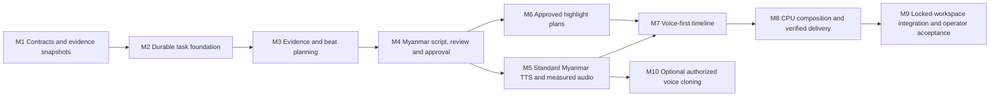

# Storyline Recap Implementation Plan

## Scope and approval

This is the Phase 23.1 plan for [Character Psychology Storyline Recap](STORYLINE_RECAP_ARCHITECTURE.md), not authorization to execute it. Only these two documentation files are created in Phase 23.1. No existing source, schema, environment, database, media, queue or paid provider is changed.

Phase 23.1A updates only these documents for the approved **ALL_CURRENT** Studio translation-context policy. Valid current aligned targets are included regardless of subtitle approval, including manual edits and QC-warned rows. Translation context is not independent evidence or claim verification. Drafts may be provisional; script approval and supported-duration counts require the source-verification gates below. Existing All Current / Approved Only subtitle exports remain unchanged.

Implement small milestones in order. Every milestone needs an explicit task; stop at its acceptance boundary. UI/UX v1.0 remains locked, existing recap and full-movie subtitle exports remain functional, and all generation is explicit. Names below are proposed locations/contracts. Dates or model/provider names are not assumed delivery commitments.

## 1. Dependency map and priorities

P0: immutable sources, evidence validation, manual authority, explicit paid gates and durable tasks. P1: useful script/review, standard voice, approved clips, measured composition and download. P2: optional cloning after a usable standard-voice pipeline. No recap dubbing, music, blur, GPU, public deployment or collaborative editing in these milestones.

## 2. Shared acceptance and test rules

- Deterministic tests use synthetic Chinese/Myanmar fixtures, fake text/TTS providers and short generated media; no production movie/job mutations or paid calls.
- Keep the one-scene/twelve-segment/one-character-at-segment-zero fixture. A valid script can have multiple beats in scene 0; a character claim citing an unrelated segment must fail.
- Extend it with mixed APPROVED/UNREVIEWED/NEEDS_REVIEW rows, MANUAL/unapproved text, active/resolved/manual QC, missing rows and stale/invalid bindings. Assert all eligible rows are included exactly and excluded rows never become provider context. Source-verification outcomes are explicit synthetic human receipts, never inferred from approval, provenance, no QC or fake AI “pass”.
- Fake responses cover missing fields, malformed/incomplete JSON, count/text boundaries, invalid confidence, cross-movie anchors and safe diagnostic propagation. Do not weaken evidence rules to make fixtures pass.
- Integration tests opt into disposable PostgreSQL/Redis namespaces and a temporary private storage root, without touching existing media or allowing normal workers to consume fixtures. Clean only IDs/files created by the fixture; record pre/post invariant checks. Real service tests must be separately authorized.
- Regression suites include existing recap diagnostics/recovery, subtitle review/manual authority, selection/export, private source streaming and both current render modes. Extraction of a shared helper requires equivalent tests for its existing caller before adoption.
- Each coding milestone runs relevant tests, `pnpm lint`, `pnpm exec tsc --noEmit`, `git diff --check`, and `pnpm exec next build --webpack`; schema milestones also run Prisma validate/generate and additive migration compatibility tests. No configuration weakening to pass a build.
- Browser milestones verify 1440/1024/390, selected older movie, all five existing Recap tabs, no overflow, keyboard access, Myanmar glyph wrapping, focus, errors, stale state and abortable bounded polling. Do not count SSR/screenshot-only checks as proof that media plays.
- No schema migrations/tests/build were executed by this documentation-only phase. Commands below are future verification instructions, not completed results.

## 3. M1 — Contracts, source snapshots and version foundation

**Dependencies:** use the approved ALL_CURRENT translation policy; confirm the source-verification rubric, remaining source prerequisites, immutable history strategy, schema limits and additive schema design. Audit current migration triggers and lock order again at implementation time. Do not request approval again for ALL_CURRENT itself.

**Likely modules:** `lib/storyline/contracts.ts`, `hash.ts`, `source.ts`, `evidence.ts`, `duration.ts`, `errors.ts`; `tests/storyline/contracts.test.ts`, `source.test.ts`, `duration.test.ts`, `database.test.ts`. Reuse source alignment/selection, private fingerprinting and safe errors from existing modules through pure helpers; do not change legacy `loadRecapSource` to include new inputs.

**Migration A:** add `StorylineStudio`, `StorySourceSnapshot`, `StoryScriptVersion`, `StoryBeat`, append-only `StorySourceVerification`; version/hash uniqueness, same-Studio FKs, immutable payload triggers and nonnegative/interval CHECKs. Verification receipts bind subject content, allowed Chinese anchors, translation row/context and policy hashes with explicit human outcomes; they do not modify immutable narration or subtitle approval. Add only necessary reverse Movie relation. No data rewrite/backfill; no live child FK dependency on replaceable scene/transcript/recap rows. Review SQL and dry-run against a disposable copy before applying an explicitly approved migration.

**API/worker:** pure services first. An explicit scoped snapshot preparation POST may be added only once tests prove no paid/job side effects; GET reads stored snapshots without hashing whole source files. No AI worker yet.

**Verify:**

- ALL_CURRENT includes every valid current aligned target, even with zero APPROVED rows. Exact text, language pair, IDs, translation/segment revisions, original timing, origin/provider/model, manual/refinement source binding, translation created/updated and segment created/edit/review timestamps, and QC scan/findings/resolutions are frozen unchanged.
- Mixed APPROVED/UNREVIEWED/NEEDS_REVIEW rows and MANUAL/NEEDS_REVIEW targets retain separate inclusion, approval, provenance and QC dimensions. No approval-gap filtering or time compression in Studio context; existing export filtering stays unchanged.
- Current rows with active heuristic/manual QC are included and visibly warned, not silently corrected, resolved or promoted to truth. Resolved findings and unscanned QC are distinct states. Approved-but-warned rows still require claim-specific review.
- Missing whole translation/row is explicit Chinese-only context; stale sourceTranscriptId, wrong language/movie, mismatched timing/sequence and stale manual hash are excluded with reasons, not admitted as current. Source-invalid/ambiguous identity fails capture. Missing context alone does not block a Chinese-source draft when the other source prerequisites hold.
- Preserve strict existing editor/refinement loaders; separate Studio read admission can represent partial/missing context without weakening their complete-alignment requirements. No source, target, approval, QC, TM or legacy recap mutation.
- Source SHA changes, actual refinement text changes without generation change, approval-only changes, added/resolved/replaced QC state, revisions/provenance/edit-review metadata and changed alignment/missing/excluded bindings invalidate the relevant context hashes. Capture timestamp alone does not change identity.
- A translation row reference is only context attached to a permitted Chinese anchor, never an anchor itself; wrong character anchors and relationship endpoints fail even when the translation is APPROVED or MANUAL.
- Server-derived SOURCE_VERIFIED, PROVISIONAL_TRANSLATION_CONTEXT, NEEDS_HUMAN_REVIEW and UNSUPPORTED_OR_INVALID_EVIDENCE meanings remain distinct. A provider/client cannot forge a verification receipt or waive deterministic invalidity. Chinese-only pending claims remain PENDING_SOURCE_REVIEW until explicit comparison.
- Stable identical input hashing; object key order canonical; ordered beat changes significant; exact Unicode preserved.
- Wrong movie/project, stale capture, missing/unsafe source, symlinks, invalid ranges/references, cross-Studio parent, duplicate version race.
- Replacing live Scene/Recap children cannot erase snapshot anchors; historical payload remains readable.
- Duration: no verified events/visuals, single-scene many verified events, duplicate paraphrases, tiny/long source, sparse coverage, overlapping footage, floor/cap coherence, deterministic coefficients and missing calibration. Provisional translation-only claims add zero to E/A/C/R/Q/V and budgets; subtitle approval, MANUAL origin and AI acceptance cannot change that. Current synthetic human verification enables only the supported claims/events and eligible intervals.

**Failure/recovery:** source changed during hashing returns conflict with no partial version/task; capture retry is explicit and unpaid. Never copy or alter original media as a “fix”.

**Acceptance:** an immutable ALL_CURRENT snapshot faithfully distinguishes every required context condition; Chinese evidence remains primary; typed claim provenance/review/verification contracts and append-only verification receipts enforce ownership/currentness. Mixed/unapproved targets allow provisional draft inputs, while unsupported claims cannot raise supported-event counts or pass the approval eligibility contract. Text/approval/QC/alignment changes stale affected bindings without changing historical artifacts. No current recap/translation/QC/TM mutation, generated narration, paid call or runnable Studio UI is claimed by M1.

## 4. M2 — Durable Studio task and dispatch lifecycle

**Dependencies:** M1, approved narrow reuse boundary for render lifecycle primitives. Do not copy the entire render framework or generalize unrelated workers.

**Likely modules:** `lib/storyline/tasks/{contracts,service,dispatch,lifecycle,operations,api}.ts`, `lib/queue/storyline-queue.ts`, `workers/storyline-worker.ts`, tests under `tests/storyline/tasks/`. Small shared dispatch/ownership helpers may be extracted from `lib/video-render/` with behavior-preserving tests; existing seven non-render queues and render behavior stay unchanged.

**Migration B:** `StoryTask`, `StoryTaskDispatch`, input hash uniqueness, generation/lease indexes, immutable task recipe checks, validated-result completion guards and durable stage/chunk receipts in bounded result manifests. If a separate receipt table proves necessary, approve it explicitly before migration. Do not add file receipt requirements to text tasks.

**API:** proposed movie/project-scoped task POST/list/detail/cancel/retry. Strict body fields, enumerated stages, `expectedInputHash`, `expectedStudioRevision`; safe DTOs exclude paths, manifests, provider IDs that contain secrets and tokens. State is QUEUED/ACTIVE/COMPLETED/FAILED/CANCELLED; DEFERRED is metadata.

**Queues/workers:** add only text foundation initially; reference-only payload `{taskId, generation}`, deterministic queue ID, local/global bounded concurrency. Readiness checks DB/Redis and required capabilities. Reconcile durable intents after commit with bounded scans; startup never creates tasks. Until stage execution exists, explicitly defer work without retry loops or false completion.

**Paid safety:** confirmation must bind stage/input/profile, ALL_CURRENT context and relevant approval dependencies, plus maximum request count; record request checkpoints (`NOT_SENT`, `SENT_UNCONFIRMED`, `RESULT_STORED`). Text, approval, QC or alignment changes stale old confirmations. Infrastructure failure before sending may recover safely. Unknown sent outcome becomes deferred pending lookup/manual confirmation, not automatic paid resend. Provider support for idempotency is discovered, not presumed.

**Verify:** concurrent duplicate submission; DB commit/Redis outage; duplicate publication; restart/missing receipt; stale generation/lease; same-Studio scoping; GET causes no work; cancellation ownership; graceful shutdown; completion without validated result rejected; stale paid confirmation rejected; unknown provider outcome cannot auto-resend.

**Acceptance:** explicit, durable, bounded task orchestration with fake executors, no paid activity, and regression parity for any reused render helper. This milestone alone does not expose generation UI.

## 5. M3 — Evidence analysis and storyline beat planning

**Dependencies:** M1/M2; approve event schema, duration policy and text provider/model configuration. Reuse the configured OpenRouter gateway behind a new provider interface; no automatic model escalation.

**Likely modules:** `lib/storyline/text/{provider,openrouter-provider,response-schema,validate-output,context,evidence-analysis,plan-beats}.ts`; `lib/storyline/diagnostics.ts`; worker stage dispatch. Existing `lib/recap/` validators remain unchanged; factor shared pure evidence rules only with regression coverage.

**Migration:** none initially; event/plan/chunk result manifests in durable task receipts, bound to snapshot and policy hashes. Add a normalized inventory only if later query/size requirements demonstrate need.

**API/worker:** explicit `ANALYZE_EVIDENCE` and `PLAN_BEATS` tasks receive Chinese evidence plus admitted ALL_CURRENT context/provenance/approval/QC. Validate chunks before synthesis; synthesis's allowed anchor set is the union of structurally validated children, not all arbitrary source references. Structural validation is not semantic source verification. Use deterministic event dedup keys; mark provisional/duplicate/unsupported arc candidates for human comparison. An explicit unpaid source-comparison operation can append `StorySourceVerification` receipts for exact candidate hashes; it cannot accept invalid anchors or change a subtitle.

**Review:** plot/character/relationship claim ownership, translation context versus Chinese evidence, uncertainty, inferred-versus-observed, chronological cause/consequence and event coverage. Source-verified observed basis and cautious Myanmar wording are required for supported inference; translation confidence cannot justify a motive. Do not infer visual identity or speak motives as facts. Report insufficient evidence instead of fabricating a complete arc.

**Verify:** one scene supports multiple beats; exact character/relationship anchors; uncertain/UNKNOWN confidence limits; no unsupported events via synthesis; closed reference sets; mixed current translation status and QC payloads; event dedup and visual coverage caps; schema/local size alignment; cached chunk recovery; rejection diagnostics never contain content. A plausible unapproved translation-only event is provisional with zero supported-budget contribution until a valid current human source receipt. An APPROVED-but-mistranslated event and an unsupported human edit cannot count either. Inconclusive/unsupported/cross-context receipts cannot enable counts. A bounded provisional draft may exist with no supported budget, without TTS/export eligibility.

**Paid gate:** each explicit stage confirms possible OpenRouter charges and bounded call plan; an execution failure never automatically starts a fresh stage or changes model. Tests use fake providers only. Any live pilot is a separate authorized task with stated request ceiling.

**Acceptance:** separate candidate and source-verified event inventories, labeled provisional beats and a duration explanation based only on eligible supported events. Approval/QC/alignment changes invalidate affected verification and budget eligibility. No voice, clips or video yet.

## 6. M4 — Myanmar narration, review and human approval

**Dependencies:** validated M3 plan, approved review policy and language quality criteria. Confirm who can approve in trusted-local operation; do not imply authenticated users.

**Likely modules:** `lib/storyline/text/{generate-narration,review-evidence,review-myanmar}.ts`, `lib/storyline/scripts.ts`, `reviews.ts`, `approvals.ts`; scoped script/review/approval API routes; fake provider and transaction tests.

**Migration C:** `StoryReviewRun`, append-only `StoryReviewDisposition` linked to existing source-verification receipts where relevant, `StoryApproval` for SCRIPT initially. Approval binds `approvalDependencyHash` with exact context, source-verification/review/disposition receipts and policy, not merely script text. Script payload/beat relations stay immutable; approval and current-version pointer updates are separate short transactions. Later approval kinds can be added with their corresponding FK targets, not unvalidated placeholder IDs.

**API:** explicit human save creates a parent-linked version with revision guard. Draft narration is allowed with unapproved valid context and provisional claims. Required evidence and Myanmar reviews operate on exact version/context hashes. AI review only proposes findings; human source comparison/disposition establishes permitted support. Approve requires all material narrated claims source-verified and no blocking findings; it does not call a model, approve translations or clear subtitle QC. Draft edit cannot preserve approval. Accepted model suggestions require explicit new save/review, never automatic rewrite.

**Verify:** valid Myanmar script; at-limit/over-limit Unicode and byte bounds; sentence/chunk claim coverage; invalid motives/anchors; evidence review cannot waive ownership; manual findings retained; advisory language finding disposition; optimistic write conflict; source staleness; approval human-only; edit invalidation; old approved version remains historical; all stage diagnostics safe. Add cases where provisional/QC-warned/manual-unapproved claims block approval, valid Chinese comparison resolves permitted semantic findings, unsupported motivation remains blocked despite cautious wording, AI “pass” cannot issue verification, approved-but-invalid evidence cannot be waived, and missing translation permits a source-verified Chinese-only claim. Script approval leaves subtitle review/QC/TM unchanged. Text/approval-only/QC-only/alignment changes stale context, verification, approvals and paid confirmations without rewriting historical artifacts.

**Paid gate:** narration and each AI review have separate acknowledgement/expected hashes. No paid call from save, approval, GET, status or navigation. Offer batch confirmation only if it explicitly enumerates stages and a bounded request ceiling and stops on invalid output.

**Acceptance:** human-approved exact Myanmar script with current source verification for every essential factual/psychological claim and all other material narration, no unresolved evidence blockers, auditable review/disposition and immutable history. An unapproved subtitle can inform an approved script only after independent source comparison; subtitle status stays unchanged. No voice generation before this approval and no changes to legacy recap semantics.

## 7. M5 — Standard Myanmar TTS and verified measured voice

**Dependencies:** M4; approve an actual Myanmar-capable provider/voice after capability/privacy/cost audit and an explicitly budgeted intelligibility pilot. No assumption that OpenRouter supplies TTS. No cloning in this milestone.

**Likely modules:** `lib/storyline/voice/{provider,capabilities,contracts,service,verify,normalize,calibration}.ts`, `workers/storyline-voice-worker.ts`, `lib/queue/storyline-voice-queue.ts`, scoped voice/task/artifact routes; additive storage helpers. Reuse bounded local FFprobe/process supervision where suitable; no API keys in FFmpeg environment.

**Migration D:** `StoryVoiceSet`, `StoryVoiceTake`, `StoryArtifact`; VOICE_SET approval target with real FK/CHECK. Fixed server voice configuration initially, no consent tables for standard voice. Successful take association immutable and unique per beat/set; one verified task/artifact can be reused by another set only with identical text/voice recipe and valid consent. Regenerate requires an explicit recipe/profile revision decision, not overwrite.

**Storage:** approved `studio-audio` namespace and private scratch; original `audio/{movieId}.wav` unchanged. Bounded provider retrieval, redirect/host validation, regular-file checking, verified decode, PCM 48 kHz mono normalization, checksum and actual sample count. Same-volume atomic publication and fenced receipt.

**Verify:** deterministic fake PCM including Myanmar request text; per-beat input identity; correct sample duration; corrupt/truncated/silent/oversized audio; request timeout; ambiguous sent outcome; missing file after receipt; provider reports unknown cost; same recipe reuse; changed narration/profile causes new take; old script approval cannot approve new voice; listen approval explicit.

**Recovery:** resume successful takes, not whole paid voice set; canceled remote request may still incur cost. Failed normalization can reuse safely retained verified provider response only if policy permits; do not resend synthesis automatically. No “Completed” without verified artifact.

**Paid gate:** exact voice profile/text hashes and selected beats shown before synthesis, bounded request ceiling, clear unknown cost if no quote. Calibrate estimate ranges with separately authorized samples; real sample counts replace estimates.

**Acceptance:** per-beat measured voice, usable native audio/download, explicit approved voice set, provider-neutral tests. Native Myanmar listener acceptance is a separate recorded requirement before production voice use, not inferred from decoding.

## 8. M6 — Human-approved highlight clip plans

**Dependencies:** approved M4 script and unchanged source SHA; may proceed alongside M5. Source preview must be playable or an explicit compatible-player verification workflow available.

**Likely modules:** `lib/storyline/highlights/{suggest,validate,service}.ts`, scoped clip-plan routes, later in-panel controls. Reuse `lib/source-video/selection.ts` and native source preview/seek; do not create a duplicate source streaming API.

**Migration E:** `StoryClipPlan` and CLIP_PLAN approval target with real FK, immutable content/parent/version uniqueness. No Scene mutation or new generated scene titles/thumbnails.

**API:** pure evidence-bound suggestions, explicit trim/order save and approve. Source times remain unchanged. Reorder within beat allowed; beat-order change forks the script and invalidates dependent approval. No task needed for deterministic suggestions; GET must not persist a plan.

**Verify:** same-scene multiple beats; bounded handles, first/last source bounds, overlapping/duplicate source frames, wrong-source anchors; older selected movie; missing/replaced source; human approval; same clip plan hash stability; trim cannot mutate transcript timing.

**Paid gate:** none; clip editing and approval do not invoke AI. Any future visual-model suggestions require a separate design/cost approval.

**Acceptance:** real saved/approved interval plan, feasible source-bound footage suggestions, honest shortage state; no manufactured waveform/frames or automatic visual semantics.

## 9. M7 — Measured voice-first timeline compiler

**Dependencies:** M5 voice approval and M6 clip approval for the exact same approved M4 script/source. Approve rational frame rounding, pause policy, no-repeat policy and fixed output profile.

**Likely modules:** `lib/storyline/timeline/{contracts,compile,validate,hash}.ts`, timeline preparation/approval API; pure sample/frame fixtures.

**Migration F:** `StoryTimeline`, TIMELINE approval target with actual dependency FKs/receipts, immutable manifest/checks. No existing RenderJob schema change.

**Compile:** exact beat audio samples/rate → cumulative timeline; approved clips cover each voice/pause interval; explicit video frame allocation and bounded final rounding. Default no inserted pause, no original audio, no looping/freeze/speed changes. Shortage blocks compilation/approval with measured deficit, not a hidden edit or automatic TTS call.

**Verify:** short/long beats, cumulative sample/frame rounding, VFR source cut boundaries, mixed-approved ALL_CURRENT context with explicit missing/excluded rows, silent source, multiple source audio tracks ignored, missing audio/clip/approval, stale dependency, no duplicate frames, too little footage, no drift/truncation and stable recipe. Human script edit or translation text/approval/QC/alignment change invalidates affected timeline eligibility without mutating historical artifacts.

**Paid gate:** none. Changing narration to resolve a shortage follows explicit script/review/TTS gates; compiler never requests a provider.

**Acceptance:** reproducible approved timeline from real audio and intervals, no encoding yet, total duration derived only from measured inputs and explicit pauses.

## 10. M8 — Local CPU composition, output verification and delivery

**Dependencies:** M7; approve fixed MP4 profile, resource limits, staging/storage/retention and supervisor reuse. Full-movie renderer remains unchanged.

**Likely modules:** `lib/storyline/render/{contracts,recipe,execution,verify,publication,download,cleanup}.ts`, `workers/storyline-render-worker.ts`, `lib/queue/storyline-render-queue.ts`; scoped task/output routes. Extract only required safe runner/publication primitives from existing rendering; maintain both existing-profile regression suites.

**Migration G:** `StoryRender` and final artifact metadata/checks, completion trigger tying job to a verified matching timeline/output; no new legacy RenderMode or changes to old immutable snapshots.

**Execution:** validate dependencies, stage/hash source/audio, claim fenced task lease and acquire existing shared CPU host lock. Accurate trim/decode video-only clips, normalize approved raster/fps, concatenate; compose narration PCM, map only composed video plus narration. CPU H.264/AAC with faststart. Enforce bounded source/intermediate/output size, disk headroom, child memory/CPU/wall limits and minimal child environment. Current renderer's whole-source verification and audio mappings must not be reused as recap correctness checks.

**Publication:** verify stream count/codecs/duration/raster/sample provenance and checksum; durable publication candidate → fsync/exclusive private link → recheck ownership/source/dependencies → receipt + completion. Download checks scoped receipt and actual same-descriptor file. Missing/corrupt file is unavailable, not regenerated by GET.

**Verify with short synthetic media:**

- Source distinct audio tone versus narration tone: output contains narration only; no source dialogue/audio stream leakage.
- Multiple source audio tracks, no audio, existing subtitles/chapters, accurate non-keyframe cuts, VFR and rejected rotation/HDR/multiple video cases.
- Text/voice/clip/source changes produce distinct recipes; duplicate submission reuses same task/output.
- Concurrent full-movie and Studio encoders obey one shared host CPU lock.
- Cancel while preparing/encoding/publishing; supervisor parent death; lost lease/stale generation; output corruption; disk full; timeout; queued restart; candidate publication crash; orphan cleanup protects referenced files.
- Failure cannot become completed; stale owner cannot publish; active cancel waits for actual drain; retry retains original immutable recipe; no provider call in CPU execution.
- Existing SRT/ASS, Burn-in MP4 and Soft Subtitle MP4 still work with unchanged payloads and histories.

**Paid gate:** none. Explicit POST acknowledges local resource use; GET/download never encodes, enqueues or invokes AI.

**Acceptance:** a verified short recap MP4 with narration-only audio and measured duration, secure trusted-local download, deterministic history and safe lifecycle recovery. Full uploaded movies require a separately authorized operator test, not automatic milestone testing.

## 11. M9 — Approved in-panel Studio integration and end-to-end acceptance

**Dependencies:** approved concrete UI extension description, M4–M8 endpoints and safe DTOs. Backend capability must exist before controls appear enabled. Small milestone-specific controls can be delivered earlier only with the same baseline review; M9 unifies acceptance, not a layout redesign.

**Likely files:** existing `app/projects/[id]/recap/page.tsx`, `RecapControls.tsx`, new narrow `components/storyline/` panels/hooks; existing Export controls for the Recap Video slot; browser fixtures under `tests/storyline/`. Reuse `components/ui/styles.ts`, native source preview, safe errors and abortable bounded polling. No shared theme/sidebar redesign.

**Migration:** none. Browser route stays movie-selected Recap; preserve current five tabs and legacy results. Script/AI Review/Voice/Highlights/Export are in-panel subviews with accessible controls, not extra global routes/sidebar groups.

**Verify:**

- 1440 desktop split, 1024 stacked panels, 390 wrapping controls, no horizontal overflow or clipped Myanmar glyphs.
- Existing five tabs and evidence/source seeks intact; older movie remains selected through every task/link/download; invalid explicit selection never falls back.
- Empty/current/stale/draft/review-blocked/unconfigured-voice/no-clips/coverage-shortage/no-job/queued/active/deferred/completed/missing-output/failed/cancelled states from real fixtures.
- Dirty-state visibility, explicit save, human-only approval, paid and CPU confirmations, stale-confirmation rejection, double-click protection and retained duplicate jobs.
- Script/AI Review show Chinese source comparison, admitted exact Myanmar text, separate subtitle approval/MANUAL/model provenance/QC labels, provisional/source-verified/pending/blocked claim states and specific blocking findings inside existing panels. Mixed approved/unapproved and QC-warned inputs are visible; missing/stale rows are honest source-only/excluded states. Invalid ownership is never offered an override. Script approval never changes a subtitle status. Stack comparison on mobile without changing navigation or the five tabs.
- GET/SSR/refresh/poll/navigation never submits work. Poll aborts on unmount, movie/stage changes and bounded errors; failed jobs require explicit retry.
- Real voice playback/listen approval, clip seeks, verified video download and compatible desktop-player A/V inspection. Original source preview never claims to show generated narration/output.
- No raw snapshots, storage keys, credentials, provider responses, internal leases or private paths in DOM/network/public errors.

**Acceptance:** usable exact-dependency Studio within locked visual patterns, synthetic end-to-end success and failure coverage, no regression to legacy flows. One live production-like verification requires a separate operator approval specifying source, stages and paid request ceiling.

## 12. M10 — Optional authorized voice profiles and cloning

**Dependencies:** standard voice pipeline accepted; separately approved provider with demonstrated Myanmar cloning capability, informed voice authorization policy, retention/deletion support and legal/operator review. This is optional, not a prerequisite for M9.

**Likely modules:** `lib/storyline/voice/{profiles,consent,consent-policy}.ts`, bounded private consent-asset services and explicit profile operations. No arbitrary URL ingestion or reusable sample in public storage.

**Migration H:** `StoryVoiceProfile`, `StoryVoiceConsent`; revision/scope/expiry/revocation constraints and private evidence artifact references. Existing standard voice recipes remain valid historical records.

**Verify:** missing/expired/revoked consent, wrong project/use/provider, stale profile revision, source asset hash change, revocation before send/publish, duplicate paid cloning request ambiguity, provider retention failure and safe audit/no secret exposure. Revocation cannot recall external downloads; do not promise that it does.

**Paid gate:** separate consent to provider sample disclosure and paid profile creation, then per-take synthesis confirmation. No automatic upload/cloning on profile selection or page load.

**Acceptance:** optional capability enabled only after verified support and valid authorization. Unconfigured/unsupported remains honestly unavailable. Public identity verification/impersonation controls require a separate authenticated deployment design.

## 13. Recovery matrix and operational boundaries

| Failure | Safe handling | Must not happen |
| --- | --- | --- |
| Source/dependency changes | Conflict/stale label; explicit new snapshot/version and approvals | Regenerate or approve on GET |
| Translation-only claim lacks source support | Permit labeled provisional draft; zero supported-budget contribution; human Chinese comparison or new corrected version | Count approval/MANUAL origin/AI acceptance as semantic verification or waive invalid ownership |
| Translation approval/QC/alignment changes | Stale affected context/verification/approval bindings; retain historical artifacts | Rewrite snapshots, auto-approve subtitles or reuse stale paid confirmation |
| Invalid text/provider schema/evidence | Terminal safe diagnostic; explicit corrected-policy/new request after approval | Truncate, repair, waive ownership or auto-escalate model |
| DB commit then Redis failure | Durable dispatch reconciliation republishes same task/generation | Lose task or create duplicate paid recipe |
| Provider accepted request, receipt unknown | Deferred ambiguous checkpoint; supported lookup or operator decision | Claim exactly-once charges or auto-resend |
| Partial voice set succeeds | Keep verified takes and approve/retry only missing explicit recipes | Regenerate all paid audio indiscriminately |
| Measured narration longer than footage | Block timeline; explicit clip/script change and renewed approvals | Loop/freeze/speed/truncate silently |
| Worker death/lease expiry | Generation fence, supervisor drain/host lock, bounded recovery | Treat lease expiry as process termination |
| Publication crash | Verify durable candidate and recover receipt under new owner | Complete from file name or stale owner's claim |
| Missing artifact | Controlled unavailable response; explicit retry policy | Recreate output on download GET |
| Consent expired/revoked | Block new use; explicit retention review | Silently continue or claim prior downloads recalled |

All production operations need existing consistent absolute private storage root on web/workers and adequate host disk/process supervision. No paid worker is started merely for readiness checks. Storage cleanup is bounded, receipt-aware and unrelated to existing media reset scripts.

## 14. Decisions before implementation

1. ALL_CURRENT is approved; no further context-scope choice is pending. Confirm the source-verification rubric/operator qualifications and remaining source prerequisites. Missing/excluded translation rows use explicit Chinese-only context, never a silent Approved Only fallback.
2. Approve proposed duration coefficients/limits, calibration pilot ceiling and definition of reviewed distinct events/arcs. Do not equate formula output with proven storytelling quality.
3. Approve additive schema and retention behavior per migration, especially Movie deletion and historical source availability.
4. Choose text review configuration and standard Myanmar TTS after compatibility/privacy/intelligibility audit; do not invent model IDs or assume cloning through OpenRouter.
5. Approve fixed 720p/30 fps/mono recap profile and initial conservative video compatibility/no-repeat policy.
6. Approve minimal in-panel subview controls against the frozen baseline before UI implementation.
7. Defer optional cloning until separate authorization, provider and consent requirements are settled.

Recommended next task: **M1 contracts and immutable source/version foundation only**, with deterministic fixtures, additive migration review and no AI, queues, voice or UI. Phase 23.1 ends with these documents; no implementation, migration, generation, commit or push is performed.
